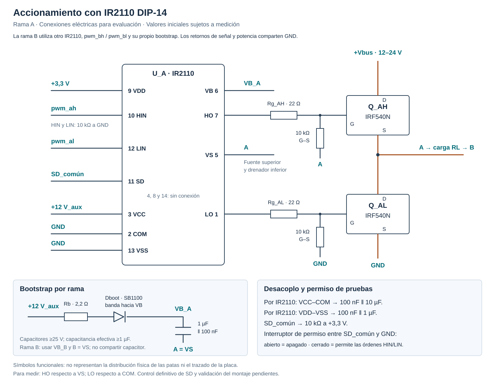

# Etapa de potencia y componentes

## Configuración del circuito

La etapa propuesta es un puente H alimentado entre 12 y 24 V DC, con cuatro MOSFET de canal N y una carga RL en serie. La modulación unipolar aplica a la carga niveles de tensión positivos, negativos y cero. La inductancia limita la variación de corriente entre conmutaciones y el controlador PR ajusta la modulación para seguir una referencia sinusoidal de 50 Hz.

La cadena de control es:

```text
Referencia de corriente → PR → PWM con tiempo muerto → drivers → puente H → carga RL
                         ↑                                                   │
                         └── XADC ← acondicionamiento ← ACS712 ←──────────────┘
```

El PR y la adquisición pertenecen a los subsistemas de control y medición. La etapa de potencia debe proporcionar señales compatibles con esas interfaces; la simulación continua es una primera aproximación a su comportamiento.

## Componentes disponibles

| Cantidad | Componente | Función y criterio de elección |
|---|---|---|
| 4 | IRF540N | Dos interruptores por rama del puente H; encapsulado adecuado para montaje y margen nominal de tensión respecto al bus de 24 V |
| 2 | IR2110 DIP-14, integrados sueltos | Un driver por rama para accionar sus MOSFET superior e inferior |
| 1 | Módulo ACS712 de 5 A | Medición bidireccional de corriente en serie con la carga, sin añadir un amplificador de shunt conectado a los nodos conmutados |
| 3 | Resistencia de 3,3 Ω y 5 W | Dos unidades forman la carga nominal de 6,6 Ω; la tercera permite aumentarla a 9,9 Ω |
| 1 | Secundario de transformador | Elemento inductivo disponible; se utiliza con el primario abierto y sus terminales aislados |

La lista anterior corresponde a los componentes principales disponibles. Los auxiliares de las tablas siguientes completan la selección eléctrica del puente. El divisor del ACS712 es la primera alternativa de acondicionamiento y debe verificarse antes de utilizarse como realimentación.

### Topología y alimentaciones

Se utiliza un puente H completo porque la corriente de referencia cambia de signo. Las dos ramas permiten aplicar tensión positiva, negativa o nula a una carga alimentada desde una fuente DC. La modulación unipolar centrada utiliza una portadora común y referencias opuestas para las ramas, con tiempo muerto independiente en cada una.

| Conexión | Elementos conectados |
|---|---|
| +Vbus, variable entre 12 y 24 V | Drenadores de Q_AH y Q_BH |
| GND de potencia | Fuentes de Q_AL y Q_BL |
| Nodo A | Fuente de Q_AH, drenador de Q_AL y VS del driver A |
| Nodo B | Fuente de Q_BH, drenador de Q_BL y VS del driver B |
| Camino de carga | A → terminal de corriente del ACS712 → segundo terminal del sensor → devanado L → dos resistencias de 3,3 Ω en serie → B |

El orden de los elementos en serie no modifica el modelo RL. Ningún extremo de la carga se conecta directamente a GND: ambos extremos pertenecen a nodos conmutados. El camino de corriente del ACS712 está separado de sus terminales VCC, OUT y GND. El signo de la lectura depende del sentido de paso por el módulo.

Los estados ideales del puente son los siguientes; cada orden inferior es complementaria de la superior de su propia rama antes de insertar el tiempo muerto.

| Orden superior A | Orden superior B | MOSFET con orden activa | Tensión ideal A−B |
|---|---|---|---|
| 1 | 0 | Q_AH y Q_BL | +Vbus |
| 0 | 1 | Q_AL y Q_BH | −Vbus |
| 0 | 0 | Q_AL y Q_BL | 0 V |
| 1 | 1 | Q_AH y Q_BH | 0 V |

Los dos estados de tensión nula conectan ambos extremos de la carga al mismo riel y permiten recirculación. Durante el tiempo muerto, la corriente inductiva encuentra camino por los diodos internos de los MOSFET según su sentido. Estos diodos no son los SB360 del bootstrap. La necesidad de diodos externos de potencia se evalúa con la recuperación y los transitorios medidos. Activar simultáneamente el superior y el inferior de una misma rama cortocircuita el bus; el tiempo muerto debe impedir esa combinación.

| Alimentación | Valor | Destino y criterio |
|---|---|---|
| Bus de potencia | 12–24 V DC | Energía del puente; su variación es una perturbación para el lazo |
| Auxiliar de accionamiento | 12 V DC regulados | VCC de ambos IR2110; se mantiene fija al variar el bus |
| Lógica de drivers | 3,3 V regulados, fuente externa | VDD de ambos IR2110 y resistencia de polarización de SD |
| Sensor | 5 V regulados | VCC del ACS712; su estabilidad afecta al cero y a la sensibilidad |

Los negativos de estas alimentaciones y GND de la Basys 3 comparten referencia. La fuente externa de 3,3 V no se conecta en paralelo con la salida de alimentación de 3,3 V de la placa. Los retornos de potencia se conducen por recorridos cortos y separados de los retornos del sensor y de la FPGA hasta el punto común, para reducir errores de medición por caídas en cables y contactos.

En el IRF540N, visto de frente con la inscripción legible y las patillas hacia abajo, los terminales son G, D y S de izquierda a derecha; la aleta metálica está unida al drenador. La conexión del disipador debe respetar ese potencial eléctrico.

### MOSFET y accionamiento

El IRF540N tiene una tensión nominal drenador–fuente de 100 V. Su resistencia de conducción se especifica con 10 V entre compuerta y fuente; el umbral de encendido no equivale a una tensión de accionamiento suficiente. Por ello, las salidas de 3,3 V de la FPGA deben pasar por drivers. El margen nominal de tensión no elimina la necesidad de revisar los transitorios del montaje. [Hoja de datos IRF540N](https://www.infineon.com/assets/row/public/documents/24/49/infineon-irf540n-datasheet-en.pdf).

Se selecciona el IR2110 por disponibilidad y por disponer de dos canales independientes, alimentación lógica separada y salida flotante para el MOSFET superior. Cada unidad acciona una rama, no los cuatro MOSFET. La referencia adquirida corresponde a [IR2110 DIP-14](https://componenteselectronicoscr.com/product/ir2110-circuito-integrado-high-and-low-side-driver-mosf); sus conexiones eléctricas se toman de la [hoja de datos del fabricante](https://www.infineon.com/assets/row/public/documents/24/49/infineon-ir2110-datasheet-en.pdf).

La propuesta utiliza `VDD=3,3 V` para la lógica y `VCC=12 V` regulados para el accionamiento. Con VDD a 3,3 V, HIN y LIN reciben las señales de la Basys 3; alimentar VDD a 12 V cambiaría sus umbrales y no corresponde a esta interfaz. La fuente auxiliar de 12 V debe mantenerse estable mientras el bus varía entre 12 y 24 V; no se conecta VCC directamente al bus variable.



La figura utiliza símbolos de conexión, no la distribución física de las patas. Los números siguientes corresponden exclusivamente al IR2110 de 14 pines, según la sección «Lead Assignments» de la hoja de datos. No se aplican al IR2110S de 16 pines.

| Pin | Terminal | Conexión |
|---|---|---|
| 1 | LO | Resistencia de 22 Ω hacia la compuerta inferior |
| 2 | COM | Retorno del MOSFET inferior y de la alimentación auxiliar |
| 3 | VCC | +12 V auxiliares regulados |
| 4, 8, 14 | Sin conexión | Dejar abiertos |
| 5 | VS | Nodo A o B: fuente superior y drenador inferior |
| 6 | VB | Cátodo del diodo de bootstrap y extremo superior de su capacitor |
| 7 | HO | Resistencia de 22 Ω hacia la compuerta superior |
| 9 | VDD | +3,3 V de lógica |
| 10 | HIN | `pwm_ah` para A; `pwm_bh` para B |
| 11 | SD | Apagado común de las dos ramas, activo en alto |
| 12 | LIN | `pwm_al` para A; `pwm_bl` para B |
| 13 | VSS | Retorno lógico, unido a COM |

El bootstrap comprende un diodo desde VCC hacia VB y un capacitor entre VB y VS. Se selecciona **SB360**, Schottky de 3 A y 60 V, por disponibilidad y por su conmutación rápida y baja caída directa. Los 60 V proporcionan margen nominal respecto al bus de 24 V; los transitorios reales deben permanecer por debajo de su tensión inversa admisible. Su corriente nominal de 3 A corresponde al diodo, no a la corriente que circula continuamente por el bootstrap. [Datos del fabricante SB360](https://www.diodes.com/part/view/SB360).

La conexión por rama es `+12 V_aux → 2,2 Ω → ánodo SB360 → cátodo (banda) → VB`. Entre VB y VS se conectan 1 µF de película, 50 V, y 100 nF cerámicos, 50 V, en paralelo. La película permite conservar la capacitancia sin la reducción por polarización de algunos cerámicos. Estos capacitores están referidos a VS, no a GND. La rama B utiliza su propio diodo, resistencia y capacitores.

Como comprobación inicial de dimensionamiento, a 10 kHz y modulación máxima de 0,85 la orden superior puede durar 92,5 µs. Un presupuesto de carga de 100 nC para compuerta, 230 µA para el driver, 0,5 mA de fuga de diodo y 1,2 mA para la resistencia compuerta–fuente produce unos 279 nC. Con 1 µF efectivo, la caída calculada es de unos 0,28 V. Es una estimación conservadora a temperatura ambiente, no una garantía térmica ni de recarga: se medirá VB−VS con el circuito real, incluyendo la caída del diodo y los intervalos mínimos de conducción inferior.

### Auxiliares para los dos drivers

La tabla indica las cantidades totales para las dos ramas, independientemente del orden de montaje. Los valores de resistencias de compuerta, bootstrap y tiempo muerto son de diseño inicial y se contrastan con las señales reales.

| Cantidad | Componente | Conexión o función |
|---|---|---|
| 2 | SB360, Schottky de 3 A y 60 V | Diodos de bootstrap, uno por rama |
| 2 | 2,2 Ω, 0,5 W, aptas para pulsos | Serie con cada diodo de bootstrap; limitar corriente de carga |
| 2 | 1 µF de película, 50 V | Capacitores de bootstrap entre VB y VS |
| 6 | 100 nF cerámicos, 50 V | Dos para bootstrap, dos para VCC y dos para VDD |
| 2 | 10 µF, ≥25 V | Desacoplo VCC–COM, uno junto a cada driver |
| 2 | 1 µF, ≥10 V; puede utilizarse película de 50 V | Desacoplo VDD–VSS, uno junto a cada driver |
| 4 | 22 Ω, 0,25 W | Serie con cada compuerta, cerca del MOSFET |
| 9 | 10 kΩ, 0,25 W | Cuatro compuerta–fuente, cuatro HIN/LIN a GND y una SD común a +3,3 V |
| 1 | Interruptor de permiso | Entre SD común y GND; abierto mantiene apagados los drivers |

Se utiliza una fuente externa regulada de 3,3 V para VDD y una salida auxiliar de laboratorio a 12 V para VCC, separadas del bus variable y con referencia común en COM/VSS. Se comprobarán los niveles y la secuencia de encendido. Los capacitores se colocan junto a los terminales correspondientes. El retorno de las compuertas inferiores llega a COM con un recorrido corto, evitando que la corriente de carga circule por el cable de tierra del sensor o de la FPGA.

Las resistencias de 22 Ω limitan la corriente instantánea de compuerta y ayudan a amortiguar oscilaciones; un valor excesivo alarga la conmutación y aumenta las pérdidas. Las resistencias de 10 kΩ entre compuerta y fuente mantienen apagado cada MOSFET sin accionamiento. En los superiores retornan a A o B, respectivamente, y en los inferiores a GND. Las de HIN/LIN evitan entradas flotantes y la de SD establece el apagado por defecto. La resistencia de 2,2 Ω limita el pulso de recarga del bootstrap; su valor debe permitir recuperar la carga durante el intervalo inferior disponible.

### Auxiliares comunes y medición

| Cantidad | Componente | Conexión o función |
|---|---|---|
| 1 | Electrolítico de 100 µF, 50 V | Entre +Vbus y GND, próximo al puente, positivo hacia +Vbus |
| 1 | Cerámico de 100 nF, 50 V | En paralelo con el electrolítico del bus, con conexiones cortas |
| 1 | Resistencia de 4,7 kΩ, 1 %, 0,25 W | Desde OUT del ACS712 hasta el nodo analógico |
| 1 | Resistencia de 1 kΩ, 1 %, 0,25 W | Desde el nodo analógico hasta GND del sensor |

Los siete capacitores de 100 nF de ambas tablas corresponden a seis del accionamiento y uno del bus. Los cuatro de 1 µF corresponden a dos bootstrap y dos desacoplos de lógica; pueden adquirirse todos de película de 50 V. El desacoplo de 5 V del ACS712 se revisa en el módulo adquirido y se complementa junto a VCC–GND si su implementación o el cableado lo requieren.

El capacitor del bus entrega parte de los pulsos de corriente localmente y reduce la inductancia del recorrido hasta la fuente. El valor de 100 µF es inicial, no una garantía de ausencia de sobretensión: se verifican la tensión del bus y la energía devuelta por la carga durante los transitorios.

El PWM debe insertar tiempo muerto: el IR2110 no sustituye esa función. Se propone comenzar la evaluación con 1 µs, equivalente a 100 ciclos de 100 MHz, y ajustar según las señales reales de compuerta. Se medirá HO respecto a VS y LO respecto a COM; la pinza de tierra de un osciloscopio convencional no se conectará a VS, pues ese nodo conmuta. El montaje inicial se realizará en protoboard con recorridos cortos de compuerta y retorno, bootstrap y desacoplo junto a cada driver y conexiones de carga firmes. Se comprobarán los transitorios y el calentamiento de contactos; si el montaje limita los ensayos, se trasladará a placa soldada o PCB.

Para las pruebas, SD común se mantiene alto mediante 10 kΩ a VDD; un interruptor entre SD y GND permite las órdenes cuando está cerrado. Se mantiene abierto durante configuración y reset. HIN y LIN llevan 10 kΩ a GND y permanecen bajos en reposo. Este permiso manual no detecta una falla del programa ni constituye protección de sobrecorriente. El control automático de SD y los pines físicos de la Basys quedan pendientes de integración.

El arranque se evaluará con referencia de modulación cero y al menos cinco períodos PWM antes de aplicar una referencia de corriente. La secuencia debe dar primero un intervalo inferior que cargue cada bootstrap, conforme a la máquina de arranque del PWM; la simulación RTL y la medición deben confirmarlo. Con 10 kHz, cinco períodos equivalen a 500 µs. La prueba inicial se realiza sin alimentar el bus de potencia, verificando retorno, alimentación de drivers, apagado, carga de bootstrap y ausencia de solapamiento en las compuertas.

### Devanado utilizado como inductancia

Las mediciones disponibles corresponden al secundario, con el primario abierto:

| Magnitud | Valor observado |
|---|---|
| Inductancia a 120 Hz | 9,291 mH |
| Inductancia a 1 kHz | 6,984 mH |
| Resistencia del devanado | Aproximadamente 0,6 Ω |

Estas mediciones no permiten extrapolar un valor preciso a 50 Hz ni determinar cómo cambia la inductancia con la corriente. El valor de 10 mH es una aproximación de diseño; el modelo PLECS guardado utiliza 9,3 mH constantes. La corriente nominal indicada de 3 A para el transformador no acredita que el devanado se comporte como una inductancia lineal hasta esa corriente.

La viabilidad se comprobará observando la corriente, el calentamiento y la respuesta a los puntos de operación. El primario permanecerá abierto, con los terminales aislados: aunque no se conecte a una fuente, puede aparecer tensión inducida en él.

## Carga y margen de tensión

Con dos resistencias en serie, la resistencia total aproximada es:

```math
R_{total}=6{,}6+0{,}6=7{,}2\ \Omega.
```

Para una corriente sinusoidal, el modelo RL lineal requiere una amplitud de tensión:

```math
V_{1,pk}=I_{pk}\sqrt{R_{total}^{2}+(2\pi fL)^2}.
```

Con 50 Hz y L = 9,3 mH, la magnitud de la impedancia es aproximadamente 7,77 Ω. En el puente ideal, la amplitud del índice de modulación es aproximadamente V₁,pk/Vdc:

| Referencia, A pico | Tensión requerida, V pico | Modulación a 12 V | Modulación a 24 V |
|---|---|---|---|
| 0,2 | 1,55 | 0,130 | 0,065 |
| 0,5 | 3,89 | 0,324 | 0,162 |
| 1,0 | 7,77 | 0,648 | 0,324 |

El cálculo indica margen de tensión para los tres puntos nominales con la carga propuesta. No incluye caídas de semiconductores, tiempo muerto ni pérdidas del núcleo. El límite de modulación utilizado en la simulación inicial es ±0,85.

A 1 A pico sinusoidal, la corriente eficaz es 0,707 A. Cada resistencia de 3,3 Ω disipa aproximadamente 1,65 W y el devanado disipa 0,30 W por resistencia de cobre. La potencia nominal de 5 W ofrece margen para ese punto, sujeto a las condiciones de montaje y temperatura; las pérdidas magnéticas se evaluarán aparte.

La tercera resistencia aumenta la resistencia externa de 6,6 a 9,9 Ω, un 50 %, manteniendo la misma inductancia. Este cambio permite ensayar el requisito de variación de carga con referencia de 0,5 A pico. La conmutación debe insertar o puentear esa resistencia sin interrumpir el camino de corriente inductiva.

## Medición e interfaz con la Basys 3

El camino de corriente del ACS712 se conecta en serie con la carga. Para la versión de 5 A, alimentada a 5 V, la salida nominal es aproximadamente:

```math
V_{sensor}=2{,}5+0{,}185\,i_L
```

con tensión en voltios y corriente en amperios. A ±1 A, esto representa aproximadamente 2,315–2,685 V. El cero y la sensibilidad reales se deben calibrar en el módulo adquirido. [Hoja de datos ACS712](https://www.allegromicro.com/-/media/Files/Datasheets/ACS712-Datasheet.ashx).

La salida del sensor no se conectará directamente al XADC. El acondicionamiento debe adaptar el rango de tensión, conservar el signo de la corriente mediante un nivel de referencia, filtrar ruido y limitar la tensión aplicada a la entrada. Su ganancia, offset y retardo deben coordinarse con el subsistema ADC y el PR. La calidad de la medición se verificará también a 0,2 A pico, donde la variación de salida del sensor es menor.

### Primera prueba de adaptación al XADC

Para caracterizar el sensor se propone un divisor de 4,7 kΩ desde OUT hasta la entrada analógica y 1 kΩ desde esa entrada hasta tierra, ambas de 1 %. El módulo se alimenta con 5 V regulados. La corriente circula por IP+ e IP−; esos terminales de potencia no se conectan a la tierra de señal. El retorno del sensor y la entrada negativa del canal XADC se conectan al retorno analógico común. El rango nominal unipolar del XADC es de 0 a 1 V. [Digilent, ejemplo Basys 3 XADC](https://github.com/Digilent/Basys-3-XADC) · [AMD, función de transferencia](https://docs.amd.com/r/en-US/ug480_7Series_XADC/ADC-Transfer-Functions).

La relación nominal es `V_ADC = V_sensor / 5,7 = 0,4386 + 0,03246·i_L`. A ±1 A, la tensión queda entre 0,4061 y 0,4711 V. Incluso con salida del sensor de 5,5 V, el divisor nominal entrega 0,965 V; con tolerancias de 1 % en el peor sentido, aproximadamente 0,981 V. Esto cubre el rango normal de salida y alimentación especificado, no una conexión accidental al bus de potencia.

El divisor carga la salida con 5,7 kΩ, por encima del mínimo de 4,7 kΩ indicado para el ACS712. Su resistencia equivalente es de unos 825 Ω; adquisición debe comprobar el tiempo de establecimiento con la impedancia del canal y del cableado. El filtrado del módulo y cualquier filtro adicional se medirán antes de fijar la temporización.

Esta adaptación solo proporciona unos 133 códigos por amperio con un resultado de 12 bits: a 0,2 A pico, la excursión es de unos 27 códigos respecto al cero. Antes de adoptarla para el lazo se comprobarán ruido, deriva y error de fundamental en ese punto. Si no alcanza la precisión requerida, se diseñará una etapa con ganancia y compensación de offset. No se declara cerrado el acondicionamiento por el solo hecho de respetar el rango de tensión.

La calibración se realizará con corriente nula y una corriente conocida, obteniendo `i_L = (n − n_cero) / K`, con K en códigos por amperio y signo verificado. Adquisición y software deben acordar primero la alineación del dato: una lectura DRP de 16 bits no equivale a un ADC de 16 bits. Se propone evaluar VAUX6, accesible por JXADC1(P) y JXADC7(N), sujeto a confirmación de Kenneth y al archivo de pines final.

Las magnitudes anteriores son nominales. No debe fijarse el cero en 2,5 V ni utilizarse una sensibilidad positiva sin verificar el módulo y su orientación. Si OUT disminuye con la corriente definida como positiva, K es negativo. La conversión entregada al PR debe conservar la convención `e = i_ref − i_L`; invertir el signo de la realimentación puede convertir el lazo en realimentación positiva. También debe comprobarse que la relación del divisor permanezca constante con la carga y que las medidas se refieran al mismo retorno analógico.

La caracterización del ACS712 puede comenzar antes de construir el puente: alimentar el módulo a 5 V regulados, medir el cero y aplicar corrientes DC conocidas mediante una carga resistiva y una fuente limitada. Se contrastará la corriente con un instrumento independiente y se medirá la tensión después del divisor antes de conectar el XADC. Se obtendrán cero, sensibilidad y signo para ambas polaridades, además del ruido con corriente nula y a 0,2 A. Finalmente se comprobarán la conversión XADC y la respuesta a 50 Hz, incluyendo el efecto del filtro. Estos ensayos determinan si el divisor basta o si se necesita una etapa con ganancia; la simulación no mide la dispersión ni el ruido del módulo adquirido.

## Interfaz con el control digital

| Magnitud o señal | Criterio para la integración |
|---|---|
| Referencia de corriente | Senoidal de 50 Hz, amplitudes de 0,2; 0,5 y 1 A **pico**, equivalentes a 0,141; 0,354 y 0,707 A RMS |
| Orden de actuación | `m` con signo, Q1.15: entero / 32768; no representa corriente ni un ciclo de trabajo directo |
| Puente ideal | `d_A = (1+m)/2`, `d_B = (1−m)/2` y tensión media `v_AB = Vbus·m`, antes de tiempo muerto y pérdidas |
| Límites iniciales | `abs(m) ≤ 0,85`, equivalente a magnitud máxima 27853 en Q1.15 |
| Frecuencia nominal de evaluación | PWM de 10 kHz y período de control de 100 µs; cambiar el período requiere recalcular y comprobar el PR discreto |
| Tiempo muerto inicial | 1 µs por rama, equivalente a 100 ciclos de 100 MHz; confirmar con VGS reales |
| Órdenes físicas | `pwm_ah`/`pwm_al` a HIN/LIN del driver A; `pwm_bh`/`pwm_bl` a HIN/LIN del driver B; todas a 3,3 V |
| Adquisición | `pwm_trigger_o` sincroniza el ADC; su fase y el retardo hasta aplicar `m` deben acordarse con adquisición y software |
| Apagado | SD alto deshabilita ambos drivers; `enable=0` debe mantener las cuatro órdenes bajas |

Con `m=0` y PWM habilitado puede haber conmutación aunque la tensión media diferencial sea cero. Esa condición es distinta del apagado. La alimentación bootstrap exige intervalos de conducción inferior; no permite mantener indefinidamente encendido el MOSFET superior sin recarga.

El software convierte la salida del PR en modulación mediante una tensión de normalización. El modelo de evaluación utiliza 12 V fijos; variar el bus a 24 V cambia la ganancia de la planta y el lazo debe rechazar esa perturbación. Normalizar con Vbus medido constituye otra estrategia y requiere un canal de medición y validación propios; no se supone que el sistema disponga de esa lectura. Los coeficientes, latencias y escalas definitivos se contrastan con [las simulaciones](02_simulacion_y_resultados.md), el [contrato PWM](../docs/diseno/nivel_3_pwm.md) y la [integración del ADC](../docs/diseno/adc/integracion_pendiente.md).

Los valores de cero y ganancia de ADC presentes en software son nominales hasta realizar la calibración. El divisor no implica que la entrada XADC admita 5 V: el nodo de entrada debe permanecer dentro de su rango de 0 a 1 V en operación normal, arranque y apagado.

## Protección y puesta en marcha

Se propone un montaje con limitación de corriente de la fuente de laboratorio, fusible en la alimentación DC y desconexión manual. El accionamiento debe garantizar apagado durante reset y ausencia de conducción simultánea en cada rama mediante tiempo muerto. Los valores del fusible, los límites de corriente y la respuesta ante fallos quedan por definir con el circuito final.

El desacoplo del bus y de los drivers forma parte del montaje. La necesidad de diodos adicionales o redes de amortiguamiento se decidirá según los caminos de recirculación, el tiempo muerto y los transitorios medidos; no se incorporan como componentes ya seleccionados. Antes de energizar el puente se comprobarán las señales de compuerta y su referencia de tensión.

[Potencia](README.md) · [Simulación](02_simulacion_y_resultados.md) · [Pendientes](03_pendientes_y_validacion.md)
