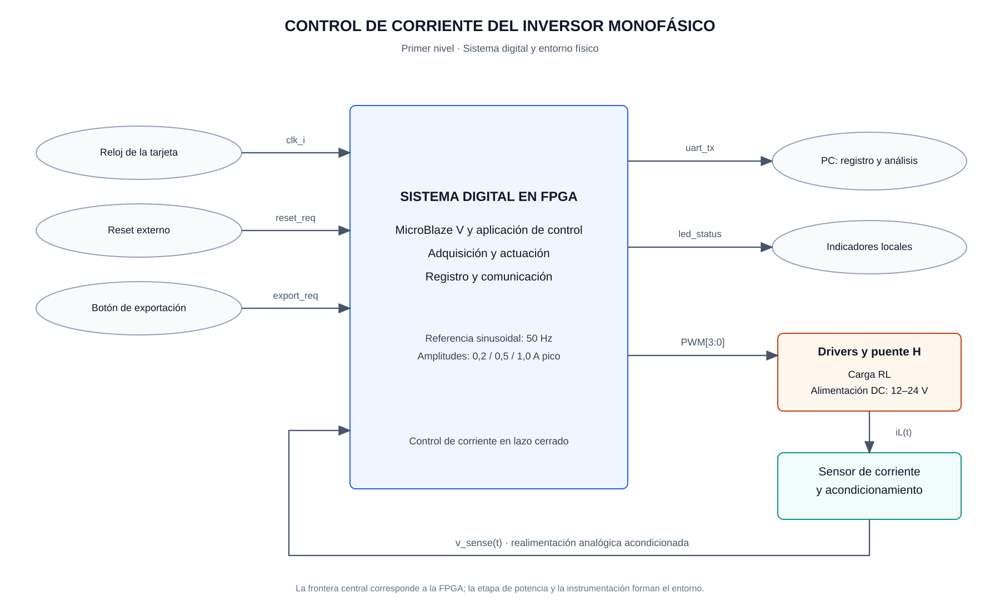
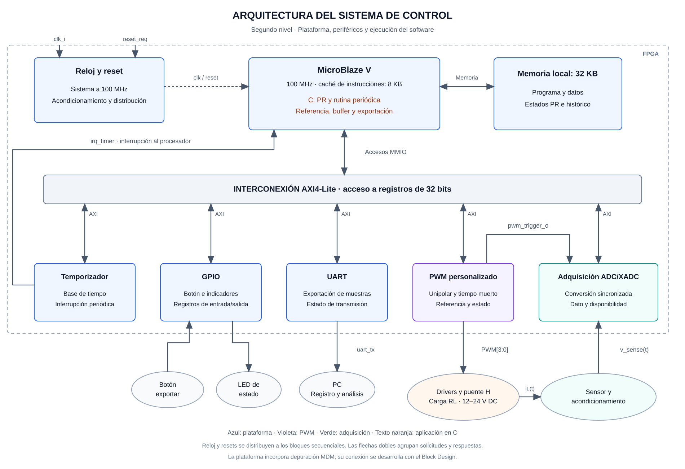

# Diseño del sistema

El sistema regula la corriente de una carga RL mediante un inversor monofásico en puente H. La Basys 3 adquiere la corriente, calcula la ley de control y genera las cuatro órdenes de conmutación. Un botón solicita el histórico por USB-UART para su análisis en PC. El bus de potencia opera nominalmente entre 12 y 24 V DC y las consignas son senoidales de 50 Hz con amplitudes de 0,2, 0,5 y 1,0 A pico.

## Primer nivel · Límites del sistema

La FPGA recibe reloj, reset, órdenes de usuario y una tensión analógica acondicionada. Entrega las cuatro órdenes PWM, el estado en LED y el histórico por UART. Los drivers, el puente, la carga y el sensor forman el camino externo entre las órdenes de actuación y el dato de corriente. El [detalle de entradas y salidas](nivel_1.md) define el sentido de cada señal.

## Segundo nivel · Arquitectura digital

| Bloque | Entradas o acceso | Función y salidas |
|---|---|---|
| MicroBlaze V, memorias y MDM | Reloj de 100 MHz, reset, JTAG y respuesta de periféricos | Ejecuta el software de control con FPU simple, caché de instrucciones de 8 KiB y una BRAM física compartida de 32 KiB. |
| SmartConnect | Solicitudes de memoria mapeada del procesador | Selecciona uno de los siete esclavos AXI. |
| AXI Timer e INTC | Reloj, reset y configuración por AXI | Solicitan la ISR periódica y permiten medir su duración con el segundo contador. |
| PWM personalizado | Referencia Q1.15, configuración por AXI4-Lite y reloj | Genera las cuatro órdenes complementarias con tiempo muerto, el disparo de adquisición y el comienzo de período. |
| ADC/XADC | VAUX6, disparo PWM u orden de software | Publica un código de 12 bits, estado, diagnóstico y token para reconocer la muestra. |
| GPIO y UART Lite | Botones, interruptores, registros de estado y datos de transmisión | Exponen comandos, selección de referencia, LED, diagnóstico de ISR y exportación por USB-UART. |

Los periféricos comparten reloj y reset AXI activo bajo. El reset del procesador es activo alto. Los offsets son direcciones locales en bytes y se suman a la base de cada periférico. El [segundo nivel detallado](nivel_2.md) relaciona funciones, señales y unidades. El mapa AXI definitivo, los pines de laboratorio y la reconstrucción se encuentran en [Integración física en Basys 3](integracion_basys3.md).

## Tercer y cuarto nivel · Diseño por subsistema

| Subsistema | Tercer nivel | Cuarto nivel |
|---|---|---|
| Plataforma MicroBlaze V | [Procesador, memorias y periféricos](nivel_3_microblaze.md) | [Reloj, reset, interconexión y Timer](nivel_4_microblaze.md) |
| PWM y actuación | [Arquitectura y registros AXI](nivel_3_pwm.md) | [Portadora, comparadores y estados de tiempo muerto](nivel_4_pwm.md) |
| ADC/XADC | [Adquisición y coordinación con PWM](nivel_3_adc.md) | [Conversión, registro de muestra y diagnóstico](nivel_4_adc.md) |
| Control PR y software | [Estados y división de tareas](nivel_3_software.md) | [ISR, ecuación PR, registro y exportación](nivel_4_software.md) |

El hardware mantiene la temporización de los pulsos independiente de la carga de software. En la configuración nominal de 10 kHz, el período PWM y el período de control son de 100 µs. A mitad del período PWM, la fase 5000 genera un pulso de 10 ns al ADC. La ISR usa la última conversión completa, comprueba el estado, reconoce el token y calcula una nueva referencia. El PWM captura esa referencia al inicio de período. Las frecuencias de 20 y 25 kHz también se verifican en el RTL del periférico. Cambiar la frecuencia de operación del lazo requiere coordinar fase de disparo, temporizador y parámetros del PR. [Contrato de temporización](pwm_integracion.md).

## Integración con potencia

El top de laboratorio `inversor_basys3` conecta las cuatro órdenes al conector JA. SW15 habilita su paso previa sincronización y a partir de una frontera de período. Al bajarlo, el top bloquea las cuatro órdenes. El apagado por SD pertenece al driver IR2110. El ACS712 va en serie con la carga entre los nodos de conmutación y su salida se acondiciona para el rango analógico del XADC. El retorno a VAUX6 negativo se cablea junto a la referencia del divisor. La corriente se reconstruye con una calibración de cero y ganancia con signo. El [diseño de potencia](../../Potencia/01_diseno_y_componentes.md) documenta el circuito, las fuentes y el dimensionamiento.

El [esquemático completo y los criterios de integración](criterios_de_diseno.md) muestran los estados del puente H con S1–S4. La [tabla de conexiones](integracion_basys3.md#conexiones) identifica el pin de Basys 3 y el canal del IR2110 para cada interruptor.

## Estrategia de verificación

| Nivel de prueba | Estímulo y criterio de aceptación |
|---|---|
| RTL de los periféricos | Escrituras y lecturas válidas e inválidas, orden independiente de AW/W, espera del maestro, reset y límites. Para el PWM, medir períodos, separación, saturación y fase de disparo. Para ADC, comprobar dato válido, ACK atrasado, sobreescritura y timeout. |
| Integración digital | Usar un maestro AXI de prueba con PWM y ADC. Comprobar una publicación por disparo, actualización de referencia en la frontera y deshabilitación. El ensayo negativo debe emitir su diagnóstico. |
| Implementación | Revisar setup y hold, utilización, DRC y CDC. Ejecutar el banco del PWM sobre la netlist ruteada con SDF y contrastar sus puertos contra los criterios de temporización. |
| Software | Probar el PR, el buffer, los drivers y la exportación con modelos en PC. En FPGA, verificar acceso MMIO, medir período y jitter extendidos desde JB1 y comprobar que UART entrega el histórico completo por botón durante el control. |
| FPGA y etapa de potencia | Verificar PWM y VGS con el bus desenergizado. Con tensión y corriente limitadas, comprobar conmutación, polaridad y escala de medición. Medir seguimiento a las tres amplitudes nominales, transitorios de referencia y carga, error de fundamental, fase y rizado. |

Los criterios de aceptación y las evidencias disponibles se desarrollan en el [informe técnico](../informe/README.md). La descripción de cada ensayo identifica el modelo utilizado y el alcance de su resultado.
