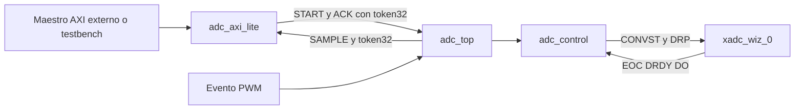

# Arquitectura ADC/XADC con ACK identificado

## Camino de adquisición preservado

`adc_control` conserva la FSM IDLE→WAIT_EOC→SEND_READ→WAIT_DRDY, el arbitraje PWM/software, los pulsos CONVST/DEN, el canal VAUX6/DRP 0x16, la normalización DO[15:4], los timeouts y los errores persistentes. `adc_top` mantiene la instancia directa de `xadc_wiz_0` y la polaridad de reset. El XCI conserva la configuración verificada. Los scripts importan una copia y regeneran los productos IP en build; no se versionan wrappers generados.

## Corrección mínima de la carrera

Antes, ack_sample_i limpiaba new_data sin comprobar qué muestra había consumido el procesador. Leer ID2, publicar ID3 y reconocer ID2 borraba la notificación de ID3. El bus no puede corregir esto comparando al aceptar AW: otra conversión puede terminar antes de que el controlador observe el pulso.

Ahora el controlador evalúa `ack_sample_i && valid_o && new_data_o && sample_token_o!=0 && ack_id_i==sample_token_o` en el flanco del efecto. Solo una coincidencia limpia new_data. En WAIT_DRDY, la publicación posterior en el mismo bloque secuencial fuerza new_data=1 y tiene prioridad sobre ACK. La detección de overrun usa la misma coincidencia; un ACK obsoleto no oculta una sobrescritura.

No se añade una FIFO, un nuevo estado de adquisición ni lógica de otros responsables. La ampliación es un token de publicación, una comparación y su transporte/snapshot en AXI.

## Cambios de interfaz

| Módulo | Señales nuevas | Señales conservadas |
|---|---|---|
| adc_control | ack_id_i[31:0], sample_token_o[31:0] | ack_sample_i sigue siendo el pulso; SAMPLE y estados mantienen nombres/formato |
| adc_top | ack_id_i[31:0], sample_token_o[31:0] | Entradas PWM/software, reloj/reset, VAUX6, muestra y diagnósticos |
| adc_axi_lite | sample_token_i[31:0], ack_id_o[31:0] | ack_sample_o es el pulso ahora procedente de ACK_ID; cinco canales AXI intactos |
| adc_system_axi | Conexiones internas sample_token y ack_id | Sin cambios en puertos externos |

Las instancias directas deben conectar los nuevos puertos. No se interpreta un identificador desconectado como permiso para reconocer cualquier muestra. El wrapper conecta un único productor de START/ACK.

## Token y formato

SAMPLE sigue siendo `{ID16,4'b0,código12}`. El ID aumenta módulo 65536. El token 32 empieza en 1, comparte los 16 bits bajos con ID y aumenta la generación superior al envolver ID16. Cero está reservado. Tras publicar el token 0xFFFFFFFF, la siguiente publicación fija token 0 y un bloqueo persistente de ACK; las conversiones y el ID16 continúan. Solo un reset coordinado reinicia esa sesión. Así no existe alias por una segunda vuelta completa del token.

La lectura SAMPLE captura muestra y token simultáneamente al aceptar AR. ACK_ID leído devuelve el token de esa captura, aunque el conversor publique entre las dos lecturas. Una respuesta R pendiente mantiene datos y respuesta estables. Si AR coincide con publicación, captura la muestra anterior completa y su token anterior, nunca una pareja mezclada.

## Dominio y alcance

Reloj común 100 MHz, reset activo bajo; liberación sincronizada a cargo de la plataforma. No se añadió IRQ ni CDC. La base AXI, empaquetado, política de reset y manejo MMIO deben acordarse con Daniel/Cortés. Los testbenches representan el maestro y el evento PWM; no implementan MicroBlaze ni PWM reales.
