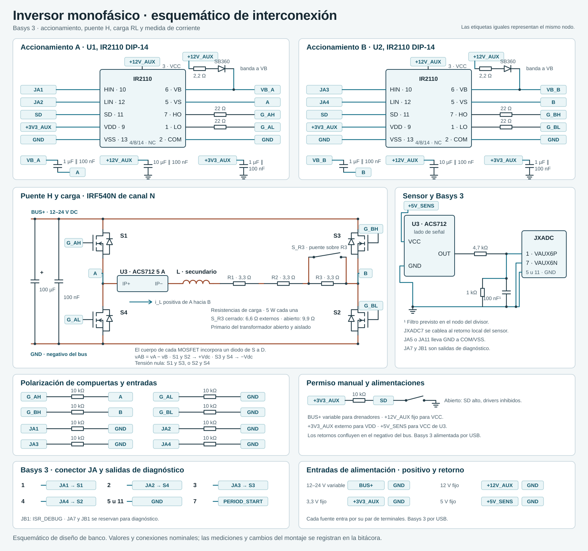

# Criterios de diseño e integración

El objetivo es regular la **corriente de carga** con una consigna sinusoidal de 50 Hz y un bus DC variable de 12 a 24 V. La combinación de un puente H, modulación unipolar y realimentación de corriente permite controlar ambos semiciclos desde una fuente DC. La Basys 3 ejecuta el controlador y genera las cuatro órdenes de conmutación. La etapa de potencia proporciona la tensión diferencial y devuelve una medida de la corriente.

## Circuito completo

Las etiquetas repetidas representan la misma conexión. Los números de patilla corresponden al IR2110 DIP-14 y los del panel Basys 3 corresponden a posiciones físicas del conector. El esquema recoge los valores nominales y señala el capacitor de filtrado analógico previsto. La bitácora identifica las variantes y condiciones de cada ensayo. [Esquemático a tamaño completo](../../Potencia/img/esquematico_inversor.svg) · [Detalle de pines y componentes](../../Potencia/01_diseno_y_componentes.md) · [Bitácora de laboratorio](../../Potencia/04_registro_laboratorio.md).

### Puente, carga y accionamiento

| Decisión | Justificación |
|---|---|
| Puente H con dos ramas | La tensión diferencial se define como $v_{AB}=v_A-v_B$. En los estados ideales, S1 (AH) y S2 (BL) aplican $+V_{dc}$. S3 (BH) y S4 (AL) aplican $-V_{dc}$. S1 y S3, o S2 y S4, conectan ambos extremos al mismo riel y aplican 0 V. Durante el tiempo muerto, los diodos internos ofrecen un camino a la corriente inductiva. |
| PWM unipolar centrado | Las dos ramas comparten portadora y reciben referencias opuestas. La tensión diferencial conmuta entre cero y un nivel del bus en cada polaridad en el caso ideal. Con una referencia casi constante dentro del período aparecen dos pulsos diferenciales por período de las ramas, lo que desplaza el rizado dominante hacia el entorno de 20 kHz cuando la portadora es de 10 kHz. |
| Cuatro IRF540N | Disponibles en TO-220 para el montaje, con VDS nominal de 100 V frente a un bus de hasta 24 V y RDS(on) especificada con VGS de 10 V. El umbral de compuerta indica el comienzo de conducción bajo las condiciones de hoja de datos. Se necesita entregar suficiente VGS para conducir con bajas pérdidas. El margen frente a sobretensiones y la temperatura dependen del montaje. |
| Dos IR2110 | Un integrado por rama permite gobernar de manera independiente al superior y al inferior. VDD a 3,3 V admite las órdenes lógicas de la placa. VCC fijo de 12 V sostiene la excitación de compuerta mientras cambia el bus. El canal superior flota respecto a A o B, de modo que HO mantiene VGS al elevarse la fuente del MOSFET superior. |
| Bootstrap con SB360, 2,2 Ω y 1 µF ∥ 100 nF | El SB360 carga VB cuando VS está cerca del retorno. Su baja caída favorece el margen de excitación y sus 60 V inversos dan margen nominal sobre el bus. Los 2,2 Ω limitan la corriente de recarga. Los capacitores sostienen VB−VS durante el intervalo superior y se montan entre VB y VS por rama. Con 1 µF efectivo y un presupuesto estimado de 279 nC, la caída estimada es 0,28 V. La recarga y los picos se verifican en el montaje. |
| Resistencias de compuerta y polarización | Los 22 Ω en serie limitan el pico de corriente de compuerta y amortiguan el lazo de conmutación. Cada 10 kΩ entre G y su propia S mantiene descargada la compuerta si falta el mando. Los cuatro 10 kΩ de HIN/LIN evitan entradas flotantes. El 10 kΩ de SD lleva ambos drivers a apagado cuando el permiso manual queda abierto. |
| Desacoplo local | El bus emplea 100 µF ∥ 100 nF para acortar el trayecto de los pulsos. Cada VCC usa 10 µF ∥ 100 nF y cada VDD usa 1 µF ∥ 100 nF. Los capacitores de accionamiento se referencian al retorno de su propia alimentación. |
| Dos resistencias de 3,3 Ω y una conmutable | Dos resistencias en serie dan 6,6 Ω externos. Abrir el puente `S_R3` sobre la tercera eleva la resistencia externa a 9,9 Ω, un cambio de 50 %. A 1 A pico ideal, cada resistencia conduce 0,707 A RMS y disipa 1,65 W. Su valor nominal de 5 W deja margen sobre ese punto. Se suma la resistencia del devanado para modelar la planta. |
| Secundario como inductancia de carga | La inductancia limita di/dt y reduce el rizado. El devanado se aprovechó por disponibilidad, con el primario abierto y sus terminales aislados. El devanado inicial dio 9,291 mH a 120 Hz y 6,984 mH a 1 kHz. Los 10 mH a 50 Hz son una hipótesis de cálculo. El devanado de reemplazo requiere su propia caracterización bajo corriente y frecuencia de operación. |

En el modelo lineal, la planta eléctrica es $1/(Ls+R)$. Con $R=7,2\,\Omega$ y $L=10\,\mathrm{mH}$, la magnitud de la impedancia a 50 Hz vale aproximadamente 7,86 Ω. Una corriente de 1 A pico exige unos 7,86 V pico de fundamental en ese modelo, equivalentes a $m\approx0,66$ con 12 V y $m\approx0,33$ con 24 V. Esta estimación omite caídas de conmutación, tiempo muerto y efectos del devanado real. Para la modulación unipolar ideal se estima un rizado máximo de $V_{\mathrm{bus}}/(8f_{\mathrm{sw}}L)$. A 24 V y 10 kHz da 30 mA pico a pico con 10 mH y aproximadamente 43 mA con 6,984 mH. Para evaluar este último valor se usó la lectura de inductancia del devanado inicial a 1 kHz como extremo del modelo. [Dimensionamiento y referencias de componentes](../../Potencia/01_diseno_y_componentes.md) · [IRF540N](https://www.infineon.com/assets/row/public/documents/24/49/infineon-irf540n-datasheet-en.pdf) · [IR2110](https://www.infineon.com/assets/row/public/documents/24/49/infineon-ir2110-datasheet-en.pdf) · [SB360](https://www.diodes.com/part/view/SB360).

### Alimentaciones, retorno y sensado

- **12–24 V variable** para los drenadores superiores. **12 V fijos** para VCC de los drivers. **3,3 V externos** para VDD y SD. **5 V regulados** para el ACS712. La Basys 3 se alimenta por USB. Los retornos convergen en el negativo del bus y se separa el recorrido de potencia del retorno analógico hasta el punto común. El riel de 3,3 V externo solo alimenta la lógica de los drivers.
- **ACS712 de 5 A en serie con la carga.** Su salida ratiométrica permite medir ambos signos alrededor de un nivel de cero. La escala nominal es 185 mV/A a 5 V y se reduce a aproximadamente 32,5 mV/A con 4,7 kΩ en serie y 1 kΩ al retorno. El paso por el sensor está separado eléctricamente de OUT/VCC/GND. La interfaz de la Basys 3 y los IR2110 sí comparte retorno.
- **JXADC1 (VAUX6P)** recibe el nodo del divisor y **JXADC7 (VAUX6N)** se cablea al retorno local. JXADC5 o 11 proporciona GND de la placa. El rango unipolar es 0–1 V y el cero nominal del divisor es 0,439 V. A 0,2 A pico la señal útil es de solo unos 6,5 mV pico, equivalentes a 26–27 códigos. Un error de retorno de 47 mV puede aparentar alrededor de 1,45 A.
- **Filtrado y calibración.** Con el capacitor previsto de 100 nF en el divisor, $R_{\mathrm{Th}}\approx825\,\Omega$ y $f_c\approx1,93\,\mathrm{kHz}$. Su aporte teórico a 50 Hz es aproximadamente −1,5° y la atenuación a 10 kHz, 14,4 dB. En el firmware se usó el cero de 1776 códigos y el factor positivo de 7,6383 mA/código, estimado con la sensibilidad nominal y el VCC medido. La verificación independiente de esa pendiente y del filtro instalado sigue siendo necesaria para cuantificar la exactitud. [ACS712](https://www.allegromicro.com/-/media/files/datasheets/acs712-datasheet.pdf) · [Esquema Basys 3](https://digilent.com/reference/_media/reference/programmable-logic/basys-3/basys-3_sch.pdf) · [ADC de 7 Series](https://docs.amd.com/r/en-US/ug480_7Series_XADC/ADC-Transfer-Functions) · [Parámetros de firmware](../../software/embedded/control/parametros.h).

## Plataforma digital y mandos

MicroBlaze V a 100 MHz ejecuta la ley de control en C y utiliza la FPU simple para los cálculos en coma flotante. La BRAM compartida de 32 KiB aloja programa y datos y la caché de instrucciones de 8 KiB corresponde a la configuración del procesador. SmartConnect enruta los accesos de memoria mapeada. AXI4-Lite basta para transferir configuración, referencia, estado y muestras de 32 bits. El control periódico y la exportación se atienden por caminos distintos para que una UART ocupada no retrase el PWM ni la conversión. Estos dos periféricos realizan su temporización a partir del reloj común. [Arquitectura de plataforma](nivel_3_microblaze.md) · [Estrategia de software](nivel_3_software.md).

### Referencia y mandos

El hardware lee los botones e interruptores por AXI GPIO. El firmware aplica un antirrebote de aproximadamente 20 ms a la interfaz de usuario y detecta flancos para evitar que una pulsación sostenida alterne repetidamente el estado. La parada con BTND durante operación también se evalúa directamente en la ISR.

| Mando | Comportamiento y motivo |
|---|---|
| SW1:SW0 | `00` selecciona 0,2 A pico, `01` 0,5 A pico y `10` o `11` 1 A pico. Los dos bits alcanzan para las tres consignas. Se aplica la nueva amplitud al envolverse la fase del seno, en el cruce ascendente, para reducir la discontinuidad de corriente solicitada. |
| BTNU | Habilita desde DETENIDO o solicita detener desde OPERACIÓN. La habilitación reinicia el PR y mantiene la orden `m=0` durante cinco iteraciones nominales para permitir la recarga inicial del bootstrap. |
| BTND | Durante OPERACIÓN solicita apagar el PWM. En FALLA reconoce la causa registrada y vuelve a DETENIDO. Se requiere una nueva orden de BTNU para operar. Separar reconocimiento y arranque evita reanudar la conmutación al reconocer una falla. |
| BTNL | Solicita exportar el historial si la UART de software está disponible. La transmisión progresa en el lazo principal para que el control mantenga su cadencia. |
| BTNC y SW15 | BTNC reinicia la plataforma. SW15 controla el paso físico de las cuatro órdenes en el top, por hardware. Al bajar bloquea las órdenes, y al subir espera sincronización y frontera de período. SW15 es independiente del estado del programa y de SD. |
| LD0–LD3 | Indican operación, falla, exportación y latido, respectivamente. Permiten distinguir un lazo detenido de una plataforma activa. |

La consigna $i_{\mathrm{ref}}$ se genera numéricamente. En cada paso de 100 µs se suma $\Delta=\operatorname{round}(2^{32}\cdot50\cdot100\,\mu\mathrm{s})$ al acumulador de fase de 32 bits. Los 8 bits superiores indexan una tabla de 256 valores Q1.15. El resultado se convierte a amplitud unitaria y se multiplica por los amperios pico seleccionados. Se calculan aproximadamente 200 puntos por ciclo de 50 Hz. Las 256 entradas representan posiciones de fase en la tabla. [Generador de referencia](../../software/embedded/control/referencia.c) · [Aplicación y GPIO](../../software/embedded/control/aplicacion.c) · [Pines físicos](integracion_basys3.md).

## Ley de control y cómo se convierte en pulsos

**El controlador es un PR discreto en realimentación negativa de corriente.** Se calcula $e[k]=i_{\mathrm{ref}}[k]-i_L[k]$. La parte proporcional actúa sobre el error instantáneo y la parte resonante aumenta la ganancia alrededor de 50 Hz, donde interesa reducir el error de seguimiento. La forma amortiguada da una ganancia finita y admite una pequeña separación de la frecuencia nominal. Un PI en el marco estacionario aporta su mayor ganancia en continua y exigiría otra estrategia para obtener esa ventaja a 50 Hz.

$$
G_{\mathrm{PR}}(s)=K_p+\frac{2K_r\omega_c s}{s^2+2\omega_c s+\omega_0^2}
$$

Se usan $K_p=12$, $K_r=200$, $\omega_c=2\pi\cdot2\ \mathrm{rad/s}$ y $\omega_0=2\pi\cdot50\ \mathrm{rad/s}$. Para fijar la escala de $K_p$ se usó la aproximación de la planta inductiva con 10 mH y se buscó un cruce del orden de 200 Hz a 12 V, lejos de los 10 kHz de muestreo. En la resonancia, la ganancia de 212 V/A con $K_r=200$ permite reducir el error previsto para la impedancia nominal. El análisis discreto y las simulaciones con retardo verifican el ajuste dentro de sus supuestos. La rama resonante usa Tustin con predeformación a 50 Hz para mantener la frecuencia del pico tras discretizar a 100 µs. En C, el término resonante usa la ecuación $r[k]=0,2509707454(e[k]-e[k-2])+1,996504651667r[k-1]-0,997490292546r[k-2]$. La salida es $v_{\mathrm{PR}}[k]=12e[k]+r[k]$. El anti-windup congela esas memorias si la salida satura y el error empuja en el mismo sentido. Si el error ayuda a salir de saturación, se actualizan. [Diseño de Potencia y sintonía](../informe/potencia/README.md) · [Implementación del PR](../../software/embedded/control/control_pr.c).

1. El PR entrega una orden $v_{\mathrm{PR}}$ en voltios del modelo. El firmware divide por **12 V fijos**, limita a aproximadamente ±0,85 y redondea a Q1.15. El entero firmado va de −27853 a +27853 y se escribe en `REFERENCE`, base PWM `0x44000000` más offset `0x04`.
2. El hardware conserva el valor escrito como pendiente. En cada comienzo de período aplica una referencia común a las dos ramas. El registro activo evita deformar un pulso si cambia el dato a mitad del período.
3. Con una portadora centrada común, el RTL obtiene anchuras equivalentes a comparar $m$ y $-m$ con una triangular. En cada rama, con período $P$ y semiancho entero $h$, la orden superior ideal se activa si la fase cumple $p<h$ o $p\ge P-h$. Para $P=10\,000$, el centro de los semianchos es 2500 y el desplazamiento por modulación es el entero redondeado de $2500m$. Idealmente $d_A=(1+m)/2$ y $d_B=(1-m)/2$. Por ejemplo, `REFERENCE=16384` representa $m=0,5$ y da 75 % en la orden superior A y 25 % en la B antes del tiempo muerto. La media diferencial ideal es $V_{\mathrm{bus}}(d_A-d_B)=V_{\mathrm{bus}}m$.
4. Cada rama inserta 100 ciclos de reloj con ambas salidas bajas al conmutar, equivalentes a **1 µs**. El RTL también exige un intervalo activo mínimo de 100 ciclos después del tiempo muerto para admitir la configuración. Con $m=0$ ambas órdenes superiores tienen 50 % ideal y ambos nodos se conmutan en fase. La referencia cero permite recargar el bootstrap y produce media diferencial nula en el modelo. El apagado completo bloquea las cuatro órdenes.

**La comparación se resuelve con el reloj de 100 MHz.** La fase avanza cada 10 ns. Con 10 000 estados por período, la portadora de cada rama es de **10 kHz**, con $T_{\mathrm{PWM}}=100\,\mu\mathrm{s}$. La fundamental objetivo de la corriente es de **50 Hz**. El RTL admite 20 y 25 kHz con 5000 y 4000 ciclos respectivamente. Se eligieron 10 kHz porque coinciden los períodos PWM y de control, dejan margen para el tiempo muerto y la recarga, y el rizado calculado con la carga nominal queda por debajo de 0,20 A pico a pico. Con la portadora de 20 o 25 kHz se reduce ese rizado ideal a costa de un mayor peso del tiempo muerto y de más conmutaciones por segundo. Un cambio de frecuencia en el sistema requiere coordinar la fase de adquisición, la cadencia del control y los coeficientes si cambia $T_s$. [Conversión de la modulación](../../software/embedded/control/modulacion.c) · [Registros del PWM](../../software/embedded/drivers/pwm/pwm_regs.h) · [Portadora y tiempo muerto](nivel_4_pwm.md).

El bus físico es una perturbación para el lazo. En el modelo promediado, la relación entre la orden del PR y la tensión aplicada es $V_{\mathrm{bus}}/12$ mientras haya margen de modulación. El controlador ajusta $m$ a partir de la corriente medida. La versión probada usa la constante configurada de 12 V. Una normalización por tensión de bus medida requeriría otra entrada y validación del lazo.

## Adquisición, latencia y protección

El PWM emite un pulso interno de 10 ns en la fase 5000, nominalmente 50 µs desde el comienzo del período. El ADC lo acepta y publica el código de 12 bits y el identificador de 16 bits en una lectura de `SAMPLE`. La conversión se midió en simulación en aproximadamente 1,13 µs. El software consulta estado y muestra, reconoce el token completo de 32 bits mediante `ACK_ID` y verifica la continuidad con el identificador de 16 bits. Esa distinción permite detectar faltantes y evita que un reconocimiento atrasado borre la notificación de otra muestra. Fuera de operación puede iniciar conversiones por software. El disparo al centro fija una fase de adquisición reproducible y busca separar la medida de los flancos. La separación real depende de la modulación, del acondicionamiento y de la conmutación. [Contrato de temporización](pwm_integracion.md) · [Diseño del ADC](nivel_4_adc.md).

El **AXI Timer** interrumpe cada 100 µs por el **AXI INTC**. La ISR usa la última muestra completa y conserva la orden si el identificador está repetido. Cuando llega un nuevo dato, actualiza el PR, entrega la referencia pendiente al PWM y registra los resultados. Si el Timer y el PWM quedan con la fase nominal prevista, adquirir a mitad de un período y aplicar en la siguiente frontera posterior a la ISR puede producir un retardo del orden de 1,5 períodos. El retardo y el jitter de extremo a extremo siguen sin una medida directa. El segundo contador estima la duración de la ISR y JB1 expone una marca externa. El máximo registrado fue 8,57 µs en la campaña final, frente a 100 µs de período. [Plataforma e interrupciones](nivel_4_microblaze.md) · [Resultados de laboratorio](../informe/resultados/potencia/laboratorio/2026-11-23/resultados.md).

| Medida de diseño | Alcance |
|---|---|
| Interbloqueo digital y tiempo muerto por rama | Evita que el RTL ordene simultáneamente los dos MOSFET de una rama. Para contrastar la conmutación física se miden VGS de ambos MOSFET respecto de sus propias fuentes. |
| Inicio con `m=0` y limitación de modulación | Se dejan intervalos para recarga y se acota la actuación. A 10 kHz y $\lvert m\rvert=0,85$, el intervalo ideal menor es de 7,5 µs y queda cerca de 6,5 µs tras el tiempo muerto. Verificar VB−VS bajo carga es parte de la validación del bootstrap. |
| SD y SW15 | SD alto inhibe el IR2110. SW15 abajo inhibe las señales de la FPGA. El límite de corriente de la fuente protege el ensayo y corresponde a corriente DC de entrada. |
| Supervisión en C | Supervisa el código fuera de 16–4079, la sobrecorriente de 1,5 A, la continuidad/estado del ADC y el tiempo de ISR. Los umbrales de código y corriente requieren tres evaluaciones válidas consecutivas para disparar. Un código fuera de ventana se sustituye para el PR por la última lectura aceptada, conservando su diagnóstico. Los picos dentro de la ventana todavía pueden llegar al control. La protección de sobrecorriente depende de la medición y del tiempo de software. |

El firmware integrado configura un buffer circular de 512 registros de 8 bytes y guarda una de cada dos iteraciones. Así conserva una ventana nominal de 102,4 ms con 4 KiB de datos a 5 kregistros/s. Este ajuste mantiene el control a 10 kHz y reserva memoria para código y pila. La salida por USB-UART a 115200, 8N1, incluye CRC-16 para verificar integridad. Algunas campañas usaron variantes de captura con otra decimación, registrada junto con sus datos. [Integración en Basys 3](integracion_basys3.md) · [Software y formato de captura](../../software/README.md) · [Supervisor de fallas](../../software/embedded/control/supervision.c).

## Qué demuestra el ensayo físico

- **Conmutación.** Se midieron 10 kHz y 1 µs de separación entre las órdenes de la FPGA. En la prueba a baja tensión se observó $v_{AB}$ de ambas polaridades y una fundamental de corriente a 50 Hz mediante la caída en una resistencia en serie. Esta evidencia corresponde a las condiciones registradas de la prueba.
- **Seguimiento en lazo cerrado.** Con 6,6 Ω externos la fundamental medida por XADC quedó en 0,190 y 0,193 A pico para la referencia de 0,2 A a 12 y 24 V, respectivamente. A 0,5 A se midieron 0,318 y 0,471 A. A 1 A se midieron 0,329 y 0,736 A en la serie de comparación, con una repetición de 0,760 A a 24 V. El recorte de $m$ en las corridas de mayor demanda muestra que la orden alcanzó el límite de actuación del firmware.
- **Interpretación de discrepancias.** El modelo RL nominal predice margen a 1 A. La saturación observada y el error de amplitud motivan contrastar $v_{AB}$, la corriente con una medición independiente, la tensión efectiva de bus y la impedancia del devanado de reemplazo. El cambio de devanado mejoró la forma observable de corriente en lazo abierto y los picos persistieron en algunas capturas aun con el sensor retirado. La contribución de la conmutación, del retorno, del lazo de la sonda y de la carga requiere mediciones separadas.
- **Perturbaciones.** Se registraron escalones de 0,2 a 0,5 A y una variación en marcha de 6,6 a 9,9 Ω externos a 24 V y 0,5 A. En el cambio de carga, la estimación de fundamental fue de 0,472 A antes y 0,483 A después. Quedan por medir el rizado con resolución suficiente, la escala del sensor de forma independiente y el desempeño del último escalón hacia 1 A.

El tiempo muerto, el acceso AXI al PWM y al ADC y la secuencia de disparo se comprobaron en bancos de prueba. La implementación ruteada en Vivado 2026.1 obtuvo holguras positivas de setup y hold a 100 MHz. La compatibilidad con la versión 2025.1 solicitada por el instructivo sigue pendiente. [Integración en Basys 3](integracion_basys3.md) · [Informe técnico de Taller](../informe/README.md).

Los resultados se interpretan por condición de ensayo y por tipo de evidencia. Las trazas UART muestran la corriente estimada por el canal de realimentación y el índice ordenado. Las capturas de osciloscopio muestran tensiones en sus puntos de conexión. Las simulaciones sirven para contrastar el modelo y sus supuestos. [Resultados y archivos de medición](../informe/resultados/potencia/laboratorio/2026-11-23/resultados.md) · [Estado de validación](../../Potencia/03_pendientes_y_validacion.md).
