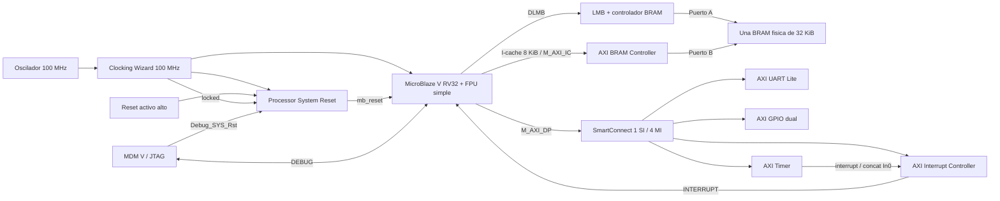

# Implementación reproducible de la plataforma MicroBlaze V

## Alcance y estado

Esta plataforma mínima de diagnóstico concreta la ruta de memoria y los IP de los [niveles 3](nivel_3_microblaze.md) y [4](nivel_4_microblaze.md), sin reemplazar esos documentos de propuesta. No incorpora PWM, ADC/XADC ni PR. No tiene conexiones a la etapa de potencia.

La reconstrucción está dirigida a **Vivado/Vitis 2026.1** y al dispositivo Basys 3 `xc7a35tcpg236-1`. El enunciado y los documentos anteriores contemplan **2025.1**: la compatibilidad con esa versión no se ha comprobado. El script Vivado rechaza versiones distintas de 2026.1 para evitar una migración silenciosa.

Las fuentes versionadas son scripts Tcl, constraints y fuentes de diagnóstico C. Vivado genera el Block Design, wrapper, IP, checkpoints y reportes en una carpeta externa. No se versionan `.xpr`, `.bd` generados, BSP, ELF, XSA ni resultados de construcción. No se copian fuentes internas de AMD; los IP se obtienen de la instalación local.

## Arquitectura y conexiones



Todas las interfaces de sistema usan 100 MHz. Processor System Reset entrega `mb_reset` activo alto al procesador, `bus_struct_reset` al LMB y `peripheral_aresetn` activo bajo a SmartConnect y los esclavos AXI. `aux_reset_in` se fija en cero porque su polaridad es activa alta. El botón central también reinicia Clocking Wizard. `locked` condiciona la liberación del sistema.

El Timer utiliza la interrupción normal de INTC, con `C_HAS_FAST=0` y entrada de nivel. Su salida llega a `In0` de un concat de un bit, después a `intr` de INTC y desde su interfaz `interrupt` a `INTERRUPT` del núcleo. La aplicación de diagnóstico no instala ni habilita una ISR: solo se comprueba por ahora la conexión de hardware.

### Memoria, caché y FPU

Se configura RV32, multiplicación/división, FPU de precisión simple y depuración habilitada. No se habilita caché de datos. ILMB está deshabilitado: las instrucciones se obtienen por `M_AXI_IC`, con caché de instrucciones de 8192 bytes. Los datos utilizan DLMB y el acceso MMIO utiliza `M_AXI_DP`.

La BRAM es una sola memoria True Dual Port de 8192 palabras de 32 bits. El puerto A pertenece al controlador LMB y el B al controlador AXI de instrucciones. Ambas vistas abarcan `0x00000000–0x00007FFF`; no son dos regiones físicas de 32 KiB. La región cacheable de instrucciones coincide con ese rango. Los 8 KiB de caché son recursos adicionales y no espacio para muestras.

El linker reserva código, constantes, datos, BSS, heap y pila dentro de la misma región. El punto de entrada es `_boot` en cero; el arranque del BSP y la alineación interna del código se conservan. Se reservan por defecto 2048 bytes de heap y 1024 de pila, con alineación de pila de 16 bytes. Los `ASSERT` del linker y `check_elf.py` verifican los límites; no garantizan que el uso dinámico de pila nunca desborde.

Escribir código mediante datos/JTAG puede requerir invalidar la caché de instrucciones antes de ejecutarlo. No se admite asumir coherencia automática ni usar código automodificable sin ese tratamiento. La efectividad de caché y el arranque real continúan pendientes de ejecución en tarjeta.

### Mapa AXI provisional

| Destino | Vista CPU | Base | Rango asignado |
|---|---|---|---|
| BRAM, puerto A por DLMB | Datos | `0x00000000` | 32 KiB |
| Misma BRAM, puerto B por AXI | Instrucciones | `0x00000000` | 32 KiB |
| AXI GPIO | Datos / MMIO | `0x40000000` | 64 KiB |
| AXI UART Lite | Datos / MMIO | `0x40600000` | 64 KiB |
| AXI INTC | Datos / MMIO | `0x41200000` | 64 KiB |
| AXI Timer | Datos / MMIO | `0x41C00000` | 64 KiB |

Los rangos son ventanas de decodificación, no cantidades de registros implementados. El software debe utilizar el `xparameters.h` del XSA reconstruido. No se asignan bases para PWM o ADC en esta etapa.

### Puertos y constraints de diagnóstico

| Puerto del wrapper generado | Pin | Dirección FPGA | Función |
|---|---|---|---|
| `clk_i` | W5 | Entrada | Reloj de 100 MHz |
| `reset_i` | U18 | Entrada | Botón central, activo alto |
| `UART_0_rxd` | B18 | Entrada | RX desde el puente USB-UART |
| `UART_0_txd` | A18 | Salida | TX hacia el puente USB-UART |
| `GPIO_0_tri_i[0]` | T18 | Entrada | Botón superior |
| `GPIO2_0_tri_o[0]` | U16 | Salida | LED0 |

Todos usan LVCMOS33. Referencia: [Basys-3-Master.xdc de Digilent](https://github.com/Digilent/digilent-xdc/blob/master/Basys-3-Master.xdc).

Clocking Wizard aporta el `create_clock` de 10 ns; el XDC propio no lo repite. Síntesis comprueba que exista un solo reloj de entrada de 10 ns y que todos los puertos tengan pin y estándar definidos. Las excepciones del XDC se limitan a entradas físicas asíncronas (botón, reset, RX) y salidas sin reloj externo (UART TX y LED). En la exploración, CDC reconoció sincronizadores en esas entradas. No se heredan excepciones del Proyecto 3 ni se excluyen caminos internos para mejorar WNS. Las excepciones existentes en los IP AMD se mantienen sin editar.

## Reconstrucción con Vivado

Desde una terminal con Vivado 2026.1 inicializado, defina rutas propias. Los ejemplos PowerShell utilizan la raíz del repositorio como directorio actual:

```powershell
$fuentes = (Resolve-Path 'Proyecto4_Inversor_Monofasico').Path
$salida = Join-Path $env:TEMP 'p4_microblaze_nuevo'
Set-Location $env:TEMP
vivado -mode batch -source "$fuentes/scripts/vivado/create_project.tcl" -log p4_create.log -journal p4_create.jou -tclargs "$salida"
vivado -mode batch -source "$fuentes/scripts/vivado/synthesize.tcl" -log p4_synth.log -journal p4_synth.jou -tclargs "$salida/microblaze_platform.xpr"
vivado -mode batch -source "$fuentes/scripts/vivado/export_hardware.tcl" -log p4_export.log -journal p4_export.jou -tclargs "$salida/microblaze_platform.xpr"
```

Deténgase ante un código de salida distinto de cero. El directorio de creación debe ser nuevo: el script no borra ni sobrescribe un proyecto existente. Todos los productos deben quedar fuera del repositorio, también los logs/journals del proceso Vivado. No se requieren board files de Basys 3: se selecciona el part explícitamente. La licencia BASIC no permite `report_qor_suggestions`; el flujo no depende de ese comando ni de compilación incremental.

`create_project.tcl` crea el diseño, configura IP, fija segmentos, ejecuta validación y comprobaciones, genera productos y wrapper y agrega el XDC. `verify_bd.tcl` comprueba parámetros y conexiones y guarda `reports/bd_configuration.txt`. `synthesize.tcl` ejecuta síntesis y genera reportes en `reports/synthesis/`. La exportación produce `platform_microblaze.xsa` **sin bitstream**.

La implementación es opcional y separada:

```powershell
vivado -mode batch -source "$fuentes/scripts/vivado/implement.tcl" -log p4_impl.log -journal p4_impl.jou -tclargs "$salida/microblaze_platform.xpr"
```

Este script conserva checkpoint y reportes de referencia post-route y de `phys_opt_design -directive Explore`. No contiene generación de bitstream. Sus reportes requieren revisión de routing, setup/hold, DRC, E/S y metodología; terminar el script no equivale a aprobar esos criterios.

## Software de diagnóstico y Vitis

Las fuentes están en [software/embedded/diagnostic](../../software/embedded/diagnostic/). Usan UART Lite por polling, comprobación de suma entera, suma `float`, variable global y variable local volátil en pila. `diagnostic_status` comienza en `0xFFFFFFFF`, toma `0x80000000` si falla inicialización UART y después conserva una máscara: bit 0 enteros, bit 1 float, bit 2 global y bit 3 pila. Cero significa que las comprobaciones ejecutadas por C pasaron, no que ya se hayan ejecutado en esta tarjeta.

En una terminal Vitis 2026.1, usando un workspace externo nuevo:

```powershell
$workspace = Join-Path $env:TEMP 'p4_vitis_nuevo'
Push-Location "$fuentes/scripts/vitis"
try {
    vitis -s build_diagnostic.py "$salida/platform_microblaze.xsa" "$workspace"
} finally {
    Pop-Location
}
```

En Windows se invoca el nombre relativo del script porque el lanzador `vitis.bat` instalado elimina comillas de sus argumentos. Use rutas externas sin espacios para XSA y workspace en este comando; esto no exige mover el repositorio. No se modifica el lanzador AMD.

El script crea la plataforma standalone para `mbv`, construye BSP y aplicación e importa únicamente las tres fuentes del diagnóstico. No instala herramientas ni modifica los drivers AMD. Comprueba en la configuración generada `-march=rv32imf_zicsr_zifencei_zicbom` y `-mabi=ilp32f`, y analiza ELF, regiones y símbolos. Guarda `elf_validation.json` fuera de Git. Puede verificarse un ELF existente con `python -B scripts/vitis/check_elf.py <diagnostic.elf>`.

El ELF no se asocia automáticamente a la inicialización de BRAM ni se descarga a la FPGA. El flujo futuro debe relacionar XSA, bitstream y ELF de la misma construcción; revisar timing/metodología y descargar mediante Vitis/JTAG antes de comprobar UART a 115200, 8N1. No se conecta potencia.

## Resultados comprobados y limitaciones

La exploración previa, fuera de Git, validó el BD, sintetizó y enrutó la plataforma. Después de optimización física obtuvo WNS +0.060 ns, TNS 0, WHS +0.033 ns y THS 0, sin fallos setup/hold ni DRC. Utilizó 5677 LUT, 3678 registros, 11 RAMB36 y 6 DSP. Son resultados históricos de aquella construcción, **no una promesa de timing de la reconstrucción desde estos scripts**.

El diagnóstico previamente enlazado reservó 11 136 bytes de los 32 KiB, incluyendo heap y pila; quedaron 21 632 bytes. Ese margen no fija todavía el tamaño del buffer PR y debe recalcularse al integrar software. La validación de la nueva reconstrucción se registra por separado en el [informe de resultados](../informe/microblaze_reconstruccion.md). Compilar, validar un BD o cerrar timing no demuestra ejecución funcional.

### BSP y metodología pendientes

`standalone_v9_5` presenta una inconsistencia: el esquema de generación `microblaze_riscv.yaml` y `XMicroblaze_RISCV_Config` de `xmicroblaze_riscv.h` no coinciden. La exploración reprodujo dos advertencias `excess elements in struct initializer` en `xmicroblaze_riscv_g.c` mediante regeneración soportada. Se relacionan con campos de tamaño de datos y política de escritura de caché ausentes de la estructura; los valores pueden quedar desplazados. La tabla afectada no estaba vinculada en el ELF mínimo inspeccionado. No se asume que sea inocuo para una aplicación futura: revisar su mapa al ampliarla. No se parchean fuentes originales ni se suprimen advertencias.

`LUTAR-1` y `TIMING-9` permanecen **no concluyentes**. El primero afecta a la OR de causas de reanudación que conduce el preset asíncrono de `resumeack_reg` dentro de AMD. El segundo es un aviso agregado de CDC sin endpoints asociados en la inspección realizada. Los cinco cruces seguros enumerados por `report_cdc` y los registros `ASYNC_REG` presentes no justifican toda la lógica interna de depuración. Se requiere confirmar el protocolo con AMD o demostrar la protección de los caminos. No hay waiver nuevo ni bitstream autorizado.

## Propuestas para integración, no contratos definitivos

Se propone AXI a 100 MHz, reset AXI activo bajo y periféricos personalizados AXI4-Lite con datos de 32 bits. El PWM propone 10/20/25 kHz y `pwm_trigger_o` de un ciclo para adquisición; se mantienen sus [registros y prioridades propios](nivel_4_pwm.md), sin implementarlos aquí. El Timer queda configurable desde software.

Falta acordar bases y rangos PWM/ADC, período PR y fase relativa Timer–PWM–ADC, formato y escala ADC, reconocimiento de muestra y errores, tamaño/submuestreo del buffer, presupuesto de ISR y GPIO finales de usuario/medición. También deben revisarse el BSP, los dos avisos de metodología y la compatibilidad 2025.1. No se crean wrappers ficticios, mapas definitivos de compañeros ni una aplicación de control sustitutiva.
