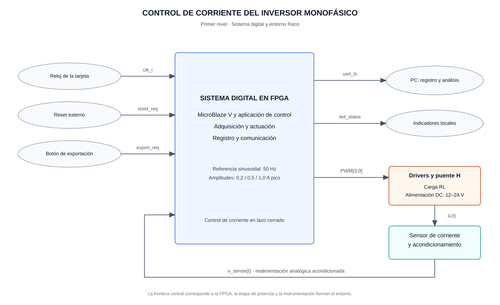

# Primer nivel — Sistema digital de control de corriente

## Objetivo

Regular la corriente de una carga RL mediante un controlador PR discreto ejecutado en MicroBlaze V. El sistema digital recibe la medición de corriente, calcula la acción de control y genera las señales PWM unipolares que accionan el inversor monofásico. También almacena muestras y las exporta a una PC cuando el usuario lo solicita.

## Límite del sistema

El bloque central representa el sistema implementado en la FPGA: procesamiento, adquisición ADC/XADC, generación PWM y comunicación. Los drivers, el puente H, la carga RL y el sensor con su acondicionamiento se muestran como elementos externos a la FPGA. Juntos forman el lazo de control del proyecto.

La alimentación DC de 12 a 24 V corresponde a la etapa de potencia. La entrada de adquisición recibe la señal acondicionada del sensor; su rango eléctrico se define con la instrumentación y la configuración del ADC.

## Diagrama general

**Figura 1.** Entradas y salidas del sistema digital y su relación con la etapa de potencia. La corriente de carga se mide y se realimenta como una señal analógica acondicionada. Las órdenes PWM, la transmisión UART y los indicadores son salidas distintas.

Los óvalos representan elementos de entrada o salida del entorno. Los bloques externos de potencia y medición muestran el recorrido de la actuación y la realimentación. Los nombres de señales identifican funciones; la asignación de puertos y pines se establece en el diseño detallado.

## Entradas

| Entrada | Naturaleza | Función |
|---|---|---|
| `clk_i` | Reloj de referencia de la tarjeta | Alimentar el bloque que proporciona la base temporal de 100 MHz del sistema |
| `reset_req` | Solicitud de reinicio | Inicializar la plataforma, los periféricos y el estado de la aplicación |
| `export_req` | Acción del usuario mediante botón | Solicitar la exportación del histórico de corriente por UART |
| `v_sense(t)` | Señal analógica acondicionada | Representar la corriente medida de la carga para su conversión ADC/XADC |

La polaridad y el acondicionamiento del reset y del botón se documentan con la tarjeta y el top. La señal `v_sense(t)` debe permitir reconstruir la magnitud y el signo de la corriente según el sensor, el acondicionamiento y la calibración acordados.

## Salidas

| Salida | Destino | Función |
|---|---|---|
| `PWM[3:0]` | Drivers del puente H | Representar las órdenes de las dos ramas del puente, con señales complementarias y tiempo muerto |
| `uart_tx` | PC mediante interfaz serial | Transmitir el histórico de muestras para almacenamiento, visualización y análisis |
| `led_status` | Indicadores locales | Presentar los estados de operación y las condiciones definidas por la aplicación |

`PWM[3:0]` agrupa cuatro órdenes lógicas; su correspondencia con las entradas de los drivers y sus niveles activos se define en la interfaz de actuación. El número y la codificación de los indicadores se especifican con el GPIO. La velocidad y el formato de exportación UART se acuerdan con el software.

## Referencia y funcionamiento

La aplicación genera una referencia sinusoidal de 50 Hz con amplitudes de 0,2; 0,5 o 1,0 A pico. Esta referencia es una variable del software de control, no una entrada analógica adicional a la FPGA.

1. Al iniciar, la aplicación configura el temporizador, los periféricos y los parámetros del controlador.
2. El PWM proporciona un evento para sincronizar la adquisición. El ADC convierte la señal de corriente y publica el resultado con su estado de disponibilidad.
3. La rutina periódica del temporizador obtiene una muestra válida, calcula la acción PR y escribe la referencia de modulación al PWM.
4. El PWM genera las órdenes de accionamiento del puente H; la corriente resultante vuelve a medirse.
5. La aplicación almacena las muestras en memoria y atiende la exportación solicitada por el usuario, conservando la ejecución periódica del control.

Los 50 Hz describen la referencia de corriente. La frecuencia de conmutación PWM y el período de control son parámetros diferentes, seleccionados y justificados en coordinación con PEDP. La relación temporal entre disparo, disponibilidad de muestra e interrupción se desarrolla en el segundo nivel.

## Referencia

Instructivo conjunto del Proyecto 4 de EL3313 y EL4201, secciones 4.1–4.3: lazo de control, plataforma MicroBlaze V, periféricos y etapa de potencia.

[Segundo nivel: arquitectura e interconexiones](nivel_2.md) · [Índice del diseño](README.md)
