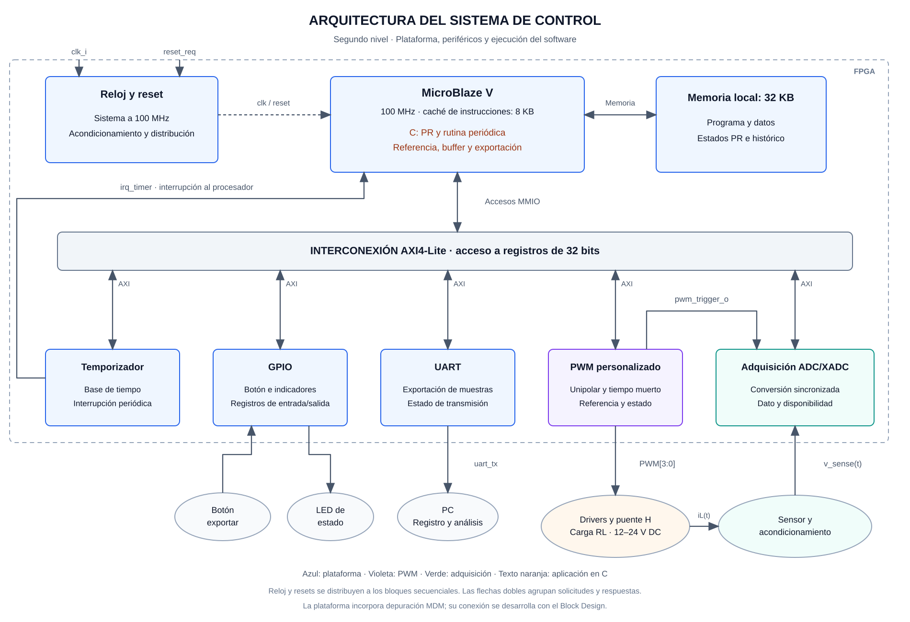

# Segundo nivel — Arquitectura del sistema de control

## Objetivo

Descomponer el sistema digital en plataforma de ejecución, memorias, interconexión y periféricos. El diseño identifica cómo se mide la corriente, cómo se ejecuta el PR y cómo se actualiza la actuación, conservando el reparto de responsabilidades del proyecto.

## Diagrama de arquitectura

**Figura 1.** Arquitectura funcional dentro de la FPGA. Los bloques azules pertenecen a la plataforma; el PWM y la adquisición se distinguen por color. El texto de software dentro del procesador identifica las funciones en C que se ejecutan sobre MicroBlaze V. El entorno físico aparece debajo del límite de la FPGA.

Las flechas dobles agrupan solicitudes y respuestas de una interfaz. La interrupción del temporizador y el disparo PWM–ADC son conexiones de control independientes del bus AXI. El reloj y los resets se distribuyen a los bloques secuenciales; el enlace dibujado hacia el procesador resume esa distribución.

## Bloques, objetivos e interfaces

| Bloque | Objetivo | Entradas principales | Salidas principales |
|---|---|---|---|
| Reloj y reset | Proporcionar una base temporal y un arranque coherente | Reloj de entrada y solicitud externa de reset | Reloj de sistema de 100 MHz y resets acondicionados |
| Plataforma MicroBlaze V | Ejecutar la aplicación de control y gestionar accesos e interrupciones | Instrucciones, datos, respuestas de periféricos e interrupción del Timer | Accesos de memoria, solicitudes AXI y actualizaciones de periféricos |
| Memoria local | Conservar programa, datos, estados del PR e histórico | Dirección y controles de acceso; datos de escritura | Instrucciones y datos leídos |
| Interconexión AXI4-Lite | Encaminar transacciones al periférico seleccionado | Solicitudes del procesador y respuestas de los periféricos | Solicitudes a cada destino y respuestas al procesador |
| Temporizador | Establecer la ejecución periódica del control | Configuración, reloj y reconocimiento de interrupción | Interrupción periódica y estado |
| GPIO | Exponer el botón e indicadores a la aplicación | Botón, accesos AXI y estado escrito por software | Estado de entrada, indicadores y respuesta AXI |
| UART | Exportar los datos almacenados | Datos y configuración escritos por software | Línea TX y estado de transmisión |
| PWM personalizado | Producir la modulación unipolar y el tiempo muerto | Referencia de modulación, configuración y accesos AXI | Cuatro órdenes de accionamiento, disparo de adquisición y estado |
| Adquisición ADC/XADC | Convertir la medición de corriente y publicar muestras | Señal analógica, disparo PWM y órdenes por software | Dato convertido, disponibilidad y respuesta AXI |

MicroBlaze V se configura a 100 MHz, con caché de instrucciones de 8 KB, memoria local de 32 KB y depuración mediante MDM. La figura agrupa la ejecución del procesador y el acceso a memoria; los bloques IP, sus puertos y la conexión de depuración se detallan en la plataforma.

## Software de control

El PR, la generación de referencia, la rutina de interrupción, el buffer circular y la exportación son procedimientos en C. Se ejecutan en el procesador y utilizan la memoria local. El PWM realiza la temporización de las salidas; el software calcula la referencia que se escribe en sus registros.

La memoria de 32 KB contiene programa y datos. El tamaño del histórico se determina junto con el consumo del programa, los estados del controlador y la pila. La caché de instrucciones de 8 KB es un recurso adicional del procesador y no se contabiliza como espacio disponible para muestras.

## Conexiones principales

| Conexión | Información | Criterio de integración |
|---|---|---|
| Procesador ↔ memoria | Instrucciones y datos | Direcciones y distribución de memoria documentadas con la plataforma y el software |
| Procesador ↔ periféricos | Transacciones AXI4-Lite y registros de 32 bits | Dirección base asignada en el Block Design; offsets y efectos definidos por cada periférico |
| Timer → procesador | Solicitud de interrupción | Período, latencia y reconocimiento definidos con la aplicación |
| PWM → adquisición | `pwm_trigger_o` | Instante y duración del evento coordinados con el modo de conversión ADC |
| Adquisición → software, mediante AXI | Código de muestra y estado | Unidades, escala, signo, validez y antigüedad definidos en el contrato de adquisición |
| Software → PWM, mediante AXI | Referencia y configuración | Formato, rango, saturación y momento de aplicación documentados |
| PWM → drivers | `PWM[3:0]` | Correspondencia de ramas, polaridad y tiempo muerto compatibles con el accionamiento |
| Entorno ↔ GPIO | Botón e indicadores | Acondicionamiento, detección de evento y codificación de estado definidos |
| UART → PC | Muestras y datos de identificación | Formato que permita reconstruir el orden de adquisición y las condiciones del ensayo |

La interconexión AXI no transporta la corriente analógica ni sustituye el disparo de conversión. El dato digital y su estado se leen mediante registros; `pwm_trigger_o` llega directamente a la lógica de adquisición.

## Secuencia temporal del lazo

La temporización relaciona cuatro sucesos: el evento PWM que inicia adquisición, la disponibilidad del resultado, la interrupción que ejecuta el PR y la aplicación de la nueva referencia de modulación.

El temporizador proporciona la interrupción periódica exigida por la aplicación. Su período y su relación con la adquisición deben permitir que la rutina identifique la muestra que utiliza. La aplicación puede iniciar o capturar una conversión según el modo acordado; la disponibilidad del resultado se comprueba antes del cálculo. El disparo no implica que el dato convertido esté disponible en ese mismo instante.

El diseño detallado establece la fase relativa de esos sucesos y el tratamiento de conversiones pendientes, muestras antiguas y actualizaciones tardías. La verificación mide el período efectivo, el jitter y la latencia entre medición y actuación. La exportación UART se atiende preservando los plazos del control.

## Configuración del PWM

El periférico expone habilitación, selección de al menos tres frecuencias, referencia de modulación y estado `running`. La referencia se satura al rango admitido. El tiempo muerto es configurable y las órdenes complementarias de cada rama se generan con la separación temporal especificada.

Los offsets `0x00` para control/estado y `0x04` para referencia son la propuesta de interfaz del instructivo. El mapa detallado, el formato numérico, la configuración de tiempo muerto y la política de actualización se desarrollan con los responsables de actuación y control. Las direcciones base pertenecen al mapa general del Block Design.

El [tercer nivel del PWM](nivel_3_pwm.md) desarrolla estos bloques y la propuesta de registros, referencia, actualización y disparo de adquisición.

## Responsabilidades

| Subsistema | Responsable | Ubicación de trabajo |
|---|---|---|
| Plataforma e integración | Daniel Puentes | `src/design/microblaze/`, `src/design/top/`, `scripts/vivado/`, `scripts/vitis/` y restricciones |
| PWM y actuación | Kevin Aguilar | `src/design/pwm/`, `src/testbench/pwm/` y acceso a registros del PWM |
| Adquisición | Kenneth Campos | `src/design/adc/`, `src/testbench/adc/` y driver de adquisición |
| PR y software | Kevin Cortés | `software/embedded/`, `software/pc/` y coordinación con los drivers |

Timer, memoria, interconexión y configuración de UART/GPIO corresponden a la plataforma; su utilización en C corresponde a la aplicación. La instrumentación y la actuación se coordinan con PEDP.

## Verificación de las interfaces

Las pruebas individuales comprueban los registros y el comportamiento de cada periférico. La integración verifica accesos desde MicroBlaze V, periodicidad, adquisición sincronizada, actualización PWM y exportación de datos. Las pruebas PWM comprueban señales complementarias, tiempo muerto, saturación y cambios de configuración; los ensayos de corriente relacionan estos resultados con la etapa de potencia.

Los criterios se organizan en la [verificación de hardware](../../src/testbench/README.md) y la [documentación de resultados](../informe/README.md).

## Referencia

Instructivo conjunto del Proyecto 4 de EL3313 y EL4201, secciones 4.1–4.3 y 6–7: arquitectura, periféricos, aplicación de control, verificación y entregables.

[Primer nivel: sistema y entorno](nivel_1.md) · [Índice del diseño](README.md)
