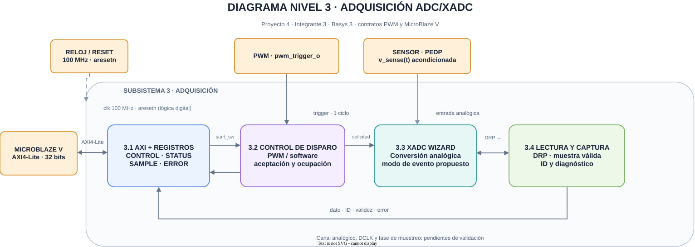

# Tercer nivel — Adquisición de corriente ADC/XADC

## Objetivo y alcance

Convertir la tensión acondicionada del ACS712 de 5 A en una muestra digital identificable para el lazo PR. La adquisición acepta solicitudes iniciadas por software o por un pulso del PWM, publica el último resultado completo para su lectura por AXI4-Lite e informa los eventos que impiden tomar o entregar una muestra. El sensor, su acondicionamiento y la calibración eléctrica se coordinan con Procesamiento Electrónico de Potencia. El cálculo PR y la conversión del código a amperios pertenecen al software.

## Arquitectura funcional

**Figura 1.** Diagrama del diseño original. La implementación usa VAUX6 en modo por evento, DCLK de 100 MHz y disparo en la fase 5000 del PWM a 10 kHz. El banco de registros incorpora `ACK_ID` en `0x10` para reconocer la muestra con su token completo de 32 bits.

El subsistema contiene una interfaz AXI4-Lite, un árbitro de disparos, la adaptación de control para XADC Wizard, una ruta de lectura DRP y registros de captura y diagnóstico. La entrada analógica acondicionada llega al XADC sin pasar por AXI. El pulso PWM sigue una conexión directa y el procesador consulta el resultado mediante registros.

La conversión no termina en el flanco del disparo. El bloque acepta un evento si está listo, espera la indicación de fin del XADC, obtiene el resultado del canal seleccionado y publica juntos código, identificador y estado. Las solicitudes recibidas durante una conversión se diagnostican como no atendidas; el PWM no se detiene para esperarlas.

## Bloques y responsabilidades

| Bloque | Función | Interfaz principal |
|---|---|---|
| AXI4-Lite y registros | Recibir el inicio por software, devolver SAMPLE, STATUS y ERROR y reconocer mediante ACK_ID | MicroBlaze V, por SmartConnect |
| Captura y arbitraje de disparos | Detectar el pulso PWM, aceptar una sola solicitud y señalar las rechazadas | `pwm_trigger_i`, solicitud por software y estado ocupado |
| Control XADC | Ejecutar una conversión por evento y seleccionar el canal de corriente | XADC Wizard y señal analógica acondicionada |
| Lectura DRP | Solicitar y recibir el registro de resultado del canal configurado | `DADDR`, `DEN`, `DRDY` y `DO` del XADC |
| Captura de muestra | Publicar código y contador de 16 bits en una lectura coherente | Resultado DRP y registros AXI |
| Diagnóstico | Indicar disparos rechazados, resultados sobrescritos y fallos de respuesta | Estado consultable por software |

## Entradas y salidas

| Señal o interfaz | Dirección | Significado |
|---|---|---|
| `s_axi_aclk` y `s_axi_aresetn` | Entrada | Reloj común de 100 MHz y reset de periférico activo bajo desde Processor System Reset |
| `vauxp6` y `vauxn6` | Entrada | Par analógico VAUX6 para la tensión acondicionada del sensor |
| `pwm_trigger_i` | Entrada | Recibe `pwm_trigger_o`, un pulso de 10 ns por período PWM habilitado |
| AXI4-Lite | Bidireccional | Inicio por software, lectura de muestra y estado, y reconocimiento por token |
| Señales de XADC Wizard y DRP | Bidireccional interna | Solicitud de conversión, fin de conversión y lectura de resultado |

El divisor de 4,7 kΩ y 1 kΩ reduce la tensión del ACS712 para el rango de medición de 0 a 1 V de VAUX6. Los pines JXADC1 (J3) y JXADC7 (K3) reciben el nodo acondicionado y su retorno, respectivamente. Los parámetros nominales del software sirven para las pruebas de modelo. La conversión a amperios en el montaje definitivo requiere medir el offset y la sensibilidad con signo. [Conexiones de Basys 3](integracion_basys3.md) · [Conversión en software](nivel_4_software.md).

## Funcionamiento general

1. Con PWM apagado, el software puede solicitar una conversión para supervisar el sensor en los estados DETENIDO y FALLA.
2. Con PWM habilitado a 10 kHz, `pwm_trigger_o` solicita la adquisición en la fase 5000, a 50 µs del inicio de cada período de 100 µs. El controlador recibe el pulso en el siguiente flanco.
3. Si el controlador está libre, acepta la solicitud. Si está ocupado, marca `missed_trigger` y conserva la conversión en curso.
4. Al completarse la conversión y la lectura DRP del canal de corriente, se captura el código, se incrementa el identificador de 16 bits y se marca el dato como válido y nuevo.
5. La ISR del Timer, atendida a través de AXI INTC, obtiene estado, código e identificador. El driver reconoce la muestra con su token completo. En operación, el software convierte el código a amperios para el PR y conserva la referencia PWM previa si la muestra se repite.

La muestra debe estar publicada antes de la lectura de la ISR. Aunque Timer y PWM operan con un período nominal de 100 µs, la fase efectiva entre ambos y la latencia hasta aplicar la referencia quedan por medir en FPGA.

## Integración y validación

- El [PWM](nivel_4_pwm.md) entrega un solo pulso `pwm_trigger_o` por período activo y no espera una señal de ocupado. La adquisición absorbe o diagnostica cada evento.
- El Block Design conecta `adc_system_axi` mediante SmartConnect en la base `0x44A00000`, con una ventana de 4 KiB. Los offsets, las respuestas AXI y el orden de lectura se detallan en el mapa del periférico.
- El contrato con [software](nivel_3_software.md) incluye código, número modular de 16 bits, dato nuevo, sobrescritura e inicio por software. SAMPLE preserva la correspondencia entre código e identificador aunque llegue otra conversión durante la transacción. STATUS y ERROR se consultan por separado; ACK_ID en 0x10 devuelve el token de 32 bits capturado con SAMPLE y permite reconocer esa publicación; los lectores y el reset deben coordinarse según el [contrato implementado](adc/mapa_registros.md).
- En laboratorio se registraron 0,426 V diferenciales y un promedio de 1748,16 códigos en reposo tras corregir el retorno de VAUX6. El cero, la sensibilidad firmada y el ruido bajo conmutación deben verificarse con el montaje definitivo. [Registro de laboratorio](../../Potencia/04_registro_laboratorio.md#referencia-analógica-y-sensor).

La integración con MicroBlaze V está implementada. El cuarto nivel resume las pruebas del periférico, la simulación conjunta PWM–ADC y la construcción ruteada. La compatibilidad con Vivado/Vitis 2025.1 sigue pendiente. [Implementación y evidencia](nivel_4_adc.md#integración-y-evidencia).

[Segundo nivel del sistema](nivel_2.md) · [Índice del diseño](README.md)
