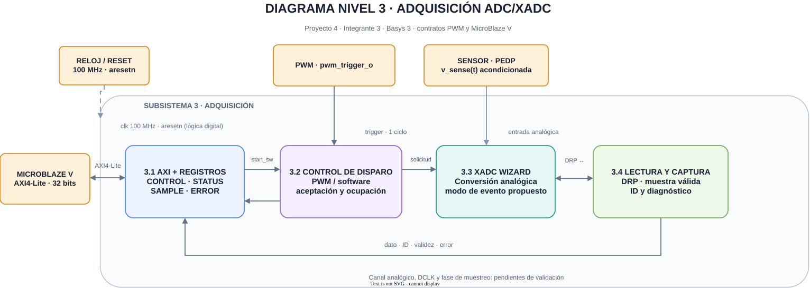

# Tercer nivel — Adquisición de corriente ADC/XADC

## Objetivo y alcance

Convertir la tensión acondicionada del sensor de corriente en una muestra digital identificable para el lazo PR. La adquisición acepta solicitudes iniciadas por software o por el pulso `pwm_trigger_o`, publica el último resultado completo para su lectura por AXI4-Lite e informa los eventos que impiden tomar o entregar una muestra. El sensor, su acondicionamiento y la calibración eléctrica se coordinan con PEDP; el cálculo PR y la conversión del código a amperios pertenecen al software.

## Arquitectura funcional

**Figura 1.** La interfaz AXI y los registros enlazan MicroBlaze V con el control de disparo. El PWM aporta un pulso directo; el sensor aporta la señal analógica acondicionada. XADC Wizard y la lectura DRP entregan el dato a la captura, que publica identificador, validez y diagnóstico.

El subsistema contiene una interfaz AXI4-Lite, un árbitro de disparos, la adaptación de control para XADC Wizard, una ruta de lectura DRP y registros de captura y diagnóstico. La entrada analógica acondicionada llega al XADC sin pasar por AXI. El pulso PWM sigue una conexión directa y el procesador consulta el resultado mediante registros.

La conversión no termina en el flanco del disparo. El bloque acepta un evento si está listo, espera la indicación de fin del XADC, obtiene el resultado del canal seleccionado y publica juntos código, identificador y estado. Las solicitudes recibidas durante una conversión se diagnostican como no atendidas; el PWM no se detiene para esperarlas.

## Bloques y responsabilidades

| Bloque | Función | Interfaz principal |
|---|---|---|
| AXI4-Lite y registros | Recibir el inicio por software y devolver SAMPLE, STATUS y ERROR | MicroBlaze V, por la interconexión AXI |
| Captura y arbitraje de disparos | Detectar el pulso PWM, aceptar una sola solicitud y señalar las rechazadas | `pwm_trigger_o`, solicitud por software y estado ocupado |
| Control XADC | Ejecutar una conversión por evento y seleccionar el canal de corriente | XADC Wizard y señal analógica acondicionada |
| Lectura DRP | Solicitar y recibir el registro de resultado del canal configurado | `DADDR`, `DEN`, `DRDY` y `DO` del XADC |
| Captura de muestra | Publicar código y contador de 16 bits en una lectura coherente | Resultado DRP y registros AXI |
| Diagnóstico | Indicar disparos rechazados, resultados sobrescritos y fallos de respuesta | Estado consultable por software |

## Entradas y salidas

| Señal o interfaz | Dirección | Significado |
|---|---|---|
| Reloj de sistema de 100 MHz y reset acondicionado | Entrada | Base de la interfaz AXI y del control digital; el reset deja la captura sin dato válido |
| Señal analógica del sensor | Entrada | Tensión acondicionada dentro del rango del canal XADC elegido |
| `pwm_trigger_o` | Entrada | Pulso de un ciclo de 100 MHz por período PWM habilitado, en la fase configurada |
| AXI4-Lite | Bidireccional | Inicio por software, lectura de código, identificador, validez y diagnóstico |
| Señales de XADC Wizard y DRP | Bidireccional interna | Solicitud de conversión, fin de conversión y lectura de resultado |

El rango admisible, la polaridad, el canal físico, la escala y el offset dependen del circuito de acondicionamiento y de la configuración final del XADC. El código bruto no representa directamente amperios ni presupone un signo. La aplicación aplica la relación de calibración documentada en el [cuarto nivel del software](nivel_4_software.md).

## Funcionamiento general

1. Con PWM apagado, el software puede solicitar una conversión para supervisar el sensor en los estados DETENIDO y FALLA.
2. Con PWM habilitado, `pwm_trigger_o` solicita la adquisición en la fase `TRIGGER_PHASE`. El árbitro reconoce el pulso en el siguiente flanco del reloj receptor.
3. Si el XADC y la ruta DRP están disponibles, se acepta la solicitud. Si están ocupados, el evento se registra en diagnóstico sin desplazar la conversión en curso.
4. Al completarse la conversión y la lectura DRP del canal de corriente, se captura el código, se incrementa el identificador de 16 bits y se marca el dato como válido y nuevo.
5. La ISR del Timer lee una muestra coherente, comprueba su identificador y convierte el código a amperios. El software conserva la referencia PWM previa si la muestra se repite.

La frecuencia del PWM, el período de control y la duración de conversión deben satisfacer el presupuesto temporal: la muestra requerida debe estar publicada antes de la lectura de la ISR. La fase del Timer respecto al PWM se mide durante la integración; compartir el reloj de 100 MHz no fija por sí solo esa fase.

## Criterios de integración

- El [PWM](nivel_4_pwm.md) entrega un solo pulso `pwm_trigger_o` por período activo y no espera una señal de ocupado. La adquisición absorbe o diagnostica cada evento.
- MicroBlaze V asigna la dirección base en el Block Design; los offsets, la respuesta AXI y el orden de lectura pertenecen al periférico ADC.
- El contrato con [software](nivel_3_software.md) incluye código, número modular de 16 bits, dato nuevo, sobrescritura e inicio por software. SAMPLE preserva la correspondencia entre código e identificador aunque llegue otra conversión durante la transacción. STATUS y ERROR se consultan por separado; el reconocimiento y la asociación de sus banderas con la muestra deben acordarse con software, como indica el cuarto nivel.
- El sensor y el acondicionamiento deben permitir reconstruir la magnitud y el signo de corriente con una calibración trazable. Se fijan canal, referencias, límites de código y escala después de validar la instrumentación.
- La latencia de disparo a dato válido, el tratamiento de eventos simultáneos y los límites de diagnóstico se verifican antes de fijar `TRIGGER_PHASE` y el período de control.

El [cuarto nivel](nivel_4_adc.md) propone la secuencia interna y un mapa de registros para acordar con plataforma y software; los parámetros eléctricos y temporales aún no se declaran validados.

[Segundo nivel del sistema](nivel_2.md) · [Índice del diseño](README.md)
