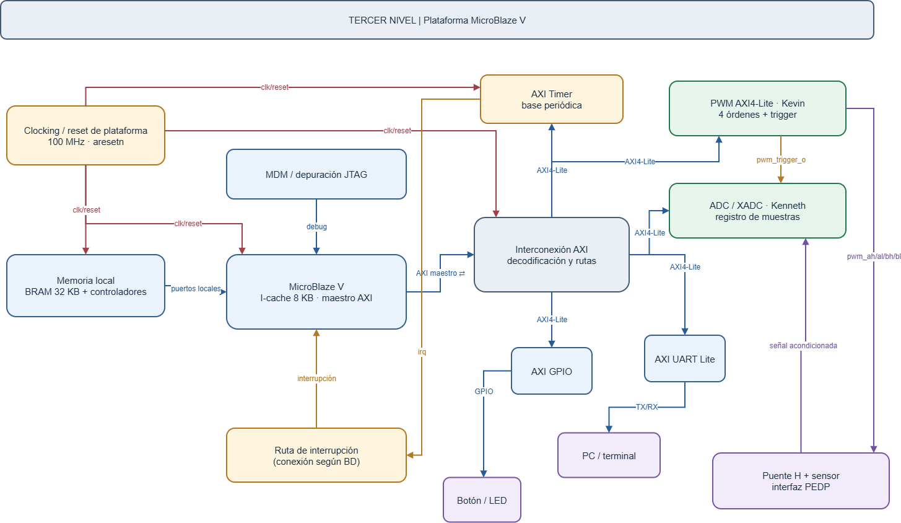

# Tercer nivel — Plataforma MicroBlaze V e integración

## Objetivo y alcance

La plataforma proporciona los recursos de procesamiento, memoria y comunicación necesarios para ejecutar el control de corriente del inversor monofásico. MicroBlaze V ejecuta la aplicación en C, accede a los periféricos mediante AXI y atiende la interrupción periódica del temporizador. La generación PWM y la conversión de corriente se realizan en sus propios bloques de hardware.

El subsistema comprende la plataforma MicroBlaze V, memoria local, interconexión AXI, AXI Timer, reloj/reset, depuración y configuración de UART/GPIO. Su integración se desarrolla en Vivado y el entorno de ejecución en Vitis. El PWM pertenece al subsistema de actuación; el ADC/XADC, al de adquisición; el PR y su rutina de atención, al software de control. Aquí se describen sus conexiones, no sus implementaciones internas.

El Block Design ya fue construido y validado con Vivado/Vitis 2026.1: MicroBlaze V tiene reloj diseñado de 100 MHz, FPU simple, caché de instrucciones de 8 KiB y una BRAM física compartida de 32 KiB. SmartConnect conecta siete destinos: INTC, Timer, UART, dos GPIO, ADC y PWM. Hay evidencia de síntesis, implementación y timing en la [integración Basys 3](integracion_basys3.md#resultados-de-la-construcción-integrada). La compatibilidad con 2025.1 y la ejecución física completa del controlador PR siguen pendientes.

## Diagrama funcional

**Figura 1.** Plataforma de ejecución y conexiones con actuación, adquisición y entorno. Los bloques de reloj/reset, memoria, depuración, procesador, interconexión, Timer y ruta de interrupción forman la infraestructura de la aplicación. PWM, ADC/XADC, PC y etapa de potencia se incluyen para mostrar sus interfaces.

Se conserva el diagrama de la propuesta inicial. Sus rótulos agrupados o pendientes no sustituyen las conexiones y direcciones implementadas: consultar la [arquitectura vigente](implementacion_microblaze.md#arquitectura-y-conexiones) y la [construcción de laboratorio](integracion_basys3.md). Esta última utiliza PWM en JA; la plataforma digital independiente conserva JC.

Las rutas AXI agrupan direcciones, datos, solicitudes y respuestas; las flechas no enumeran cada conductor. La conexión con memoria local es distinta del acceso a registros de periféricos. La interrupción y `pwm_trigger_o` también son rutas independientes de AXI. Los cruces de líneas no implican una conexión adicional si no existe un destino identificado.

## Bloques y funciones

| Bloque del diagrama | Función dentro del sistema |
|---|---|
| Clocking / reset de plataforma | Entregar la base temporal de 100 MHz y resets adecuados para cada IP |
| MicroBlaze V | Ejecutar programa, accesos de memoria, configuración de periféricos y atención de interrupciones |
| Memoria local: BRAM y controladores | Conservar programa, datos, estados del PR, pila e histórico de muestras dentro de 32 KB totales |
| MDM / depuración JTAG | Conectar las herramientas de depuración de PC con el núcleo mediante `mdm_riscv` |
| Interconexión AXI | Encaminar solicitudes y respuestas mediante SmartConnect con siete destinos |
| AXI Timer | Proporcionar la base periódica programable para la rutina de control |
| Ruta de interrupción | Llevar la solicitud del Timer a INTC y después a MicroBlaze V, en modo normal |
| AXI UART Lite | Permitir que el software exporte las muestras por el enlace serial hacia la PC |
| AXI GPIO | Exponer el botón de exportación y los indicadores a la aplicación |
| PWM AXI4-Lite | Recibir referencia/configuración y producir cuatro órdenes de actuación y un disparo de adquisición |
| ADC/XADC | Convertir la señal acondicionada y publicar la muestra y su disponibilidad para el software |

Los scripts de `scripts/vivado/` reconstruyen el Block Design; los de `scripts/vitis/` preparan la plataforma, el BSP local y las aplicaciones. Los productos se generan fuera del repositorio. `src/design/top/` contiene el wrapper de laboratorio. Los bloques funcionales pueden corresponder a IP o jerarquías del Block Design, no necesariamente a archivos SystemVerilog individuales.

## Entradas, salidas e interfaces relevantes

| Interfaz o señal | Dirección y extremos | Información y criterio de integración |
|---|---|---|
| `clk_i` / reloj de plataforma | Entrada desde la tarjeta; distribución interna | Base física de reloj; salida de sistema objetivo de 100 MHz |
| `reset_req` / resets acondicionados | Entrada desde el entorno; distribución a los IP | Solicitud funcional realizada como `reset_i` activo alto; AXI/PWM reciben reset activo bajo |
| Memoria local | Intercambio entre CPU, controladores y BRAM | Datos por DLMB al puerto A; instrucciones por `M_AXI_IC` y controlador AXI al puerto B de la misma BRAM |
| AXI maestro / AXI4-Lite | CPU → interconexión → periféricos; respuestas en sentido inverso | `M_AXI_DP` hacia SmartConnect; registros de 32 bits y mapa implementado |
| `irq` / interrupción | Timer → INTC → MicroBlaze V | Entrada de nivel en In0 y modo normal; instalación y reconocimiento mediante software |
| JTAG / debug | PC ↔ MDM V ↔ núcleo | Carga y depuración; no sustituye la UART de exportación |
| TX/RX | UART ↔ PC | UART Lite a 115200, 8N1; exportación binaria con CRC definida por el software, sin protocolo de comandos RX propio |
| GPIO | Botones e interruptores → software; software → LED y diagnóstico | Entradas de 3 y 2 bits; salidas de 4 y 1 bits; pines según la construcción seleccionada |
| `pwm_trigger_o` | PWM → adquisición | Conexión directa de un pulso de un ciclo de 100 MHz por período habilitado |
| `pwm_ah`, `pwm_al`, `pwm_bh`, `pwm_bl` | PWM → drivers del puente H | Cuatro órdenes lógicas; no son salidas generadas directamente por el procesador |
| Señal de corriente acondicionada | Sensor/interfaz PEDP → ADC/XADC | Entrada analógica; no circula por la interconexión AXI |

Esta tabla conserva los nombres funcionales del [primer nivel](nivel_1.md). Los puertos y pines reales se consultan en la [guía de implementación](implementacion_microblaze.md#puertos-y-constraints-de-diagnóstico) para la plataforma JC y en [integración Basys 3](integracion_basys3.md#conexiones) para el top de laboratorio JA; no deben mezclarse sus constraints ni ejecutables.

## Procesamiento y memoria local

MicroBlaze V ejecuta el PR discreto, la referencia sinusoidal, el registro de muestras y la exportación. Estas funciones son procedimientos de software sobre un mismo procesador, no bloques aritméticos adicionales de este subsistema. Los drivers convierten sus operaciones en accesos a registros del PWM, adquisición y demás periféricos.

La BRAM física de 32 KiB contiene programa, datos y pila en `0x00000000–0x00007FFF`. La caché de instrucciones de 8 KiB cubre ese rango por `M_AXI_IC`; los datos acceden por DLMB y no se habilita D-cache. La caché no amplía el espacio de muestras ni garantiza una latencia constante. La [construcción integrada](integracion_basys3.md#reconstrucción-y-programas) dimensiona el histórico y la pila para cada ELF; el [cuarto nivel](nivel_4_microblaze.md) explica las rutas de memoria.

El bloque `mdm_riscv` implementa la depuración compatible con MicroBlaze V. La [carga mediante JTAG](integracion_basys3.md#carga-y-verificación) relaciona bitstream, XSA y ELF de la misma construcción. La compilación y el enlace no demuestran ejecución estable; tampoco se asume que el reset borre toda la BRAM o invalide automáticamente la caché de instrucciones.

## Interconexión y periféricos

SmartConnect recibe las operaciones de `M_AXI_DP` y las dirige a los siete periféricos. El dato de retorno y la respuesta recorren la ruta inversa. La dirección absoluta es la base del periférico más el offset del registro. Los scripts asignan y comprueban el [mapa vigente](integracion_basys3.md#mapa-y-temporización), sin solapamientos.

El [PWM implementado](nivel_3_pwm.md) utiliza CONTROL, REFERENCE, DEADTIME y TRIGGER_PHASE. El software escribe la referencia Q1.15 y consulta/configura la actuación por AXI4-Lite. La generación de órdenes complementarias, el tiempo muerto y el pulso de adquisición siguen dentro del PWM; no se reproducen en la plataforma.

El ADC real recibe directamente `pwm_trigger_o` y publica el dato por registros. Disparo y disponibilidad son sucesos distintos. El [contrato ADC](adc/mapa_registros.md) define SAMPLE y el token de ACK_ID; el PWM no espera una respuesta de ADC ocupado. La calibración definitiva del offset y la ganancia firmada del sensor sigue pendiente: el código bruto no representa directamente amperios.

UART Lite y GPIO completan el intercambio con el usuario. El botón solicita exportar el histórico y los LED presentan el estado de la aplicación. UART trabaja a 115200, 8N1; la [trama de exportación](nivel_4_software.md#4-trama-de-exportación) incluye muestras y CRC. No se hereda el protocolo de los proyectos anteriores. La exportación durante el control aún requiere comprobación física.

## AXI Timer y funcionamiento conjunto

AXI Timer dispone de dos contadores independientes de 32 bits. El contador 0 proporciona la base nominal de 100 µs; el contador 1 se reserva para mediciones. La solicitud sigue Timer → In0 de AXI INTC → MicroBlaze V, con entrada de nivel y modo normal. El software instala, habilita y reconoce la interrupción; su compilación con el BSP local y la auditoría ABI no sustituyen una prueba de ejecución física.

El Timer no ejecuta el PR ni garantiza que haya una conversión terminada al interrumpir. La configuración nominal usa PWM y control a 10 kHz, con disparo en fase 5000; la disponibilidad ADC se comprobó durante los ensayos registrados. La fase efectiva Timer–PWM y el jitter siguen pendientes de medición. Los 100 MHz del reloj, los 50 Hz de referencia y la frecuencia PWM son magnitudes distintas.

La aplicación compilada inicializa memoria y drivers con el PWM deshabilitado. En cada atención lee y reconoce la muestra antes de procesar las solicitudes de arranque o parada; después ejecuta el control cuando corresponde, escribe la referencia pendiente y registra. El PWM la aplica al comienzo de período. El software organiza la exportación sin esperas bloqueantes; el lazo PR y la exportación se verificaron en el [montaje de laboratorio](../informe/README.md#operación-a-12-y-24-v).

## Justificación y relación con el cuarto nivel

Separar la temporización hardware de la aplicación evita que los tiempos de ejecución de C determinen directamente los bordes de conmutación. La memoria local conserva el estado próximo al procesador y AXI permite acceder a los periféricos sin incluir sus funciones dentro del núcleo. El Timer proporciona eventos periódicos verificables; su atención y el transporte UART deben organizarse para no bloquear el control.

El [cuarto nivel de la plataforma](nivel_4_microblaze.md) desarrolla cuatro vistas de este mismo sistema: interconexión y mapa; procesamiento, memoria y depuración; reloj/reset; y Timer/interrupciones. El detalle interno del PWM se conserva en su [documentación propia](nivel_4_pwm.md).

El Block Design, el mapa y las conexiones de memoria, depuración, reloj, reset e interrupción ya pasaron las verificaciones digitales. La [evidencia integrada](../informe/README.md#verificación-digital-e-implementación) distingue síntesis, routing, simulación y enlace del software. Permanecen las advertencias de BSP y metodología documentadas, la compatibilidad con 2025.1, la calibración, la medición temporal y el seguimiento físico del PR. Los diagramas por sí solos no demuestran esos resultados.

[Cuarto nivel: desarrollo de la plataforma](nivel_4_microblaze.md) · [Segundo nivel](nivel_2.md) · [Índice del diseño](README.md)
