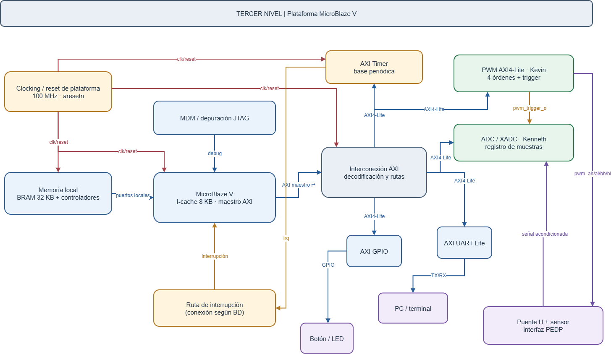

# Tercer nivel — Plataforma MicroBlaze V e integración

## Objetivo y alcance

La plataforma proporciona los recursos de procesamiento, memoria y comunicación necesarios para ejecutar el control de corriente del inversor monofásico. MicroBlaze V ejecuta la aplicación en C, accede a los periféricos mediante AXI y atiende la interrupción periódica del temporizador. La generación PWM y la conversión de corriente se realizan en sus propios bloques de hardware.

El subsistema de Daniel Puentes comprende la plataforma MicroBlaze V, memoria local, interconexión AXI, AXI Timer, reloj/reset, depuración y configuración de UART/GPIO. Su integración se desarrolla en Vivado y el entorno de ejecución en Vitis. El PWM pertenece al subsistema de actuación; el ADC/XADC, al de adquisición; el PR y su rutina de atención, al software de control. Aquí se describen sus conexiones, no sus implementaciones internas.

Se conserva la arquitectura del [segundo nivel](nivel_2.md): procesador a 100 MHz, caché de instrucciones de 8 KB y memoria local de 32 KB. Son requisitos de configuración; todavía no existe un Block Design validado ni resultados de implementación de esta plataforma en el repositorio. Los nombres agrupados del diagrama no deben interpretarse como una lista definitiva de puertos de IP.

## Diagrama funcional

**Figura 1.** Plataforma de ejecución y conexiones con actuación, adquisición y entorno. Los bloques de reloj/reset, memoria, depuración, procesador, interconexión, Timer y ruta de interrupción forman la infraestructura de la aplicación. PWM, ADC/XADC, PC y etapa de potencia se incluyen para mostrar sus interfaces.

Las rutas AXI agrupan direcciones, datos, solicitudes y respuestas; las flechas no enumeran cada conductor. La conexión con memoria local es distinta del acceso a registros de periféricos. La interrupción y `pwm_trigger_o` también son rutas independientes de AXI. Los cruces de líneas no implican una conexión adicional si no existe un destino identificado.

## Bloques y funciones

| Bloque del diagrama | Función dentro del sistema |
|---|---|
| Clocking / reset de plataforma | Entregar la base temporal de 100 MHz y resets adecuados para cada IP |
| MicroBlaze V | Ejecutar programa, accesos de memoria, configuración de periféricos y atención de interrupciones |
| Memoria local: BRAM y controladores | Conservar programa, datos, estados del PR, pila e histórico de muestras dentro de 32 KB totales |
| MDM / depuración JTAG | Conectar las herramientas de depuración de PC con el núcleo; se concretará mediante un MDM V compatible |
| Interconexión AXI | Decodificar direcciones y encaminar solicitudes y respuestas entre procesador y periféricos |
| AXI Timer | Proporcionar la base periódica programable para la rutina de control |
| Ruta de interrupción | Llevar la solicitud del Timer al mecanismo de interrupciones del procesador, según el Block Design |
| AXI UART Lite | Permitir que el software exporte las muestras por el enlace serial hacia la PC |
| AXI GPIO | Exponer el botón de exportación y los indicadores a la aplicación |
| PWM AXI4-Lite | Recibir referencia/configuración y producir cuatro órdenes de actuación y un disparo de adquisición |
| ADC/XADC | Convertir la señal acondicionada y publicar la muestra y su disponibilidad para el software |

Las carpetas `src/design/microblaze/` y `src/design/top/` están destinadas a la plataforma; `scripts/vivado/` y `scripts/vitis/`, a su reconstrucción y preparación del software. Esta organización no significa que esos procedimientos ya estén implementados. Los bloques funcionales pueden corresponder a IP o jerarquías del Block Design, no necesariamente a archivos SystemVerilog individuales.

## Entradas, salidas e interfaces relevantes

| Interfaz o señal | Dirección y extremos | Información y criterio de integración |
|---|---|---|
| `clk_i` / reloj de plataforma | Entrada desde la tarjeta; distribución interna | Base física de reloj; salida de sistema objetivo de 100 MHz |
| `reset_req` / resets acondicionados | Entrada desde el entorno; distribución a los IP | Solicitud física de polaridad pendiente; AXI/PWM usan reset activo bajo |
| Memoria local | Intercambio entre CPU, controladores y BRAM | Instrucciones, datos, direcciones y controles; interfaces concretas pendientes del Block Design |
| AXI maestro / AXI4-Lite | CPU → interconexión → periféricos; respuestas en sentido inverso | Registros de 32 bits; direcciones base y rangos por asignar |
| `irq` / interrupción | Timer → ruta de interrupción → MicroBlaze V | Solicitud de atención; conexión, habilitación y reconocimiento por definir con el software |
| JTAG / debug | PC ↔ MDM V ↔ núcleo | Carga y depuración; no sustituye la UART de exportación |
| TX/RX | UART ↔ PC | La exportación utiliza TX; la figura incluye RX sin definir todavía un protocolo de comandos |
| GPIO | Botón → GPIO → software; software → GPIO → LED | Solicitud de exportación y estado; anchos, pines y codificación pendientes |
| `pwm_trigger_o` | PWM → adquisición | Pulso de un ciclo de 100 MHz por período habilitado, según la propuesta PWM |
| `pwm_ah`, `pwm_al`, `pwm_bh`, `pwm_bl` | PWM → drivers del puente H | Cuatro órdenes lógicas; no son salidas generadas directamente por el procesador |
| Señal de corriente acondicionada | Sensor/interfaz PEDP → ADC/XADC | Entrada analógica; no circula por la interconexión AXI |

Esta tabla describe intercambios funcionales, no congela la interfaz de un futuro top. `clk_i` y `reset_req` conservan los nombres del [primer nivel](nivel_1.md). La selección de pines, los anchos de GPIO y las señales concretas de cada IP se fijarán al construir la plataforma.

## Procesamiento y memoria local

MicroBlaze V ejecuta el PR discreto, la referencia sinusoidal, el registro de muestras y la exportación. Estas funciones son procedimientos de software sobre un mismo procesador, no bloques aritméticos adicionales de este subsistema. Los drivers convierten sus operaciones en accesos a registros del PWM, adquisición y demás periféricos.

La BRAM local de 32 KB contiene programa y datos. El tamaño del histórico se determina después de considerar código, variables, estados del PR y pila. La caché de instrucciones de 8 KB se configura como recurso del procesador; no amplía la memoria disponible para almacenar muestras ni garantiza por sí sola una latencia de ejecución constante. La ruta de acceso local y la región cubierta por caché se concretan en el [cuarto nivel](nivel_4_microblaze.md), con la configuración real de Vivado.

El bloque MDM representa la función de depuración. Su realización debe utilizar el módulo compatible con MicroBlaze V y el entorno Vitis. La plataforma debe permitir cargar y ejecutar la aplicación y relacionar cada construcción de software con el hardware exportado, sin asumir que la inicialización o el reset borran automáticamente toda la memoria.

## Interconexión y periféricos

La interconexión recibe las operaciones del maestro AXI del procesador y las dirige al espacio asignado a cada periférico. El dato de retorno y la respuesta recorren la ruta inversa. Una dirección base identifica al periférico; el offset selecciona un registro dentro de él. Las direcciones absolutas se asignan en el Address Editor del Block Design y aún están pendientes.

El [contrato propuesto del PWM](nivel_3_pwm.md) utiliza CONTROL, REFERENCE, DEADTIME y TRIGGER_PHASE. El software escribe la referencia Q1.15 y consulta/configura la actuación por AXI4-Lite. La generación de órdenes complementarias, el tiempo muerto y el pulso de adquisición siguen dentro del PWM; no se reproducen en la plataforma.

La adquisición recibe directamente `pwm_trigger_o` y publica el dato por registros. Disparo y disponibilidad son sucesos distintos: el primero solicita la conversión y el segundo informa que terminó. El mapa, escala, signo y reconocimiento de muestras deben acordarse con adquisición y control. El PWM no espera una respuesta de ADC ocupado; esa situación se trata en el contrato de adquisición.

UART Lite y GPIO completan el intercambio con el usuario. El botón solicita exportar el histórico y los LED presentan el estado que escribe la aplicación. La velocidad, el formato de exportación y el uso de recepción UART siguen pendientes; no se hereda el protocolo de los proyectos anteriores.

## AXI Timer y funcionamiento conjunto

AXI Timer establece la periodicidad mediante configuración de software y genera una solicitud de interrupción. La ruta indicada como «conexión según BD» no selecciona todavía un controlador de interrupciones ni una conexión directa particular. La plataforma debe entregar un camino compatible con MicroBlaze V; el software instala y habilita su atención.

El Timer no ejecuta el PR ni garantiza que haya una conversión terminada al interrumpir. El período y la fase relativa entre disparo PWM, disponibilidad ADC y atención de la rutina forman un acuerdo del sistema. Tampoco se identifica la frecuencia de control con los 100 MHz del reloj, los 50 Hz de referencia o las frecuencias PWM de evaluación.

El funcionamiento previsto comienza con la inicialización de memoria y drivers. Con el PWM deshabilitado, la aplicación configura actuación, adquisición y temporizador; luego habilita la operación coordinada. En cada atención periódica obtiene una muestra válida, calcula el PR, escribe la referencia pendiente del PWM y registra la muestra. El PWM aplica la referencia conforme a su política de comienzo de período, mientras el software atiende la exportación sin incumplir el siguiente plazo de control.

## Justificación y relación con el cuarto nivel

Separar la temporización hardware de la aplicación evita que los tiempos de ejecución de C determinen directamente los bordes de conmutación. La memoria local conserva el estado próximo al procesador y AXI permite acceder a los periféricos sin incluir sus funciones dentro del núcleo. El Timer proporciona eventos periódicos verificables; su atención y el transporte UART deben organizarse para no bloquear el control.

El [cuarto nivel de la plataforma](nivel_4_microblaze.md) desarrolla cuatro vistas de este mismo sistema: interconexión y mapa; procesamiento, memoria y depuración; reloj/reset; y Timer/interrupciones. El detalle interno del PWM se conserva en su [documentación propia](nivel_4_pwm.md).

Antes de considerar cerrado el diseño deben validarse el Block Design, mapa de direcciones, ruta de memoria/caché, compatibilidad de MDM V, polaridades de reset y ruta de interrupción. La integración comprobará accesos, arranque y latencia medición–actuación. Estos criterios son trabajo pendiente, no resultados demostrados por los diagramas.

[Cuarto nivel: desarrollo de la plataforma](nivel_4_microblaze.md) · [Segundo nivel](nivel_2.md) · [Índice del diseño](README.md)
