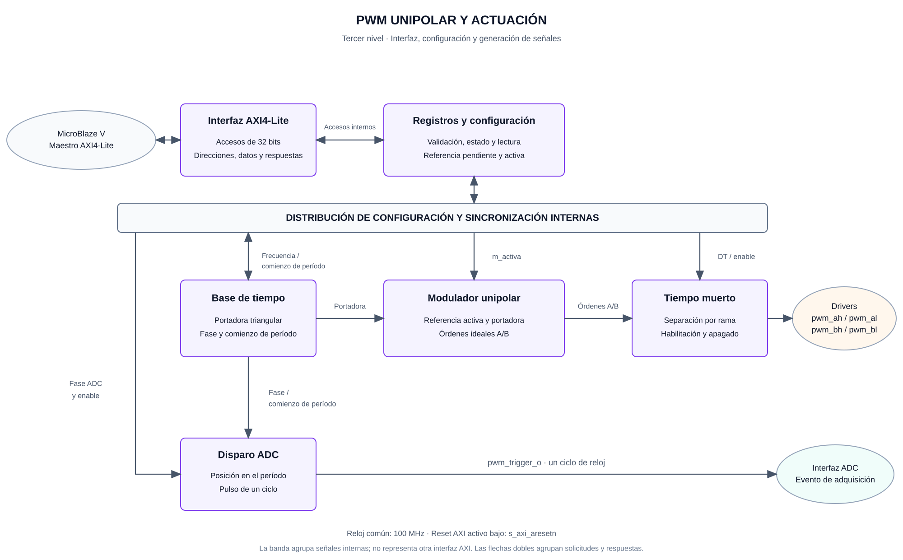

# Tercer nivel — PWM personalizado y actuación

## Objetivo

Convertir la referencia de modulación escrita por MicroBlaze V en cuatro órdenes lógicas para el puente H. El periférico genera PWM unipolar centrado, inserta tiempo muerto por rama y proporciona un evento de sincronización para la adquisición de corriente.

## Alcance y organización

El subsistema comprende la interfaz AXI4-Lite, los registros, la base de tiempo, el modulador, la inserción de tiempo muerto y el disparo de adquisición. El procesador calcula el PR; el PWM utiliza la referencia resultante para generar la actuación.

Este documento especifica una propuesta de interfaz para la integración con plataforma, adquisición y software. Las frecuencias de evaluación RTL se distinguen de los parámetros que deben justificarse con el inversor y su instrumentación.

## Diagrama del subsistema



**Figura 1.** Descomposición funcional del PWM. El banco de registros distribuye la configuración interna; la base de tiempo alimenta al modulador y al generador de disparo. La interfaz AXI devuelve las lecturas y respuestas al procesador. Las órdenes hacia los drivers pasan por la inserción de tiempo muerto.

La banda de configuración representa conexiones internas agrupadas, no una segunda interconexión AXI. Las flechas dobles agrupan solicitudes y respuestas. El reloj y el reset son comunes a los bloques secuenciales.

## Entradas y salidas externas

| Interfaz o señal | Dirección respecto al PWM | Función |
|---|---|---|
| `s_axi_aclk` | Entrada | Reloj de 100 MHz para la interfaz y la lógica PWM |
| `s_axi_aresetn` | Entrada | Reset activo bajo, con liberación sincronizada al reloj |
| Canales AXI `AW` y `W` | Recepción de dirección/dato; salida de disponibilidad | Recibir direcciones, datos y habilitaciones por byte de una escritura |
| Canal AXI `B` | Salida de respuesta; entrada de aceptación | Informar la finalización o rechazo de la escritura |
| Canal AXI `AR` | Recepción de dirección; salida de disponibilidad | Recibir una solicitud de lectura |
| Canal AXI `R` | Salida de datos/respuesta; entrada de aceptación | Entregar el valor leído y el resultado del acceso |
| `pwm_ah`, `pwm_al` | Salidas | Órdenes superior e inferior de la rama A |
| `pwm_bh`, `pwm_bl` | Salidas | Órdenes superior e inferior de la rama B |
| `pwm_trigger_o` | Salida | Evento de inicio de adquisición dirigido a la interfaz ADC |

En la interfaz lógica, uno representa una orden de activación y cero una orden inactiva. La adaptación a los drivers, la correspondencia de pines y los niveles eléctricos pertenecen a la conexión de actuación. El periférico permanece deshabilitado después del reset.

## Bloques funcionales

| Bloque | Objetivo | Entradas | Salidas |
|---|---|---|---|
| Interfaz AXI4-Lite | Completar accesos de registros | Canales de dirección, datos y aceptación de respuestas | Solicitudes internas, datos de lectura y respuestas AXI |
| Registros y control de configuración | Conservar y validar parámetros; distinguir referencia pendiente y activa | Escrituras, habilitaciones por byte, lecturas y comienzo de período | Configuración interna, referencia activa, datos de lectura y estado `running` |
| Base de tiempo | Establecer el período y la fase del PWM | Habilitación y selección de frecuencia | Portadora triangular, fase del período y evento de comienzo |
| Modulador unipolar | Obtener las órdenes previas al tiempo muerto | Portadora y referencia activa | Órdenes complementarias ideales de las ramas A y B |
| Tiempo muerto por rama | Separar las activaciones complementarias | Órdenes ideales, habilitación y tiempo muerto | Cuatro órdenes lógicas de accionamiento |
| Generador de disparo | Marcar el instante de adquisición | Fase, posición configurada y habilitación | Pulso `pwm_trigger_o` |

### Interfaz AXI y registros

La interfaz utiliza datos de 32 bits y direcciones alineadas a cuatro bytes. La dirección y los datos de escritura se aceptan por sus canales independientes; una operación se aplica una sola vez cuando se dispone de ambos. Las respuestas se mantienen hasta su aceptación. `WSTRB` determina qué bytes participan en la actualización.

Una solicitud válida devuelve `OKAY`. Un offset no implementado, un acceso desalineado o una modificación de configuración no permitida devuelve `SLVERR` y no cambia los registros. Las escrituras a campos de solo lectura o reservados se ignoran; los bits reservados se leen como cero. Una orden de apagado en CONTROL tiene prioridad: se acepta y conserva la frecuencia anterior aunque el acceso intente modificarla.

| Offset | Registro | Campos y lectura | Escritura |
|---|---|---|---|
| `0x00` | CONTROL | Bit 0: `enable`; bits 2:1: `freq_sel`; bit 3: `running` | Habilitación y frecuencia; `running` es de solo lectura |
| `0x04` | REFERENCE | Bits 15:0: última referencia aceptada y saturada, en Q1.15 | Actualiza la referencia pendiente |
| `0x08` | DEADTIME | Tiempo muerto configurado, en ciclos de 100 MHz | Se modifica con el periférico deshabilitado |
| `0x0C` | TRIGGER_PHASE | Posición del disparo, en ciclos desde el comienzo del período | Se modifica con el periférico deshabilitado |

La dirección base se asigna en el Block Design. Una escritura se evalúa después de combinar los bytes habilitados con el contenido anterior. El software escribe la referencia mediante una operación de palabra; si realiza varias transacciones parciales, cada una constituye una actualización independiente.

### Referencia de modulación

La referencia tiene 16 bits con signo, en complemento a dos. Su interpretación es `m = entero_con_signo / 32768`. Por ejemplo, 16384 representa 0,5 y −16384 representa −0,5. El rango representable es de −1 a `1 − 2⁻¹⁵`; el límite operativo puede ser menor y se establece con el diseño de actuación.

La saturación limita el valor al intervalo operativo definido. Leer REFERENCE devuelve la última referencia aceptada; durante el resto del período, la referencia activa puede conservar el valor anterior. La aplicación distingue así la escritura de una orden del instante en que se aplica.

### Base de tiempo y modulación unipolar

La base de tiempo utiliza una portadora triangular común para ambas ramas. Para el modelo ideal, antes de cuantización y tiempo muerto, los ciclos de trabajo son:

```math
d_A = \frac{1+m}{2}, \qquad d_B = \frac{1-m}{2}.
```

La tensión media diferencial ideal resulta `v_AB = Vdc · (d_A − d_B) = Vdc · m`. Las órdenes inferiores son complementarias a las superiores antes de insertar el tiempo muerto. La discretización temporal y los retardos de conmutación se consideran al analizar la actuación real.

`m=0` solicita tensión media diferencial ideal nula y puede mantener conmutación en ambas ramas. `enable=0` mantiene las cuatro órdenes inactivas. La referencia de corriente de 50 Hz se genera en software; la portadora trabaja a la frecuencia PWM seleccionada.

### Tiempo muerto

Cada rama dispone de lógica propia para apagar la orden activa y retrasar la activación de la complementaria. El intervalo se expresa en ciclos; a 100 MHz cada ciclo equivale a 10 ns. La conversión desde el tiempo requerido redondea hacia arriba para no reducir el intervalo solicitado.

El tiempo muerto físico se justifica con los transistores, drivers y condiciones de operación. El intervalo configurado y el límite de modulación deben ser compatibles con los pulsos que puede producir y aceptar el accionamiento. Las combinaciones de configuración se validan antes de habilitar la generación.

### Disparo de adquisición

El generador compara la fase del período con TRIGGER_PHASE y produce un pulso de un ciclo de 100 MHz, una vez por período habilitado. La posición debe pertenecer al período seleccionado. Con el generador deshabilitado no se emiten disparos.

Este pulso es un evento de la interfaz digital. La adquisición lo captura y adapta al inicio de conversión del XADC. El PWM no recibe una indicación de ADC ocupado: la adquisición identifica los disparos que no puede aceptar y publica el diagnóstico según su contrato. La disponibilidad y el número de muestra se consultan en el periférico ADC.

## Configuración y actualización

| Suceso | Comportamiento propuesto |
|---|---|
| Reset | Habilitación y `running` en cero; órdenes y disparo inactivos |
| Configuración en reposo | Permite cambiar frecuencia, tiempo muerto y posición del disparo; se validan sus límites |
| Habilitación | Se comprueba la coherencia de la configuración y se inicia la base de tiempo desde el comienzo del período |
| Escritura de referencia durante operación | Se almacena como pendiente y se aplica al comienzo del siguiente período |
| Varias referencias antes del comienzo | Se conserva la última escritura aceptada |
| Configuración de frecuencia, tiempo muerto o fase durante operación | Se rechaza; una orden de apagado en CONTROL se acepta conservando la frecuencia |
| Deshabilitación | Desactiva la actuación sin esperar a completar el período PWM |

`running` indica que la base de tiempo y la modulación están activas; no implica que una salida concreta esté en alto. El comienzo de período informa al control de configuración para transferir la referencia pendiente. Si coincide una escritura, se aplica la pareja de referencia y umbrales pendiente anterior; la nueva escritura queda para el siguiente período, conforme al [cuarto nivel](nivel_4_pwm.md#referencia-pendiente-y-activa).

## Frecuencias de evaluación RTL

La propuesta de ensayos digitales utiliza tres frecuencias que pueden representarse con un número entero de ciclos. Si `N` es la duración de medio período, la frecuencia es `100 MHz / (2 · N)`.

| `freq_sel` | Frecuencia de portadora | Período | Ciclos por período | `N` |
|---|---:|---:|---:|---:|
| `00` | 10 kHz | 100 µs | 10000 | 5000 |
| `01` | 20 kHz | 50 µs | 5000 | 2500 |
| `10` | 25 kHz | 40 µs | 4000 | 2000 |
| `11` | Selección inválida | — | — | — |

Estos valores sirven para evaluar la lógica y sus cambios de configuración. Las frecuencias utilizadas en el inversor se justifican con PLECS, rizado, pérdidas y componentes. El tiempo muerto, el límite de modulación, la fase de adquisición y el período de control se obtienen del diseño coordinado de potencia, instrumentación y software.

## Criterios de verificación

- Accesos AXI con dirección y datos en distinto orden, escrituras por bytes y respuestas retenidas.
- Lecturas de registros, bits reservados y rechazo de accesos inválidos.
- Períodos seleccionados y actualización coherente de la referencia.
- Referencias positivas, negativas, cero y extremos de saturación.
- Ausencia de activación simultánea de órdenes complementarias y cumplimiento del tiempo muerto.
- Habilitación, deshabilitación y reset en distintas fases.
- Un disparo por período y coincidencia con la posición configurada.
- Simulación temporizada del periférico implementado y observación de sus salidas.

Las pruebas se almacenan en `src/testbench/pwm/`. El [cuarto nivel](nivel_4_pwm.md) desarrolla registros, contadores, comparadores, estados y prioridades a partir de estas funciones.

## Referencias

- Instructivo conjunto del Proyecto 4 de EL3313 y EL4201, secciones 4.2.2–4.2.4 y 6–7.
- [Arm, especificación AXI y AXI4-Lite, parte B1](https://developer.arm.com/-/media/Arm%20Developer%20Community/PDF/IHI0022H_amba_axi_protocol_spec.pdf).
- [AMD, comprobaciones de protocolo AXI](https://docs.amd.com/r/en-US/pg267-axi-vip/AXI-Protocol-Checks-and-Descriptions).
- [Imperix, operación del inversor monofásico y modulación de tres niveles](https://imperix.com/doc/implementation/introduction-to-single-phase-inverter).
- [AMD, muestreo por eventos del XADC](https://docs.amd.com/r/en-US/ug480_7Series_XADC/Event-Driven-Sampling).

[Segundo nivel: arquitectura del sistema](nivel_2.md) · [Índice del diseño](README.md)
