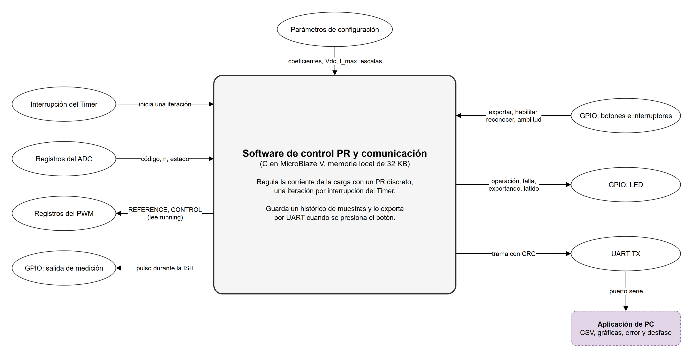
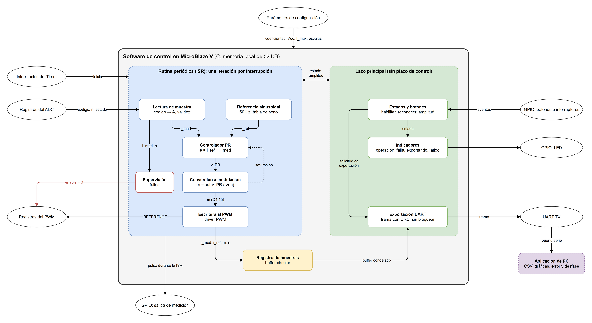
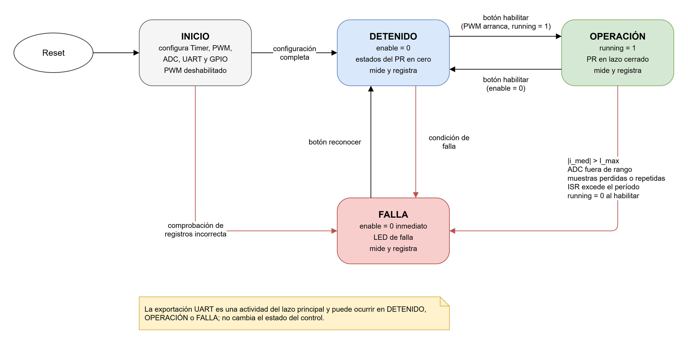

# Tercer nivel — Software de control PR y comunicación

## Objetivo

Ejecutar en MicroBlaze V el lazo de control de corriente del inversor. En cada interrupción del Timer, el software obtiene la muestra de corriente, calcula el PR discreto y escribe la referencia de modulación en el PWM. También conserva un histórico de muestras y lo exporta por UART a la PC cuando el usuario lo solicita, sin interrumpir el control.

## Alcance y organización

El subsistema comprende la aplicación en C y la herramienta de PC:

- inicialización de los periféricos;
- rutina periódica de control;
- referencia sinusoidal;
- controlador PR;
- conversión a la referencia de modulación;
- registro de muestras;
- estados de operación y fallas;
- exportación UART;
- recepción y análisis en la PC.

Los drivers de PWM y adquisición se escriben con los contratos de cada periférico y se coordinan con sus responsables.

## El subsistema como caja negra



**Figura 1.** El software de control visto desde afuera: qué recibe y qué entrega, sin su estructura interna.

## Diagrama del subsistema



**Figura 2.** Descomposición funcional del software.


## Entradas y salidas

| Interfaz | Dirección respecto al software | Información |
|---|---|---|
| Interrupción del Timer | Entrada | Evento periódico que inicia una iteración del control |
| Registros del ADC | Entrada (lectura AXI) | Código de la muestra, número de muestra y estado (dato nuevo, sobrescritura) |
| Registros del PWM | Salida y lectura AXI | CONTROL, REFERENCE, DEADTIME y TRIGGER_PHASE; lectura de `running` |
| GPIO: botones e interruptores | Entrada | Solicitud de exportación, habilitación del control, reconocimiento de falla y amplitud de referencia |
| GPIO: LED | Salida | Operación, falla, exportación en curso y latido |
| GPIO: salida de medición | Salida | Pulso durante la rutina de control, para medir período y duración con osciloscopio |
| UART Lite | Salida (TX) | Trama de exportación hacia la PC |
| Parámetros de configuración | Entrada (tiempo de compilación) | Coeficientes PR, Vdc, I_max, frecuencias, período de control, límite de modulación y escala del ADC |

Los parámetros que dependen del montaje se reúnen en un único archivo de configuración. Un cambio de ganancias, de carga o de frecuencia no modifica la lógica del programa.

## Bloques funcionales

| Bloque | Objetivo | Entradas | Salidas |
|---|---|---|---|
| Inicialización | Llevar el sistema a un estado conocido con la actuación apagada | Parámetros de configuración | Periféricos configurados, estado del PR en cero y estado DETENIDO |
| Rutina periódica (ISR) | Ejecutar siempre la misma secuencia en cada período de control | Interrupción del Timer | Llamadas ordenadas a los bloques del lazo y reconocimiento de la interrupción |
| Lectura de muestra | Obtener una corriente válida en amperios | Registros del ADC y escala | `i_med` en A, número de muestra e indicación de validez |
| Referencia sinusoidal | Generar `i_ref` de 50 Hz | Amplitud seleccionada y fase actual | `i_ref` en A y fase siguiente |
| Controlador PR | Calcular la tensión de salida a partir del error | `e = i_ref − i_med`, estados internos e indicación de saturación | `v_PR` en V y estados actualizados |
| Conversión a modulación | Transformar la tensión en la referencia del PWM | `v_PR`, Vdc y límite de modulación | `m` saturada en Q1.15 e indicación de saturación |
| Escritura al PWM | Entregar la referencia al periférico | `m` en Q1.15 | Escritura en REFERENCE |
| Supervisión | Detectar condiciones inseguras y aplicar el estado de falla | `i_med`, validez de la muestra y tiempo de la ISR | Estado de la aplicación y apagado del PWM |
| Registro de muestras | Conservar el histórico para su análisis | `i_med`, `i_ref`, `m` y número de muestra | Buffer circular en memoria local |
| Lazo principal | Atender lo que no tiene plazo de control | Botones, estado y buffer | Cambios de estado, LED y exportación |
| Exportación UART | Enviar el histórico sin bloquear el control | Buffer congelado y parámetros del ensayo | Trama por TX |
| Aplicación de PC | Recibir y analizar el ensayo | Trama recibida por el puerto serie | Archivos de datos, gráficas, amplitud de la fundamental, error y desfase |

### Rutina periódica y lazo principal

El trabajo se divide en dos contextos.

**La ISR** contiene todo lo que tiene plazo: leer la muestra, calcular la referencia y el PR, escribir el PWM, supervisar y registrar. Su orden es fijo:

1. Leer y validar la muestra.
2. Calcular `i_ref`.
3. Calcular el PR.
4. Convertir a `m` y escribir REFERENCE.
5. Registrar la muestra.
6. Reconocer la interrupción.

La escritura al PWM va antes del registro para no retrasar la actuación con operaciones que no la afectan.

**El lazo principal** atiende botones, LED y exportación. Puede ser interrumpido en cualquier punto, y ninguna de sus operaciones espera a la UART dentro de la ISR.

Las variables que comparten ambos contextos son pocas y se declaran `volatile`: estado de la aplicación, solicitudes de habilitación, amplitud solicitada e indicación de buffer congelado. El contenido del buffer solo lo lee el lazo principal mientras está congelado, cuando la ISR no escribe en él. Las que escribe el lazo principal y lee la ISR son de 32 bits o menos y se actualizan en una sola escritura.

### Aritmética

El controlador se implementa en punto flotante de 32 bits (`float`) con la FPU de MicroBlaze V (extensión F). Así, los coeficientes y las variables conservan las unidades del diseño de PEDP (A y V), y la comparación con PLECS es directa. Además, el cálculo se ejecuta en un número de ciclos acotado sin analizar escalas ni desbordes intermedios.

Solo las interfaces con el hardware usan enteros: el código del ADC, la referencia Q1.15 y las muestras de 16 bits del registro. Si la plataforma no puede incluir la FPU, se cambia a punto fijo Q15/Q31 con las mismas interfaces de bloque.

### Referencia sinusoidal

La referencia es `i_ref[k] = A · sin(θ[k])`, con `θ[k+1] = θ[k] + 2π · 50 Hz · Ts` (módulo 2π), donde `Ts` es el período de control. El seno se obtiene de una tabla en memoria indexada por la fase, sin llamar a `sinf()` en la ISR. Así, el tiempo de cálculo es constante y la biblioteca matemática no ocupa memoria. El tamaño de la tabla se elige para que el error de amplitud por cuantización sea despreciable frente al criterio de 10 %.

La amplitud A toma 0,2, 0,5 o 1,0 A pico según los interruptores. Un cambio solicitado se aplica en el siguiente cruce por cero de la referencia, de modo que los ensayos de cambio de amplitud (0,2 → 0,5 A y 0,5 → 1,0 A) comienzan sin un salto en `i_ref`. La fase avanza en cada iteración de OPERACIÓN, también si la muestra se repite, porque la referencia depende del tiempo y no del número de muestras recibidas.

### Controlador PR

La estructura de referencia es el PR no ideal:

```math
G_{PR}(s) = K_p + \frac{2 K_r \omega_c s}{s^2 + 2\omega_c s + \omega_0^2}, \qquad \omega_0 = 2\pi \cdot 50\ \text{rad/s}.
```

Discretizada, la parte resonante es una ecuación en diferencias de segundo orden:

```math
r[k] = b_0 e[k] + b_1 e[k-1] + b_2 e[k-2] - a_1 r[k-1] - a_2 r[k-2], \qquad v_{PR}[k] = K_p e[k] + r[k].
```

El código implementa esta forma general con los coeficientes `b0, b1, b2, a1, a2` y `Kp` como parámetros. Así funciona con cualquier método de discretización que elija PEDP (por ejemplo, Tustin con pre-warping en 50 Hz) sin cambiar la lógica. Los estados `e[k-1]`, `e[k-2]`, `r[k-1]` y `r[k-2]` se ponen en cero al pasar a DETENIDO o FALLA.

**Anti-windup:** cuando la conversión a modulación satura y el error tiene el mismo signo que `v_PR`, la parte resonante no actualiza sus estados en esa iteración (integración condicional). Así se evita que acumule un error que la actuación no puede corregir. Si el error tiene el signo opuesto, los estados se actualizan, porque ese error ayuda a salir de la saturación.

### Conversión a modulación

En PWM unipolar, la tensión media aplicada a la carga es `v_AB = Vdc · m`. Por lo tanto:

```math
m = \text{sat}\left(\frac{v_{PR}}{V_{dc}}\right), \qquad \text{entero}_{Q1.15} = \text{round}(m \cdot 32768).
```

El software satura `m` al mismo límite `MOD_LIMIT_Q15` que aplica el PWM y entrega la indicación de saturación al anti-windup. La saturación del periférico se mantiene como protección, pero no reemplaza la del software, porque el PR necesita saber que su salida fue recortada. La ISR escribe REFERENCE en una sola operación de 32 bits.

### Registro de muestras

El registro es un buffer circular en la memoria local. Cada entrada guarda en 16 bits:

- la corriente medida;
- la referencia;
- la modulación aplicada;
- el número de muestra del ADC.

Con el número de muestra, la PC detecta saltos o repeticiones. Fuera de OPERACIÓN no hay referencia ni PR, y se registran `i_ref` y `m` en cero.

El análisis exige al menos cinco períodos de 50 Hz (100 ms). Si el control corre a una frecuencia alta, guardar todas las iteraciones no cabe en los 32 KB compartidos con el programa. Por eso se registra una de cada `k` iteraciones, con `k` elegido para que:

```math
N_{buf} \cdot k \cdot T_s \geq 100\ \text{ms}.
```

`N_buf` y `k` se fijan cuando se conozca el tamaño del programa; la tabla de la sección de pendientes resume esa dependencia. Al solicitar una exportación, el buffer se congela: la ISR sigue controlando, pero deja de escribir en él hasta terminar el envío.

### Exportación UART y aplicación de PC

Al presionar el botón de exportación, el lazo principal congela el buffer y construye una trama binaria con:

- un encabezado de sincronización;
- los parámetros del ensayo (frecuencia de conmutación, período de control, amplitud, `k`, causa de falla y duración máxima de la ISR);
- las muestras en orden cronológico;
- un CRC.

La trama se envía escribiendo en la FIFO de UART Lite solo cuando tiene espacio. Si no lo tiene, el lazo principal sigue con sus otras tareas y vuelve a intentarlo más tarde. Al terminar, el buffer se descongela.

La aplicación de PC recibe la trama, comprueba el CRC y guarda los datos en archivos binarios y CSV. Con una ventana de al menos cinco períodos, calcula:

- la amplitud de la fundamental;
- el error relativo respecto a la referencia;
- el desfase;
- el residuo de baja frecuencia, que queda al restar la fundamental.

La muestra se toma en el valle de la portadora, donde la corriente coincide con su valor medio en el período, y se registra a 8–10 kHz como máximo. Por eso el histórico representa la componente de baja frecuencia y no el rizado de conmutación. El rizado pico a pico que pide el enunciado se mide con el osciloscopio.

### Estados de la aplicación



**Figura 3.** Estados de la aplicación de control. La exportación es una actividad del lazo principal que puede ocurrir en DETENIDO, OPERACIÓN o FALLA, por lo que no se representa como un estado del control.

| Estado | PWM | Rutina periódica | Sale con |
|---|---|---|---|
| INICIO | Deshabilitado | Sin habilitar | Fin de la configuración → DETENIDO; lectura de comprobación de los registros incorrecta → FALLA |
| DETENIDO | `enable=0`, órdenes inactivas | Lee y registra la corriente sin controlar; estados del PR en cero | Botón de habilitación → OPERACIÓN; condición de falla → FALLA |
| OPERACIÓN | Habilitado, `running=1` | Control en lazo cerrado | Botón de habilitación → DETENIDO; condición de falla → FALLA |
| FALLA | `enable=0` escrito en la misma iteración en que se detecta | Lee y registra la corriente sin controlar | Botón de reconocimiento → DETENIDO |

Condiciones de falla:

- sobrecorriente `|i_med| > I_max`;
- código del ADC fuera de rango;
- varias muestras seguidas perdidas o repetidas, según el número de muestra;
- una iteración de la ISR que no termina antes de la siguiente interrupción;
- `running` que no sube después de habilitar el PWM.

Las cuatro primeras se vigilan en DETENIDO y en OPERACIÓN, de modo que un sensor desconectado o un ADC que no responde se detecta antes de habilitar la potencia. La comprobación de `running` se hace solo al habilitar.

La falla nunca regresa directamente a OPERACIÓN: el operador la reconoce y vuelve a habilitar desde DETENIDO.

En DETENIDO y FALLA la rutina sigue leyendo la corriente. Así se puede comprobar el offset del sensor con la potencia apagada y conservar en el histórico lo ocurrido alrededor de una falla.

## Temporización de una iteración

Una iteración relaciona cinco instantes:

1. el disparo del PWM;
2. el dato del ADC disponible;
3. la interrupción del Timer;
4. la escritura de REFERENCE;
5. el inicio del siguiente período PWM, cuando la referencia se aplica.

El Timer y el PWM comparten el reloj de 100 MHz. Si el período de control es igual a un número entero de períodos PWM, la fase entre ambos se mantiene constante, pero depende del instante de arranque.

La propuesta es:

- configurar TRIGGER_PHASE para que la conversión termine antes de la interrupción;
- que la ISR lea siempre la última muestra disponible y compruebe con su número que sea nueva.

El retardo total entre muestreo y aplicación es de aproximadamente un período de control, y lo usa PEDP en su análisis de estabilidad.

El presupuesto de la ISR (atención, lectura, cálculo, escritura, registro y reconocimiento) debe ser menor que el período de control, con margen para el lazo principal. Se mide con la salida GPIO de medición: se activa al entrar a la ISR y se desactiva al salir. En el osciloscopio se ven el período efectivo, el jitter y la duración, que son los indicadores de la prueba de precisión temporal del enunciado.

## Interfaces con los demás subsistemas

| Interfaz | Acordado | Pendiente |
|---|---|---|
| Software–PWM (Aguilar) | Registros CONTROL, REFERENCE, DEADTIME y TRIGGER_PHASE; `m` en Q1.15; aplicación de la referencia al inicio del período; SLVERR ante configuraciones inválidas; reconfiguración solo con el PWM apagado | Valor de `MOD_LIMIT_Q15` y frecuencias definitivas |
| Software–adquisición (Campos) | Muestra disparada por `pwm_trigger_o` y leída por AXI | Registros, lectura coherente de muestra y número, bits de dato nuevo y sobrescritura, escala a amperios y latencia de conversión |
| Software–plataforma (Puentes) | 100 MHz, 32 KB de memoria local, AXI Timer con recarga e interrupción, UART Lite y GPIO | FPU, controlador de interrupciones, direcciones base, velocidad de UART, asignación de botones, interruptores y LED, y salida de medición |
| Software–PEDP | El PR se ejecuta en MicroBlaze V | Coeficientes, período de control, Vdc, I_max y retardo admisible |

La secuencia de arranque del PWM que usa el software respeta su contrato:

1. `enable=0`.
2. Escribir DEADTIME y TRIGGER_PHASE.
3. Escribir REFERENCE=0.
4. Escribir CONTROL con la frecuencia y `enable=1`.
5. Comprobar `running=1`.

Después de escribir DEADTIME, TRIGGER_PHASE y REFERENCE, el software los lee de vuelta y comprueba el valor. Un valor distinto, o `running=0` después de habilitar, lleva a FALLA. El periférico responde SLVERR ante una configuración inválida, pero desde C esa respuesta solo se observa si la plataforma la convierte en una excepción de acceso; la lectura de comprobación no depende de esa configuración.

## Estrategia de implementación

El desarrollo avanza de lo que se puede probar en la PC hacia lo que necesita la tarjeta:

1. **Bloques de control en C puro**: referencia, PR, conversión a modulación, registro de muestras y trama. No dependen de MicroBlaze, así que se compilan y prueban en la PC con un modelo discreto de la carga RL antes de que exista la plataforma.
2. **Aplicación de PC**: recepción, validación y análisis, probada con tramas generadas por el paso 1.
3. **Drivers**: PWM, ADC, GPIO y UART sobre la plataforma de Puentes, comprobando lecturas, escrituras y respuestas de cada periférico por separado.
4. **Rutina periódica**: Timer e interrupción con la salida de medición, verificando período, jitter y duración antes de cerrar el lazo.
5. **Lazo completo**: primero con la etapa de potencia desenergizada, revisando las compuertas y el tiempo muerto como exige PEDP; después con la carga y los ensayos de corriente.

Cada paso se integra en la rama `kCortes` mediante un issue y un pull request propio.

## Plan de pruebas

| Prueba | Entorno | Criterio de aceptación |
|---|---|---|
| Referencia | PC | Amplitud y frecuencia correctas; el cambio de amplitud ocurre en el cruce por cero |
| PR contra modelo | PC | La respuesta a un escalón y a una sinusoide coincide con la ecuación en diferencias calculada aparte |
| Lazo con modelo RL | PC | En régimen permanente, error de amplitud de la fundamental ≤ 10 % para 0,2, 0,5 y 1,0 A, y con R + 25 % |
| Saturación y anti-windup | PC | `m` nunca supera el límite; al salir de saturación no hay sobreimpulso por acumulación |
| Conversión Q1.15 | PC | Extremos, cero y redondeo correctos, incluido el valor negativo máximo |
| Registro de muestras | PC | Orden cronológico, submuestreo `k` y congelamiento durante la exportación |
| Trama y aplicación de PC | PC | Trama válida reconstruida sin pérdidas; CRC incorrecto y trama cortada rechazados |
| Drivers | Tarjeta | Lecturas y escrituras de registros; arranque del PWM; una configuración inválida se detecta con la lectura de comprobación y lleva a FALLA |
| Temporización | Tarjeta | Período efectivo de la ISR igual al configurado; jitter y duración medidos con el osciloscopio, también durante la exportación |
| Estados y fallas | Tarjeta | Sobrecorriente simulada, muestras perdidas y botón de reconocimiento llevan a los estados esperados con el PWM apagado |
| Exportación durante el control | Tarjeta | Los números de muestra no muestran pérdidas mientras se transmite |

Las pruebas de PC terminan con un código de error ante cualquier falla y guardan su registro en `docs/informe/resultados/`.

## Pendientes

| Decisión | Depende de | Afecta a |
|---|---|---|
| Activar la FPU | Puentes | Aritmética del PR |
| Período de control y fase de TRIGGER_PHASE | Los cuatro y PEDP | ISR, referencia, coeficientes y retardo |
| Registros y escala del ADC | Campos | Lectura de la muestra y supervisión |
| `MOD_LIMIT_Q15` | Aguilar y PEDP | Saturación y anti-windup |
| Coeficientes del PR, Vdc e I_max | PEDP | Controlador, conversión a modulación y fallas |
| Direcciones, interrupción, UART y GPIO | Puentes | Drivers y lazo principal |
| `N_buf` y `k` | Tamaño del programa | Registro y exportación |


[Segundo nivel: arquitectura del sistema](nivel_2.md) · [Índice del diseño](README.md)
