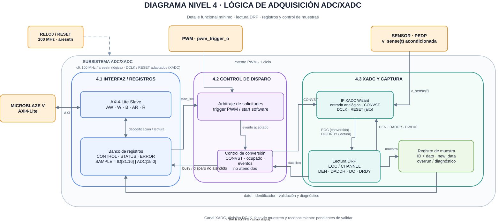

# Cuarto nivel — Control de conversión y captura ADC/XADC

Este documento desarrolla la [arquitectura de adquisición](nivel_3_adc.md). El mapa y las secuencias siguientes son una propuesta de contrato para revisión con plataforma, PWM y software; no fijan todavía el canal analógico, las direcciones base ni la latencia real del IP configurado.

**Figura 1.** El esclavo AXI4-Lite conecta el banco de registros con MicroBlaze V. El arbitraje recibe `pwm_trigger_o` e inicio por software; el control de conversión propone `CONVST` hacia XADC Wizard. La lectura DRP obtiene el resultado y el registro de muestra publica conjuntamente identificador y dato. El reloj/reset de la lógica y `DCLK`/`RESET` del XADC aparecen separados.

## 1. Interfaz AXI4-Lite y banco de registros

La interfaz esclava usa datos de 32 bits y offsets alineados a cuatro bytes. Los canales AW y W se aceptan de manera independiente; la escritura se ejecuta una sola vez cuando están disponibles dirección y dato. Las respuestas B y R permanecen válidas hasta su aceptación. `WSTRB` determina los bytes escritos. Un offset no implementado o desalineado devuelve `SLVERR` y no altera el estado. Los bits reservados se leen como cero.

| Offset | Registro | Lectura | Escritura |
|---|---|---|---|
| `0x00` | CONTROL | Cero en el bit 0; demás bits reservados | Bit 0 `start_sw`: escribir 1 solicita una conversión; escritura de pulso, sin estado retenido |
| `0x04` | STATUS | Bits 0 `valid`, 1 `new_data` y 2 `busy`; otras posiciones pendientes de acuerdo | Solo lectura |
| `0x08` | SAMPLE | Bits 15:0 `adc_data`, bits 31:16 `sample_id`; ambos de la misma conversión | Solo lectura |
| `0x0C` | ERROR | Indicadores de disparo no atendido, sobrescritura y fallo de conversión/lectura; posiciones y reconocimiento pendientes | Por acordar |

`STATUS.valid` indica que existe al menos una conversión publicada desde el reset. `STATUS.new_data` anuncia una publicación posterior a la muestra reconocida, según la política que se acuerde. STATUS puede cambiar antes de leer SAMPLE; el driver usa `sample_id` para comprobar la novedad. La lectura única de SAMPLE siempre devuelve un par `adc_data`/`sample_id` atómico, aunque llegue otra conversión durante el acceso. La semántica exacta de reconocimiento de `new_data` está pendiente con software.

ERROR debe permitir distinguir un evento no atendido, una muestra sobrescrita antes de su lectura y un fallo de conversión o lectura DRP. La persistencia de banderas, los mecanismos de reconocimiento y los contadores se acordarán antes de implementar el driver. El software también puede determinar pérdidas a partir de la diferencia modular entre valores `sample_id`.

El registro CONTROL no deshabilita el disparo PWM; este proviene de la habilitación del PWM. En reposo del PWM, la ISR inicia la siguiente conversión escribiendo `start_sw=1`. Un intento mientras `busy=1` debe quedar diagnosticado. La respuesta AXI confirma la escritura; no promete que la conversión fue aceptada. El driver comprueba STATUS y el avance de `sample_id`.

## 2. Control de adquisición y prioridad de disparos

El pulso `pwm_trigger_o` se muestrea en el siguiente flanco de 100 MHz. Si software y PWM solicitan en el mismo ciclo, el arbitraje debe escoger una solicitud y diagnosticar la otra; la prioridad está pendiente de acuerdo. Con el bloque ocupado, ninguna solicitud nueva modifica la conversión en curso; cada evento no atendido se indica mediante ERROR. No se presupone una cola que desplace el instante de muestreo.

El control de conversión propone `CONVST` como inicio por evento del XADC Wizard. Su polaridad, duración y relación con el instante real de muestreo dependen de la configuración final del IP. `busy` permanece alto desde la aceptación hasta la publicación. El reset invalida la muestra y limpia el estado de error. La lógica debe impedir que una indicación de fin previa al disparo se interprete como final de la conversión actual.

## 3. XADC Wizard y lectura DRP

XADC Wizard se configura para el canal de corriente que se acuerde con la instrumentación y para un modo que permita iniciar conversiones por evento. La señal del sensor se acondiciona según el rango y las restricciones del canal elegido. Ni el ancho efectivo del dato ni su posición dentro del registro DRP se asumen a partir de un dibujo: se extraen de la configuración y de la documentación del IP seleccionado.

`EOC` indica fin de conversión, pero todavía no garantiza que el dato leído mediante DRP esté listo. Tras `EOC`, el controlador coloca en `DADDR` la dirección del registro del canal, activa `DEN` con `DWE=0` y espera `DRDY` antes de capturar `DO`. Si el IP informa `CHANNEL`, se comprueba que corresponda al canal de corriente. La publicación se retrasa hasta tener el resultado. El formato de los 16 bits de `adc_data`, incluidos los bits sin información, se documenta con la configuración real del IP para que el driver ajuste offset y ganancia correctamente.

La latencia máxima de conversión y DRP, y la relación entre reloj del sistema y reloj requerido por XADC, se determinan al configurar el IP. Si se usan dominios distintos, el pulso de disparo y las señales de resultado se transfieren con sincronización y confirmación explícitas; no se supone que un pulso de un ciclo atraviese por sí solo el límite de reloj.

## 4. Captura, identificador y diagnóstico

La publicación actualiza `adc_data` y `sample_id` en el mismo flanco. `sample_id` es un contador modular de 16 bits que aumenta una vez por resultado completo, independientemente de si lo inició PWM o software; no aumenta por solicitudes rechazadas. El primer resultado después del reset tiene `sample_id=1`. La aplicación compara `(sample_id - sample_id_anterior) mod 2^16` con el número de conversiones esperado por iteración; después de cambiar el origen del disparo debe tolerar la transición descrita en el [software de cuarto nivel](nivel_4_software.md).

`valid` permanece en uno después del primer resultado hasta reset. `new_data` se vuelve uno al publicar y su reconocimiento sigue la política pendiente de STATUS. Una sobrescritura antes del reconocimiento y un disparo no atendido se reflejan en ERROR sin alterar el identificador por sí solos.

La ausencia de `EOC` o `DRDY` requiere un límite de espera calculado con la configuración real del IP. Al vencerlo, el bloque conserva la última muestra válida y registra el fallo en ERROR, sin publicar un resultado incompleto. El valor del límite y la recuperación se añaden al contrato cuando se mida la latencia.

## 5. Reloj, reset e integración temporal

AXI, captura de disparo y registros usan el reloj de sistema de 100 MHz proporcionado por la plataforma. El reset de AXI es activo bajo y su liberación se sincroniza con ese reloj, conforme al contrato de plataforma. XADC recibe el reloj y reset que exija la configuración de Wizard; la adaptación entre dominios se verifica en el Block Design.

La posición `TRIGGER_PHASE` del [PWM](nivel_4_pwm.md) debe dejar tiempo suficiente para conversión, lectura DRP y publicación antes de la ISR del Timer. También debe respetar el instante de medición acordado con PEDP. La relación exacta entre el valle de la portadora, el disparo y el inicio real del muestreo se comprueba con la configuración final del XADC; un pulso registrado por PWM no demuestra por sí solo que la muestra se tomó en ese mismo ciclo.

## 6. Estrategia de validación

| Caso | Resultado esperado |
|---|---|
| Reset y primera conversión | `valid=0` inicialmente; primer resultado publica `sample_id=1` y un código coherente |
| AXI con AW y W separados, backpressure y `WSTRB` | Una sola orden por escritura; respuestas estables hasta aceptación; accesos inválidos sin cambios de estado |
| Solicitud por software con PWM apagado | Un resultado nuevo y contador aumentado una vez, sin depender de disparos PWM |
| Pulso PWM y coincidencia con software | Se acepta una sola solicitud según la prioridad acordada; la restante queda registrada como no atendida |
| Disparo durante `busy` | Conversión vigente intacta; el evento no atendido se refleja en ERROR |
| Nueva publicación que sustituye una muestra no reconocida | ERROR indica sobrescritura; SAMPLE siempre entrega un par dato/identificador consistente |
| Lectura simultánea con publicación | El valor leído es el anterior o el nuevo completo |
| Vuelta de `sample_id` de `0xFFFF` a cero | La diferencia modular permite reconocer continuidad sin una falsa pérdida |
| XADC/DRP | `EOC`, `CHANNEL`, `DEN`, `DADDR`, `DWE=0`, `DRDY` y `DO` corresponden al canal elegido; latencia medida para cada modo previsto |
| Integración Timer–PWM–ADC | El dato requerido está listo antes de la ISR; no hay solicitudes rechazadas en operación nominal |

Estas son comprobaciones pendientes para RTL, simulación e integración. La elección de canal, los límites eléctricos, el presupuesto temporal y el mapa de registros deben confirmarse con los responsables antes de implementar drivers o conectar la etapa de potencia.

[Tercer nivel de adquisición](nivel_3_adc.md) · [Índice del diseño](README.md)
