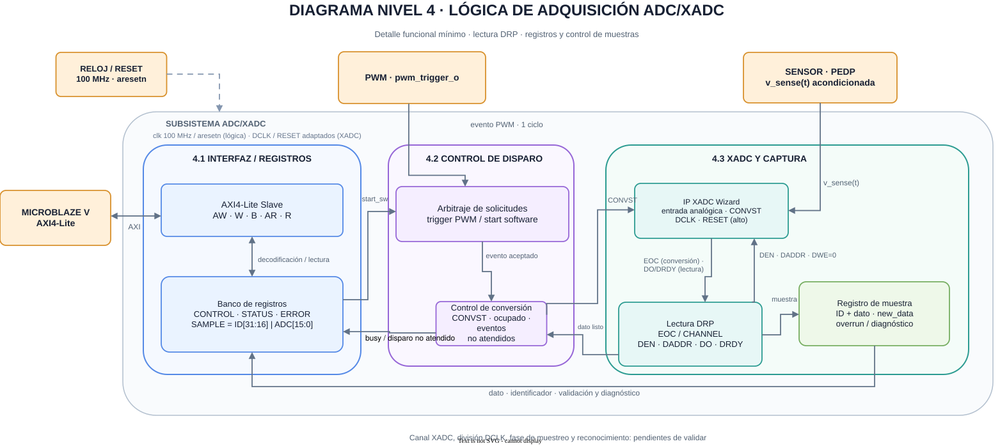

# Cuarto nivel — Control de conversión y captura ADC/XADC

Este documento describe el RTL del periférico ADC/XADC y su conexión con MicroBlaze V en la plataforma integrada. La verificación se realizó con Vivado 2026.1. [Arquitectura de adquisición](nivel_3_adc.md) · [Mapa de registros](adc/mapa_registros.md).

**Figura 1.** Diagrama del diseño original. La etiqueta `ADC[15:0]` muestra el formato preliminar. En el RTL vigente, `SAMPLE` es una palabra de 32 bits con ID en `[31:16]`, ceros en `[15:12]` y el código ADC de 12 bits en `[11:0]`, obtenido de `DO[15:4]`. Al leer `SAMPLE` se captura su token de 32 bits, que se lee y se escribe de vuelta para reconocer la muestra mediante `ACK_ID` en `0x10`.

## Control y adquisición

`adc_system_axi` conecta `adc_axi_lite` con `adc_top`; este último instancia `adc_control` y `xadc_wiz_0`. El controlador usa IDLE → WAIT_EOC → SEND_READ → WAIT_DRDY: emite CONVST, espera un flanco EOC posterior, solicita una lectura DRP con DEN y publica únicamente al recibir DRDY.

La configuración entregada usa VAUX6, dirección DRP `0x16`, modo por evento y DCLK de 100 MHz. Se toma DO[15:4] como código de 12 bits. Processor System Reset distribuye `peripheral_aresetn` al periférico y sincroniza su liberación. `adc_top` invierte ese reset para el XADC Wizard. PWM y ADC comparten el reloj de 100 MHz.

El evento PWM y START por software producen una conversión cuando el controlador está libre. Si coinciden se acepta una sola y se marca `missed_trigger`; si llegan durante `busy`, se conserva la conversión en curso y se diagnostica el evento no atendido. No se implementa una cola. Cada espera de EOC o DRDY tiene un límite configurable de 1024 ciclos; el timeout conserva la última muestra y no publica datos incompletos.

## Publicación y acceso AXI

SAMPLE publica juntos ID modular de 16 bits, cuatro ceros y código de 12 bits. El primer resultado tras reset tiene ID 1. `valid` persiste hasta reset; `new_data` permanece hasta un ACK válido o reset. `missed_trigger`, `overrun` y `timeout` son persistentes hasta reset.

El esclavo acepta AW y W independientemente y mantiene B/R estables bajo espera del receptor. CONTROL, STATUS, SAMPLE y ERROR conservan offsets 0x00, 0x04, 0x08 y 0x0C; ACK_ID ocupa 0x10. El [mapa](adc/mapa_registros.md) define bits, WSTRB, SLVERR y valores de reset.

Leer SAMPLE captura simultáneamente su palabra y el token completo de 32 bits. Leer ACK_ID devuelve ese snapshot aunque llegue otra publicación. El driver actual devuelve el token completo si es distinto de cero. La pareja de lecturas requiere exclusión si se agrega otro lector. El controlador compara el token en el flanco del reconocimiento. Un ACK atrasado conserva la muestra nueva y una publicación simultánea tiene prioridad.

El ID de 16 bits puede envolver sin reutilizar el token de 32 bits dentro de la sesión. Tras agotar este último se bloquea ACK con token cero hasta reset coordinado. Reset inicia una sesión nueva y cancela las operaciones anteriores; la plataforma debe impedir reconocer un token antiguo después de un reinicio.

## Integración y evidencia

El Block Design conecta la interfaz AXI4-Lite de 32 bits de `adc_system_axi` a SmartConnect, en `0x44A00000` con una ventana de 4 KiB y `ADDR_WIDTH=12`. Conecta directamente `pwm_trigger_o` a `pwm_trigger_i`. A 10 kHz, el disparo de un ciclo ocurre en la fase 5000. La ISR de control consulta el ADC a partir de la interrupción del Timer por AXI INTC. [Integración en Basys 3](integracion_basys3.md).

- **Periférico.** Se aprobaron seis bancos de ADC y ocho casos del banco conjunto `tb_adc_pwm_axi`, que usa PWM y ADC completos y el modelo XADC de Vivado. También se sintetizó `adc_system_axi` fuera de contexto. [Pruebas del ADC](adc/verificacion.md) · [Prueba conjunta](../informe/adc_verificacion.md) · [Síntesis aislada](adc/advertencias_sintesis.md).
- **Integración digital.** `tb_pwm_adc_axi` pasó 65 602 comprobaciones con maestros AXI de prueba y un modelo digital del XADC. La validación de las conexiones de MicroBlaze V corresponde al Block Design. La ejecución del firmware queda fuera de esos bancos. [Verificación digital integrada](../informe/verificacion_digital_integrada_microblaze.md).
- **Ruteo y bitstream.** La construcción de `inversor_basys3` completó el ruteo y generó bitstream. Los márgenes reportados para el reloj interno de 100 MHz fueron WNS de +0,289 ns y WHS de +0,042 ns. [Resultados del sistema integrado](integracion_basys3.md#resultados-de-la-construcción-integrada).
- **Adquisición física.** Se comprobó la lectura de VAUX6 en reposo y la adquisición durante el control PR. El ensayo registró el cero y el signo del ACS712. Falta contrastar la sensibilidad nominal con una corriente independiente y medir la latencia adquisición–ISR–actuación. [Registro de laboratorio](../../Potencia/04_registro_laboratorio.md#referencia-analógica-y-sensor) · [Pendientes del ADC](adc/integracion_pendiente.md).

[Tercer nivel de adquisición](nivel_3_adc.md) · [Fuentes y reproducción](adc/README.md) · [Índice del diseño](README.md)
