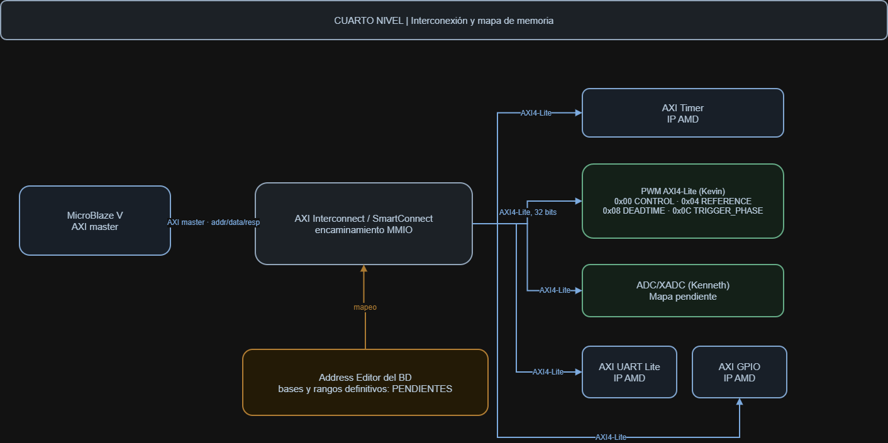
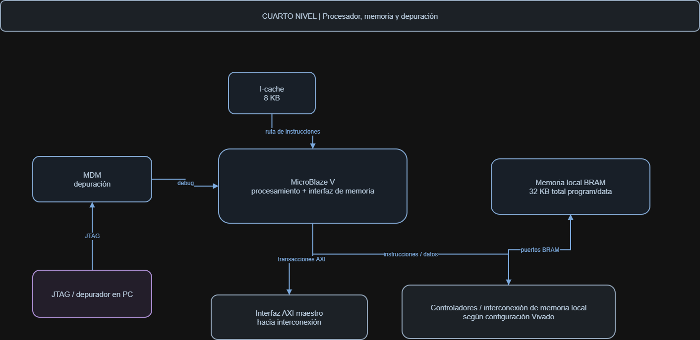
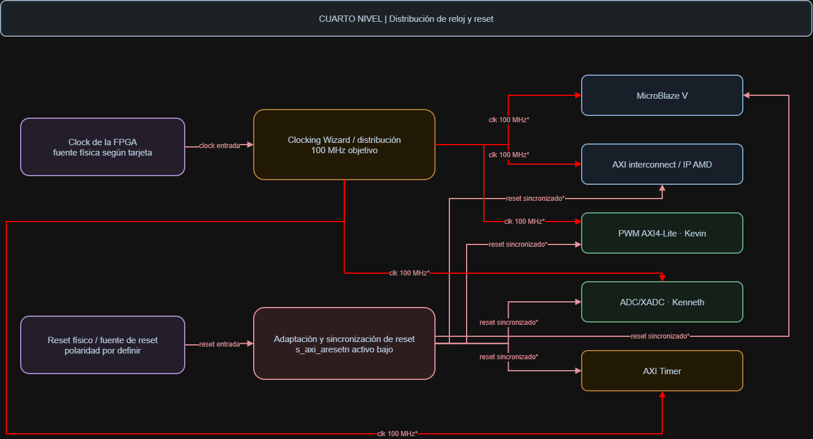
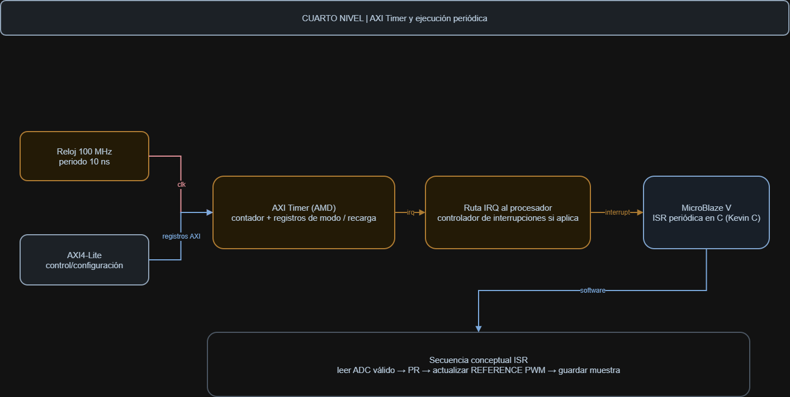

# Cuarto nivel — Plataforma MicroBlaze V, memoria y temporización

Este documento desarrolla los bloques de la [plataforma de tercer nivel](nivel_3_microblaze.md) mediante cuatro vistas: interconexión, memoria/procesamiento, reloj/reset y Timer/interrupciones. Se conservan los requisitos del [segundo nivel](nivel_2.md): 100 MHz, caché de instrucciones de 8 KB, memoria local de 32 KB y acceso AXI a periféricos.

Las figuras representan un diseño propuesto, no capturas de un Block Design validado. Los nombres de IP, puertos y rangos definitivos se documentarán al configurar Vivado/Vitis 2025.1, versión indicada por el proyecto. No se describe el circuito interno de MicroBlaze V ni se atribuyen resultados de simulación o implementación a esta arquitectura.

## 1. Interconexión AXI y mapa de memoria

**Figura 1.** Encaminamiento entre el maestro AXI de MicroBlaze V y Timer, PWM, adquisición, UART Lite y GPIO. El Address Editor representa la asignación de bases y rangos durante el diseño, no un circuito adicional que opere en tiempo de ejecución.

### Objetivo, entradas y salidas

El módulo funcional de interconexión dirige cada transacción al destino correspondiente y devuelve sus datos y respuestas al procesador. La figura deja abierta la elección entre AXI Interconnect y SmartConnect; no implica instanciar ambos. Deben seleccionarse el IP y sus opciones de compatibilidad cuando se construya el Block Design.

| Grupo | Entradas al bloque de interconexión | Salidas |
|---|---|---|
| Maestro del procesador | Direcciones, datos de escritura y controles; aceptación de respuestas | Disponibilidad, datos de lectura y respuestas hacia MicroBlaze V |
| Destinos AXI4-Lite | Disponibilidad y respuestas de Timer, PWM, ADC/XADC, UART y GPIO | Solicitudes de lectura/escritura al destino decodificado |
| Temporización | Reloj y reset acondicionados de plataforma | Funcionamiento coordinado de las interfaces; distribución detallada en la sección 3 |

MicroBlaze V distingue interfaces para periféricos, memoria local y caché. La figura agrupa el maestro de acceso MMIO; no afirma que toda la memoria se conecte por ese mismo enlace. La interfaz periférica `M_AXI_DP` admite AXI4-Lite o AXI4 según configuración, que deberá ser compatible con la interconexión y sus destinos ([UG1629: interfaces](https://docs.amd.com/r/2025.1-English/ug1629-microblaze-v-user-guide/MicroBlaze-V-I/O-Overview)).

### Asignación de direcciones

El Address Editor asigna a cada segmento una dirección base y un rango sin solapamientos. El software accede a un registro mediante `dirección absoluta = base del periférico + offset`. Los offsets del PWM no son direcciones absolutas ni identifican las bases de los demás IP. El mapa de adquisición y los segmentos del Timer, UART, GPIO y memoria aún deben concretarse.

La siguiente tabla resume exclusivamente el [contrato provisional de Kevin](nivel_3_pwm.md). No sustituye su definición de [prioridades y accesos](nivel_4_pwm.md).

| Offset PWM | Registro | Lectura | Escritura |
|---|---|---|---|
| `0x00` | CONTROL | `enable[0]`, `freq_sel[2:1]`, `running[3]`; restantes cero | Enable y frecuencia; running es solo lectura |
| `0x04` | REFERENCE | Última referencia aceptada y saturada en `[15:0]` | Referencia pendiente Q1.15 con signo |
| `0x08` | DEADTIME | Tiempo muerto en ciclos de 100 MHz | Modificable con el PWM deshabilitado |
| `0x0C` | TRIGGER_PHASE | Posición del disparo en ciclos dentro del período | Modificable con el PWM deshabilitado |

La base PWM queda pendiente de asignación. La referencia representa `m = entero_con_signo / 32768`, no una corriente expresada directamente en amperios. La conversión desde la acción PR corresponde al software y a los límites de actuación acordados. Leer REFERENCE informa la referencia aceptada; no garantiza que ya se haya transferido al conjunto activo.

### Lecturas, escrituras y respuestas

AXI4-Lite utiliza canales independientes de dirección de escritura (AW), datos de escritura (W), respuesta (B), dirección de lectura (AR) y datos/respuesta de lectura (R). La aceptación se produce con VALID y READY simultáneos. Un acceso no puede darse por terminado por el solo envío de su dirección; la aplicación y sus drivers deben respetar la respuesta del destino.

El PWM propuesto acepta AW y W en distinto orden, aplica la escritura una sola vez y conserva las respuestas hasta su aceptación. Los datos son de 32 bits y `WSTRB[3:0]` selecciona bytes. Los accesos válidos reciben OKAY; el contrato prevé SLVERR para offsets inválidos, desalineación o cambios no permitidos. Esto describe al esclavo PWM, no congela la política de respuesta del resto de IP ni de direcciones no decodificadas por la plataforma.

La configuración PWM se modifica en reposo. La orden de apagado en CONTROL tiene prioridad y conserva la frecuencia anterior; durante operación no se aceptan cambios de frecuencia, tiempo muerto o fase. Las referencias se almacenan pendientes y se aplican al comienzo de un período. Si una escritura coincide con ese comienzo, se aplica la pareja pendiente anterior y la nueva queda para el siguiente, según el contrato existente.

### Relación con otros módulos y justificación

El Timer expone configuración y estado por AXI; su IRQ sigue una conexión independiente. ADC/XADC devuelve muestras y disponibilidad, pero recibe el disparo directamente del PWM. UART Lite transmite los datos que escribe la aplicación y GPIO permite consultar el botón y actualizar indicadores. La interconexión no convierte la señal analógica ni calcula el PR.

Separar interconexión y registros permite integrar los IP sin reimplementar el bus de los proyectos anteriores. Antes de cerrar esta vista se deben comprobar los segmentos, anchos locales y efectos de acceso de cada periférico. Las direcciones exportadas a Vitis deben corresponder a la misma revisión del Block Design.

## 2. Memoria, procesamiento y depuración

**Figura 2.** Relación funcional entre MicroBlaze V, caché de instrucciones, controladores de memoria local, BRAM y depuración JTAG. La interfaz AXI hacia periféricos aparece separada del acceso a memoria. Las flechas agrupan el intercambio, no fijan un cableado definitivo de buses.

### Objetivo, entradas y salidas

El módulo funcional de procesamiento y memoria ejecuta la aplicación C y conserva su programa y estado. La propuesta requiere MicroBlaze V a 100 MHz, una caché de instrucciones de 8 KB y 32 KB totales de memoria local BRAM para programa y datos.

| Bloque | Entradas relevantes | Salidas relevantes |
|---|---|---|
| MicroBlaze V | Reloj/reset propios del núcleo, instrucciones, datos, respuestas AXI, interrupción y debug | Solicitudes de memoria/periféricos, datos escritos y estado de depuración |
| Caché de instrucciones | Solicitudes de instrucciones y datos de la ruta de llenado configurada | Instrucciones hacia la ruta de ejecución |
| Controladores de memoria local | Direcciones, controles y datos del procesador | Controles/puertos BRAM y respuestas hacia el núcleo |
| BRAM de 32 KB | Direcciones, habilitaciones, reloj y datos de escritura | Instrucciones y datos almacenados |
| MDM V / JTAG | Solicitudes de depuración desde PC e intercambio con el núcleo | Control de depuración y respuesta a las herramientas |

### Procesador y caminos de memoria

MicroBlaze V proporciona rutas separadas para instrucciones y datos. El acceso local puede utilizar ILMB y DLMB con controladores BRAM; la selección exacta no está fijada por esta figura. El número de controladores, sus anchos, puertos y rangos se debe obtener del Block Design validado, no de una suposición sobre el dibujo ([UG1629: arquitectura de memoria](https://docs.amd.com/r/2025.1-English/ug1629-microblaze-v-user-guide/Memory-Architecture)).

La rama «instrucciones / datos» de la figura resume esos intercambios: una lectura devuelve información al procesador y una escritura lleva datos a memoria. La etiqueta «puertos BRAM» no implica conectar las señales AXI del maestro periférico directamente al arreglo de memoria.

La caché de instrucciones pertenece al núcleo y sus 8 KB no son una memoria de muestras adicional. Tampoco debe interpretarse como una etapa obligatoria en serie con todo acceso a BRAM local: LMB y las interfaces de caché son caminos diferenciados. Se debe documentar qué rango utiliza la caché y cómo se atienden sus fallos. Activarla no demuestra por sí solo que acelere el código ubicado en memoria local ni que la rutina tenga duración constante.

### Distribución de memoria y depuración

Los 32 KB son capacidad total para programa y datos, no 32 KB para cada uno. El enlazado debe reservar código, datos inicializados, variables, pila y buffer de muestras sin superposición. El arranque de la aplicación inicializa el estado requerido; no se presupone que el reset borre BRAM. La capacidad útil del histórico se determina cuando se conozca el consumo real del ejecutable.

El rótulo MDM del dibujo identifica la función de depuración; para MicroBlaze V corresponde seleccionar un MDM V compatible. Su interfaz permite la comunicación con las herramientas mediante JTAG, sin utilizar la UART de exportación. Las opciones de debug deben coincidir en procesador y módulo de depuración ([UG1629: interfaz de depuración](https://docs.amd.com/r/2024.1-English/ug1629-microblaze-v-user-guide/Debug-Interface-Description)).

La exportación de hardware hacia Vitis debe conservar procesador, memoria y periféricos de la misma plataforma. El ejecutable, el mapa de enlazado y la configuración de arranque se validarán juntos. No existe todavía evidencia de carga o ejecución que permita considerar finalizado ese flujo.

### Relación con otros módulos y justificación

El programa alojado en memoria utiliza la interconexión de la sección 1 para leer ADC, configurar Timer y escribir PWM, UART y GPIO. La solicitud de interrupción entra por la ruta de la sección 4; reloj y reset proceden de la sección 3. El cálculo PR permanece en software, sin añadir una ruta de datos personalizada dentro del procesador.

La memoria local reduce dependencias de memoria externa y permite delimitar el espacio del programa. La depuración facilita comprobar carga, arranque y accesos. Estas ventajas requieren verificar el mapa y la ruta real de ejecución; no justifican inventar pipeline, registros internos del núcleo o latencias fijas heredadas de la CPU del Proyecto 3.

## 3. Generación de reloj y distribución de reset

**Figura 3.** Fuente física de reloj, bloque de generación/distribución y adaptación de reset. La figura resume la entrega de reloj y reinicio a procesador, interconexión, PWM, adquisición y Timer. Memoria, UART, GPIO y depuración también requieren las conexiones correspondientes, aunque no estén desplegadas en esta vista.

### Objetivo, entradas y salidas

Este módulo funcional establece una base temporal de 100 MHz y evita que los bloques comiencen a operar con reloj o reset incoherentes. La fuente de entrada depende de la tarjeta; no se asigna aquí una frecuencia física distinta ni un pin que todavía no esté documentado.

| Interfaz | Entrada | Salida o destino |
|---|---|---|
| Reloj físico | Oscilador de la tarjeta | Clocking Wizard o distribución que produzca el reloj de sistema |
| Reloj de sistema | Salida estable de generación/distribución | Núcleo, memoria, interconexión e interfaces de periféricos a 100 MHz |
| Solicitud de reset | Fuente física de polaridad pendiente | Adaptación a los requisitos de reset de los IP |
| Estado de bloqueo, si se usa MMCM/PLL | `locked` del generador | Condición para liberar la plataforma; conexión por concretar |
| Reset AXI/PWM | Salida acondicionada activa baja | Interconexión e interfaces `s_axi_aresetn` compatibles |
| Reset del núcleo y otros IP | Salidas de la gestión de reset | Polaridad y duración propias de cada IP seleccionado |

### Generación y distribución

El reloj de sistema tiene período de 10 ns. El bloque Clocking Wizard / distribución representa la función de obtenerlo y llevarlo a los consumidores mediante los recursos de reloj de la FPGA. La elección del IP y sus parámetros depende del oscilador y del dispositivo seleccionados. Si existe una señal de bloqueo, el arranque no debe liberarse antes de que el reloj sea utilizable.

Los 100 MHz son el ritmo de la lógica secuencial, no la frecuencia de conmutación. El PWM obtiene sus períodos mediante contadores; el Timer deriva otro intervalo para ejecutar el control. Los 50 Hz de la referencia de corriente son una tercera magnitud. Las frecuencias PWM de evaluación de Kevin no fijan automáticamente el período del PR.

### Polaridad y secuencia de reset

El contrato PWM utiliza `s_axi_aresetn` activo bajo: cero solicita reset y uno permite operar. Su afirmación es asíncrona y su liberación debe estar sincronizada con el reloj, según el [cuarto nivel PWM](nivel_4_pwm.md). La polaridad del botón físico sigue pendiente y debe adaptarse antes de distribuir el reinicio.

Ese nombre no debe extenderse a todos los consumidores. MicroBlaze V dispone de entradas de reset activas altas; el rótulo común de la figura expresa una solicitud de reinicio, no autoriza unir directamente todas las entradas al mismo hilo. La adaptación debe respetar las polaridades y tiempos del núcleo ([UG1629: reset](https://docs.amd.com/r/2025.1-English/ug1629-microblaze-v-user-guide/Reset)).

La selección de la gestión de reset queda pendiente del Block Design. Processor System Reset es una opción para proporcionar salidas activas altas y bajas, coordinadas con el reloj y su bloqueo; sus salidas se conectan al tipo de entrada correspondiente, no por semejanza de nombres ([PG164](https://docs.amd.com/api/khub/documents/5VcEWg~hYG0gT~7WNDt64g/content)). Si adquisición introduce otro dominio, deberá definir su propio cruce y liberación; un pulso de 10 ns no se considera capturado automáticamente por un reloj distinto.

### Arranque, relación con otros módulos y justificación

Durante reset, el PWM conserva sus cuatro órdenes y el disparo inactivos. Al liberar el sistema, la aplicación prepara memoria, drivers, parámetros de adquisición y actuación, y la ruta de interrupción antes de iniciar el control. El reset no equivale a un borrado general de memoria ni sustituye la inicialización C.

La distribución coordinada permite evitar transacciones incompletas y actuación involuntaria al arrancar. La figura no muestra `locked`, todas las ramas de reset ni los puertos exactos de cada IP; esas conexiones deben cerrarse y verificarse en Vivado. La aceptación requiere revisar resets durante actividad AXI, Timer y PWM, y comprobar la recuperación sin habilitar la potencia antes de una configuración válida.

## 4. AXI Timer, interrupciones y ejecución periódica

**Figura 4.** Configuración AXI del temporizador, ruta IRQ y secuencia conceptual de la rutina de control. «Leer ADC válido → PR → actualizar REFERENCE PWM → guardar muestra» describe software ejecutado por MicroBlaze V, no una cadena adicional de módulos RTL.

### Objetivo, entradas y salidas

AXI Timer establece el evento periódico de atención del control. El procesador programa sus registros y atiende la interrupción para ejecutar el PR con una muestra identificada como válida. La ruta IRQ de la figura mantiene pendiente la elección de controlador de interrupciones y el modo compatible del núcleo.

| Bloque o interfaz | Entradas | Salidas |
|---|---|---|
| AXI Timer | Reloj de 100 MHz, reset y accesos AXI de configuración | Estado/datos leídos y solicitud IRQ |
| Ruta IRQ | Solicitud del Timer y configuración de atención | Solicitud compatible hacia MicroBlaze V; reconocimiento según implementación |
| Rutina periódica en C | Evento atendido, muestra ADC válida y estado del PR | Referencia PWM, estado actualizado e histórico |
| Driver ADC | Accesos a muestra y disponibilidad | Dato y diagnóstico según contrato de adquisición |
| Driver PWM | Acción de control convertida al formato acordado | Escritura REFERENCE mediante AXI4-Lite |

### Configuración y funcionamiento del contador

La aplicación debe configurar el Timer para generación periódica, cargar el valor inicial, seleccionar el sentido de conteo y habilitar recarga automática e interrupción. La secuencia concreta debe seguir el IP y su driver. La recarga evita depender de una reprogramación por software para iniciar cada intervalo ([PG079: modo Generate](https://docs.amd.com/r/en-US/pg079-axi-timer/Generate-Mode)).

El período de control definitivo no está acordado. Con 100 MHz se dispone de 10 ns por ciclo, pero el valor de carga no debe deducirse solo como `100 MHz × período`: hay que aplicar la relación de conteo/recarga del modo seleccionado y comprobarla por simulación o medición. Tampoco se fija aquí un ancho de contador o un número de Timer utilizados sin una configuración validada.

Cuando vence el intervalo, el Timer registra la condición de interrupción y su ruta solicita atención. El software debe reconocer la fuente y limpiar el estado pendiente según el IP y el controlador utilizado; entrar o retornar de la rutina no sustituye ese reconocimiento. La ruta IRQ no debe suponerse un pulso de un ciclo idéntico a `pwm_trigger_o`.

### Adquisición, cálculo y actualización

El PWM dispara la adquisición en la fase configurada. La conversión tarda un intervalo y el software consulta el resultado y su disponibilidad mediante AXI. El Timer no genera esa muestra ni garantiza que sea nueva cuando interrumpe. El diseño debe establecer qué conversión corresponde a cada iteración y qué hacer si el ADC sigue ocupado o el dato está antiguo; no se introduce una política nueva en esta documentación.

La rutina toma la medición válida, obtiene el error respecto a la referencia, ejecuta la ecuación PR y convierte su salida a la referencia de modulación acordada. El desarrollo de coeficientes, escalamiento y saturación pertenece al software de control. El driver escribe el resultado Q1.15 en REFERENCE y conserva el estado del algoritmo y las muestras en memoria.

Una escritura aceptada no cambia necesariamente el PWM de inmediato. Su contrato aplica la referencia pendiente al comienzo de período y conserva la pendiente anterior si la escritura coincide con ese flanco. La latencia total incluye conversión, espera hasta atención, cálculo, acceso AXI y espera hasta aplicación PWM. La coordinación debe considerar también el arranque: sin PWM habilitado no existe el disparo periódico previsto.

### Determinismo, relación con otros módulos y justificación

La fecha del evento del Timer y el comienzo real de la rutina son instantes distintos. La latencia y el jitter dependen de ejecución interrumpida, habilitación de interrupciones, memoria/caché y accesos a periféricos. Una interrupción periódica no demuestra por sí sola una actuación periódica dentro de plazo.

El presupuesto de una iteración debe incluir atención, lectura ADC, cálculo PR, escritura PWM y registro de muestra. Debe terminar antes del siguiente plazo acordado, con margen para las demás tareas. La exportación UART solicitada mediante GPIO se atiende sin esperas bloqueantes que impidan ese cumplimiento; el tamaño del buffer y su gestión pertenecen a la aplicación.

Separar Timer, adquisición y PWM permite verificar cada función sin confundir sus frecuencias. La integración debe medir el intervalo de interrupciones, el tiempo máximo de rutina y la latencia muestra–actuación bajo carga UART. La estrategia ante incumplimientos y la fase relativa de los eventos siguen pendientes de acuerdo. Ninguna de esas prestaciones se considera probada únicamente por estas figuras.

[Tercer nivel: plataforma y funciones](nivel_3_microblaze.md) · [Segundo nivel del sistema](nivel_2.md) · [Índice del diseño](README.md)
