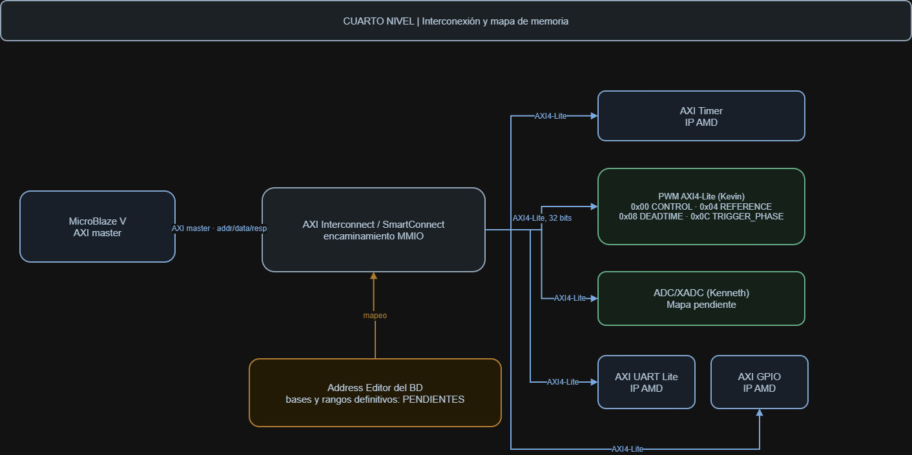
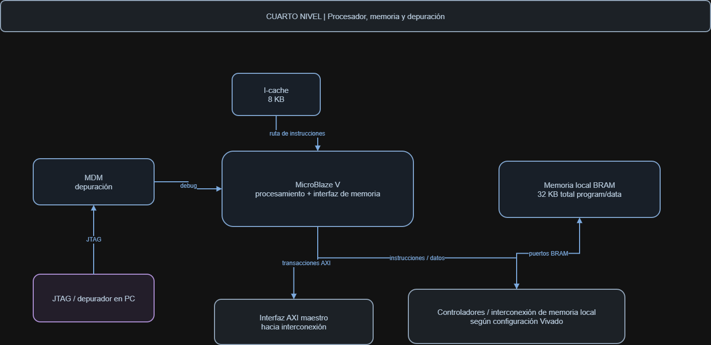
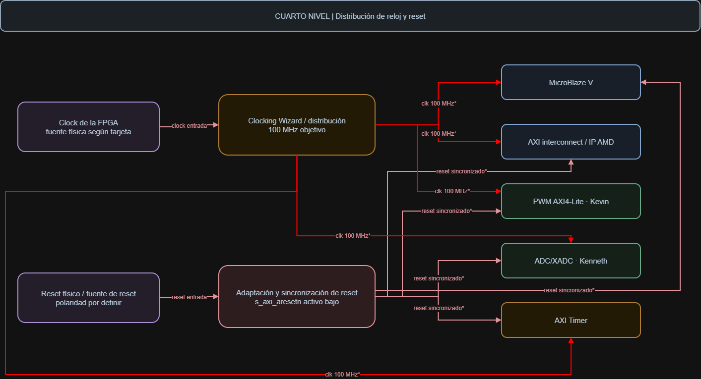
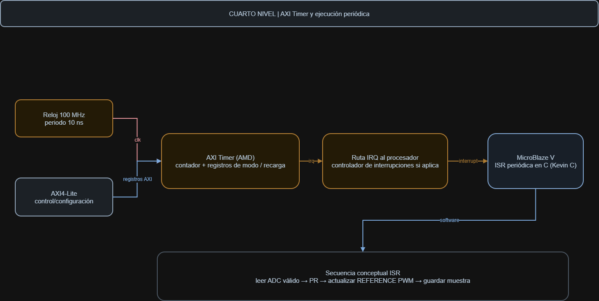

# Cuarto nivel — Plataforma MicroBlaze V, memoria y temporización

Este documento desarrolla los bloques de la [plataforma de tercer nivel](nivel_3_microblaze.md) mediante cuatro vistas: interconexión, memoria/procesamiento, reloj/reset y Timer/interrupciones. Se conservan los requisitos del [segundo nivel](nivel_2.md): 100 MHz, caché de instrucciones de 8 KB, memoria local de 32 KB y acceso AXI a periféricos.

El Block Design ya fue construido y validado con Vivado/Vitis 2026.1. Las figuras conservan la propuesta inicial: sus rótulos pendientes y conexiones agrupadas no sustituyen el diseño implementado. La [guía de implementación](implementacion_microblaze.md#arquitectura-y-conexiones) describe la plataforma digital independiente y la [integración Basys 3](integracion_basys3.md) identifica la construcción de laboratorio. La compatibilidad con 2025.1 sigue pendiente. El lazo PR integrado operó en el [montaje de laboratorio](../informe/README.md#operación-a-12-y-24-v).

## 1. Interconexión AXI y mapa de memoria

**Figura 1.** Encaminamiento entre el maestro AXI de MicroBlaze V y los periféricos. El Address Editor asigna bases y rangos durante el diseño; no es un circuito adicional. Los rótulos «mapa pendiente» corresponden a la propuesta inicial. La implementación conecta siete destinos mediante SmartConnect y utiliza el mapa de esta sección.

### Objetivo, entradas y salidas

La implementación utiliza SmartConnect, no dos interconexiones alternativas. Su entrada `S00_AXI` recibe `M_AXI_DP` del procesador; sus siete salidas atienden INTC, Timer, UART Lite, GPIO de entradas, GPIO de salidas, ADC y PWM, en ese orden. Devuelve los datos y respuestas del destino seleccionado.

| Grupo | Entradas al bloque de interconexión | Salidas |
|---|---|---|
| Maestro del procesador | Direcciones, datos de escritura y controles; aceptación de respuestas | Disponibilidad, datos de lectura y respuestas hacia MicroBlaze V |
| Siete destinos AXI | Disponibilidad y respuestas de INTC, Timer, UART, dos GPIO, ADC y PWM | Solicitudes de lectura/escritura al destino decodificado |
| Temporización | Reloj y reset acondicionados de plataforma | Funcionamiento coordinado de las interfaces; distribución detallada en la sección 3 |

MicroBlaze V distingue interfaces para periféricos, memoria local y caché. `M_AXI_DP` accede a MMIO mediante SmartConnect; `M_AXI_IC` atiende instrucciones mediante su controlador AXI BRAM y DLMB atiende datos locales. La memoria de instrucciones no es un octavo destino de SmartConnect ([UG1629: interfaces](https://docs.amd.com/r/2025.1-English/ug1629-microblaze-v-user-guide/MicroBlaze-V-I/O-Overview)).

### Asignación de direcciones

Los scripts asignan y verifican segmentos sin solapamientos. El software accede mediante `dirección absoluta = base del periférico + offset`; los offsets PWM no son bases de periféricos. El mapa comprobado en `create_bd.tcl` y `prepare_pwm_integration.tcl` es:

| Destino | Dirección base | Rango asignado |
|---|---|---|
| BRAM física compartida, vistas de instrucciones y datos | `0x00000000` | `0x00000000–0x00007FFF`, 32 KiB totales |
| GPIO entradas | `0x40000000` | 64 KiB |
| GPIO salidas | `0x40010000` | 64 KiB |
| UART Lite | `0x40600000` | 64 KiB |
| AXI INTC | `0x41200000` | 64 KiB |
| AXI Timer | `0x41C00000` | 64 KiB |
| PWM | `0x44000000` | 4 KiB |
| ADC/XADC | `0x44A00000` | 4 KiB |

Son ventanas de decodificación, no memoria física adicional. PWM y ADC usan direcciones locales de 12 bits en el BD. Las bases de `xparameters.h` deben proceder del mismo XSA que el ELF; los [pines y programas vigentes](integracion_basys3.md) dependen de la construcción seleccionada.

La siguiente tabla resume el [contrato implementado del PWM](nivel_3_pwm.md). No sustituye su definición de [prioridades y accesos](nivel_4_pwm.md).

| Offset PWM | Registro | Lectura | Escritura |
|---|---|---|---|
| `0x00` | CONTROL | `enable[0]`, `freq_sel[2:1]`, `running[3]`; restantes cero | Enable y frecuencia; running es solo lectura |
| `0x04` | REFERENCE | Última referencia aceptada y saturada en `[15:0]` | Referencia pendiente Q1.15 con signo |
| `0x08` | DEADTIME | Tiempo muerto en ciclos de 100 MHz | Modificable con el PWM deshabilitado |
| `0x0C` | TRIGGER_PHASE | Posición del disparo en ciclos dentro del período | Modificable con el PWM deshabilitado |

La base PWM es `0x44000000`. La referencia representa `m = entero_con_signo / 32768`, no una corriente en amperios. La conversión desde el PR corresponde al software. Leer REFERENCE informa la referencia aceptada; no garantiza que ya se haya transferido al conjunto activo.

### Lecturas, escrituras y respuestas

AXI4-Lite utiliza canales independientes de dirección de escritura (AW), datos de escritura (W), respuesta (B), dirección de lectura (AR) y datos/respuesta de lectura (R). La aceptación se produce con VALID y READY simultáneos. Un acceso no puede darse por terminado por el solo envío de su dirección; la aplicación y sus drivers deben respetar la respuesta del destino.

El PWM implementado acepta AW y W en distinto orden, aplica la escritura una sola vez y conserva las respuestas hasta su aceptación. Los datos son de 32 bits y `WSTRB[3:0]` selecciona bytes. Los accesos válidos reciben OKAY; devuelve SLVERR para offsets inválidos, desalineación o cambios no permitidos. Esto describe al esclavo PWM, no la política de respuesta del resto de IP.

La configuración PWM se modifica en reposo. La orden de apagado en CONTROL tiene prioridad y conserva la frecuencia anterior; durante operación no se aceptan cambios de frecuencia, tiempo muerto o fase. Las referencias se almacenan pendientes y se aplican al comienzo de un período. Si una escritura coincide con ese comienzo, se aplica la pareja pendiente anterior y la nueva queda para el siguiente, según el contrato existente.

### Relación con otros módulos y justificación

El Timer expone configuración y estado por AXI; su IRQ sigue una conexión independiente. ADC/XADC devuelve muestras y disponibilidad, pero recibe el disparo directamente del PWM. UART Lite transmite los datos que escribe la aplicación y GPIO permite consultar el botón y actualizar indicadores. La interconexión no convierte la señal analógica ni calcula el PR.

Separar interconexión y registros permite integrar los IP sin reimplementar el bus de los proyectos anteriores. Los segmentos, anchos y conexiones pasan las comprobaciones del BD. Las direcciones exportadas a Vitis deben corresponder a esa revisión; la validación estructural no demuestra por sí sola la ejecución de accesos desde el procesador.

## 2. Memoria, procesamiento y depuración

**Figura 2.** Relación funcional entre MicroBlaze V, caché de instrucciones, controladores de memoria local, BRAM y depuración JTAG. La interfaz AXI hacia periféricos aparece separada del acceso a memoria. Las flechas agrupan el intercambio, no fijan un cableado definitivo de buses.

### Objetivo, entradas y salidas

La configuración implementada es RV32 con multiplicación/división y FPU simple, reloj de 100 MHz, I-cache de 8 KiB y 32 KiB totales de BRAM física para programa y datos. La compilación y el enlace de la aplicación C se verificaron por separado de la ejecución física.

| Bloque | Entradas relevantes | Salidas relevantes |
|---|---|---|
| MicroBlaze V | Reloj/reset propios del núcleo, instrucciones, datos, respuestas AXI, interrupción y debug | Solicitudes de memoria/periféricos, datos escritos y estado de depuración |
| Caché de instrucciones | Solicitudes de instrucciones y datos de la ruta de llenado configurada | Instrucciones hacia la ruta de ejecución |
| Controladores de memoria local | Direcciones, controles y datos del procesador | Controles/puertos BRAM y respuestas hacia el núcleo |
| BRAM de 32 KB | Direcciones, habilitaciones, reloj y datos de escritura | Instrucciones y datos almacenados |
| MDM V / JTAG | Solicitudes de depuración desde PC e intercambio con el núcleo | Control de depuración y respuesta a las herramientas |

### Procesador y caminos de memoria

MicroBlaze V tiene ILMB deshabilitado. Los datos van por DLMB y su controlador LMB BRAM al puerto A; las instrucciones van por `M_AXI_IC`, I-cache y un controlador AXI BRAM al puerto B. Es una sola memoria True Dual Port de 8192 palabras de 32 bits: ambas vistas cubren `0x00000000–0x00007FFF`, no dos memorias independientes ([UG1629: arquitectura de memoria](https://docs.amd.com/r/2025.1-English/ug1629-microblaze-v-user-guide/Memory-Architecture)).

La rama «instrucciones / datos» de la figura resume esos intercambios: una lectura devuelve información al procesador y una escritura lleva datos a memoria. La etiqueta «puertos BRAM» no implica conectar las señales AXI del maestro periférico directamente al arreglo de memoria.

La I-cache cubre `0x00000000–0x00007FFF`; sus fallos se atienden mediante el controlador AXI del puerto B. Sus 8 KiB no son espacio adicional para muestras. No se habilita D-cache. La figura conserva una vista funcional inicial; la [implementación de memoria](implementacion_microblaze.md#memoria-caché-y-fpu) identifica las rutas reales. La eficacia de caché y la duración de la rutina requieren medición.

### Distribución de memoria y depuración

Los 32 KiB son capacidad total para programa y datos, no 32 KiB para cada uno. El linker y las auditorías ELF comprueban código, datos, BSS, pila y buffer sin superposición. La [construcción de laboratorio](integracion_basys3.md#resultados-de-la-construcción-integrada) identifica ocupación y configuración de cada programa. El margen estático no demuestra suficiencia dinámica de pila; el reset tampoco supone borrado de BRAM.

El rótulo MDM del dibujo corresponde a `mdm_riscv`, conectado a `DEBUG` de MicroBlaze V. Permite depuración JTAG sin utilizar la UART de exportación. La depuración está habilitada en la plataforma ([UG1629: interfaz de depuración](https://docs.amd.com/r/2024.1-English/ug1629-microblaze-v-user-guide/Debug-Interface-Description)).

La exportación XSA y los ELF se reconstruyen mediante los scripts publicados. `_boot` se enlaza en cero y la carga JTAG debe utilizar bitstream y ELF de la misma plataforma; la caché de instrucciones requiere el tratamiento correspondiente al cargar código. El [procedimiento de carga](integracion_basys3.md#carga-y-verificación) y las observaciones de laboratorio no equivalen a validar el lazo PR completo ni las interrupciones bajo todas las condiciones de operación.

### Relación con otros módulos y justificación

El programa alojado en memoria utiliza la interconexión de la sección 1 para leer ADC, configurar Timer y escribir PWM, UART y GPIO. La solicitud de interrupción entra por la ruta de la sección 4; reloj y reset proceden de la sección 3. El cálculo PR permanece en software, sin añadir una ruta de datos personalizada dentro del procesador.

La memoria local reduce dependencias de memoria externa y permite delimitar el espacio del programa. La depuración facilita comprobar carga, arranque y accesos. Estas ventajas requieren verificar el mapa y la ruta real de ejecución; no justifican inventar pipeline, registros internos del núcleo o latencias fijas heredadas de la CPU del Proyecto 3.

## 3. Generación de reloj y distribución de reset

**Figura 3.** Fuente física de reloj, bloque de generación/distribución y adaptación de reset. La figura resume la entrega de reloj y reinicio a procesador, interconexión, PWM, adquisición y Timer. Memoria, UART, GPIO y depuración también requieren las conexiones correspondientes, aunque no estén desplegadas en esta vista.

### Objetivo, entradas y salidas

Clocking Wizard recibe el oscilador de 100 MHz de Basys 3 y proporciona el reloj de sistema de 100 MHz. Processor System Reset coordina la liberación con `locked`. El reloj físico usa W5 y el reset activo alto usa BTN C/U18; los pines completos se mantienen en la [guía de la construcción](integracion_basys3.md#conexiones).

| Interfaz | Entrada | Salida o destino |
|---|---|---|
| Reloj físico | Oscilador de Basys 3, 100 MHz | Entrada de Clocking Wizard |
| Reloj de sistema | Salida estable de generación/distribución | Núcleo, memoria, interconexión e interfaces de periféricos a 100 MHz |
| Solicitud de reset | `reset_i`, BTN C activo alto | Reset de Clocking Wizard y `ext_reset_in` de Processor System Reset |
| Estado de bloqueo | `locked` de Clocking Wizard | `dcm_locked` de Processor System Reset |
| Reset AXI/PWM | Salida acondicionada activa baja | Interconexión e interfaces `s_axi_aresetn` compatibles |
| Reset del núcleo y LMB | `mb_reset` y `bus_struct_reset` | Reset activo alto de MicroBlaze V y reinicio de la infraestructura LMB |

### Generación y distribución

El reloj de sistema tiene período de 10 ns. Clocking Wizard y los recursos de reloj de la FPGA lo distribuyen al núcleo, memoria, SmartConnect y periféricos. `locked` condiciona la liberación del reset. Clocking Wizard aporta la restricción del reloj de entrada; los XDC propios no repiten `create_clock`.

Los 100 MHz son el ritmo de la lógica secuencial, no la frecuencia de conmutación. El PWM obtiene sus períodos mediante contadores; el Timer deriva otro intervalo para ejecutar el control. Los 50 Hz de la referencia de corriente son una tercera magnitud. Las frecuencias PWM de evaluación de Kevin no fijan automáticamente el período del PR.

### Polaridad y secuencia de reset

El contrato PWM utiliza `s_axi_aresetn` activo bajo: cero solicita reset y uno permite operar. Recibe `peripheral_aresetn` de Processor System Reset, con liberación sincronizada. El botón físico `reset_i` es activo alto; no se conecta directamente como reset activo bajo de los periféricos.

Ese nombre no debe extenderse a todos los consumidores. MicroBlaze V dispone de entradas de reset activas altas; el rótulo común de la figura expresa una solicitud de reinicio, no autoriza unir directamente todas las entradas al mismo hilo. La adaptación debe respetar las polaridades y tiempos del núcleo ([UG1629: reset](https://docs.amd.com/r/2025.1-English/ug1629-microblaze-v-user-guide/Reset)).

Processor System Reset entrega `mb_reset`, `bus_struct_reset` y `peripheral_aresetn` según la polaridad de cada consumidor; `aux_reset_in` se fija en cero y `Debug_SYS_Rst` procede de MDM ([PG164](https://docs.amd.com/api/khub/documents/5VcEWg~hYG0gT~7WNDt64g/content)). PWM y control digital del ADC comparten 100 MHz: `pwm_trigger_o` es un evento directo de un ciclo, no un reloj nuevo. Los cruces internos del XADC y de depuración conservan sus verificaciones y avisos propios.

### Arranque, relación con otros módulos y justificación

Durante reset, el PWM conserva sus cuatro órdenes y el disparo inactivos. Al liberar el sistema, la aplicación prepara memoria, drivers, parámetros de adquisición y actuación, y la ruta de interrupción antes de iniciar el control. El reset no equivale a un borrado general de memoria ni sustituye la inicialización C.

La figura inicial no muestra `locked` ni todas las ramas de reset; los scripts ya conectan y verifican esas redes. La recuperación física tras reset, el tratamiento de fallas y los avisos de metodología siguen requiriendo revisión. El top de laboratorio añade un permiso SW15 y mantiene SD externo independiente, según la [integración con potencia](integracion_basys3.md).

## 4. AXI Timer, interrupciones y ejecución periódica

**Figura 4.** Configuración AXI del temporizador, ruta IRQ y secuencia conceptual de la rutina de control. «Leer ADC válido → PR → actualizar REFERENCE PWM → guardar muestra» describe software ejecutado por MicroBlaze V, no una cadena adicional de módulos RTL.

### Objetivo, entradas y salidas

AXI Timer establece el evento periódico nominal del control. Su IRQ pasa por In0 de un concat de un bit a AXI INTC, cuya salida llega a `INTERRUPT` de MicroBlaze V. Se utiliza entrada de nivel y modo normal (`C_HAS_FAST=0`), no interrupción rápida. La figura conserva la ruta conceptual; el BD y el software concretan su conexión y reconocimiento.

| Bloque o interfaz | Entradas | Salidas |
|---|---|---|
| AXI Timer | Reloj de 100 MHz, reset y accesos AXI de configuración | Estado/datos leídos y solicitud IRQ |
| Ruta IRQ | Solicitud del Timer y configuración de atención | Solicitud compatible hacia MicroBlaze V; reconocimiento según implementación |
| Rutina periódica en C | Evento atendido, muestra ADC válida y estado del PR | Referencia PWM, estado actualizado e histórico |
| Driver ADC | Accesos a muestra y disponibilidad | Dato y diagnóstico según contrato de adquisición |
| Driver PWM | Acción de control convertida al formato acordado | Escritura REFERENCE mediante AXI4-Lite |

### Configuración y funcionamiento del contador

La IP contiene dos contadores independientes de 32 bits, no una cascada de 64 bits. El driver configura Timer 0 descendente, con recarga automática e interrupción, y Timer 1 ascendente para mediciones, sin habilitar su interrupción. La recarga evita reprogramar cada intervalo ([PG079: modo Generate](https://docs.amd.com/r/en-US/pg079-axi-timer/Generate-Mode)).

El período nominal configurado es 100 µs: 10000 ciclos de 100 MHz. `drv_timer.c` carga `TLR0=9998`, pues el modo de generación descendente utiliza `(TLR0 + 2) · Tclk`. Timer 1 permite medir ciclos transcurridos. Estas configuraciones y el enlace del software están comprobados; la periodicidad efectiva, el jitter y el tiempo completo de atención aún deben medirse en FPGA.

Cuando vence el intervalo, el Timer registra la condición de interrupción y su ruta solicita atención. El software debe reconocer la fuente y limpiar el estado pendiente según el IP y el controlador utilizado; entrar o retornar de la rutina no sustituye ese reconocimiento. La ruta IRQ no debe suponerse un pulso de un ciclo idéntico a `pwm_trigger_o`.

### Adquisición, cálculo y actualización

El PWM real dispara el ADC mediante `pwm_trigger_o` → `pwm_trigger_i`, en fase 5000 para el período nominal de 10000 ciclos. La conversión tarda un intervalo. El software lee SAMPLE y su token de ACK_ID, devuelve el token completo y después procesa las solicitudes de arranque o parada. La validación del identificador y el tratamiento de muestras repetidas o perdidas pertenecen al [software implementado](nivel_4_software.md); el Timer no garantiza por sí solo una muestra nueva.

En operación y con muestra nueva, la rutina obtiene el error, ejecuta el PR y escribe Q1.15 en REFERENCE; conserva los estados y registra según la configuración. La configuración de laboratorio utiliza un cero de 1776 códigos, el signo verificado para la orientación del sensor y una escala nominal de 7,64 mA por código. Los ensayos de seguimiento se presentan en el [informe conjunto](../informe/README.md). Esa escala todavía requiere contraste con una medición independiente de corriente.

Una escritura aceptada no cambia necesariamente el PWM de inmediato. Su contrato aplica la referencia pendiente al comienzo de período y conserva la pendiente anterior si la escritura coincide con ese flanco. La latencia total incluye conversión, espera hasta atención, cálculo, acceso AXI y espera hasta aplicación PWM. La coordinación debe considerar también el arranque: sin PWM habilitado no existe el disparo periódico previsto.

### Determinismo, relación con otros módulos y justificación

La fecha del evento del Timer y el comienzo real de la rutina son instantes distintos. La latencia y el jitter dependen de ejecución interrumpida, habilitación de interrupciones, memoria/caché y accesos a periféricos. Una interrupción periódica no demuestra por sí sola una actuación periódica dentro de plazo.

El presupuesto de una iteración debe incluir atención, lectura ADC, cálculo PR, escritura PWM y registro de muestra. Debe terminar antes del siguiente plazo acordado, con margen para las demás tareas. La exportación UART solicitada mediante GPIO se atiende sin esperas bloqueantes que impidan ese cumplimiento; el tamaño del buffer y su gestión pertenecen a la aplicación.

Separar Timer, adquisición y PWM permite verificar cada función sin confundir sus frecuencias. El [informe conjunto](../informe/README.md) distingue pruebas digitales, implementación y observaciones de laboratorio. En los registros de laboratorio, la duración máxima instrumentada de la ISR fue de 8,57 µs y se recibieron exportaciones UART durante la operación. Ese máximo observado no constituye una cota de peor caso. La fase Timer–PWM, el jitter y la latencia muestra–actuación requieren mediciones específicas; también se conserva la revisión de avisos de BSP y metodología y de compatibilidad con 2025.1.

[Tercer nivel: plataforma y funciones](nivel_3_microblaze.md) · [Segundo nivel del sistema](nivel_2.md) · [Índice del diseño](README.md)
