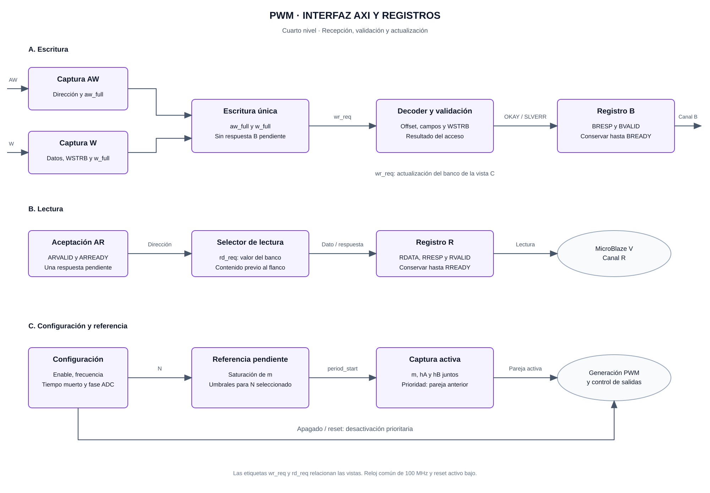
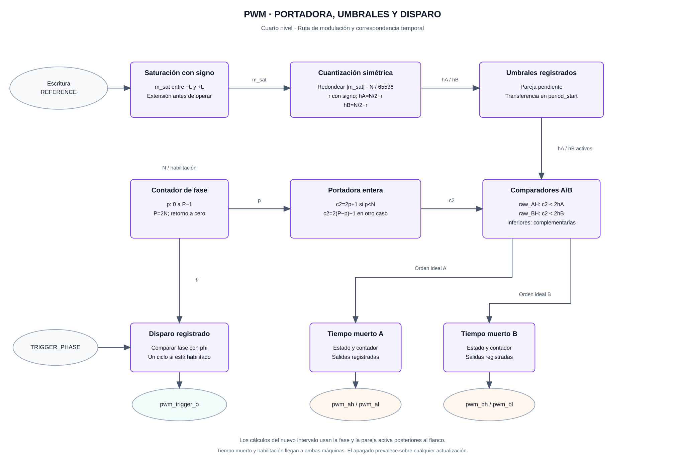
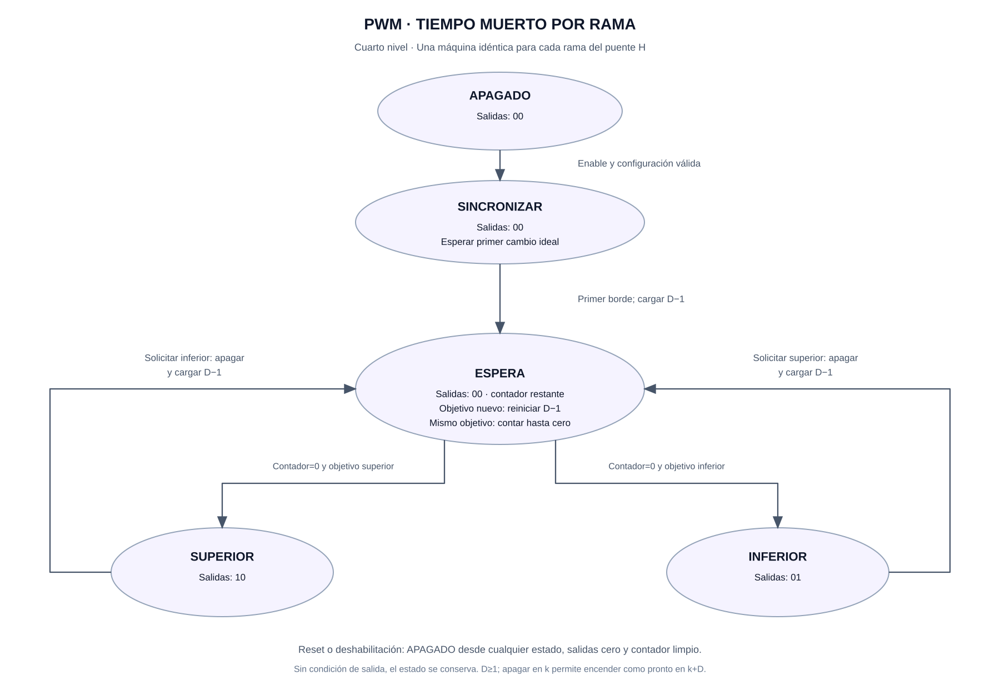

# Cuarto nivel — Registros, modulación y tiempo muerto

## Objetivo

Desarrollar los circuitos y las reglas de actualización del [tercer nivel del PWM](nivel_3_pwm.md): recepción AXI4-Lite, banco de registros, contador de fase, cuantización de referencia, comparadores, estados de tiempo muerto y pulso de adquisición.

La arquitectura es una propuesta para implementación RTL. Las ecuaciones y secuencias definen el comportamiento que deben comprobar los testbenches; los parámetros eléctricos se justifican con la etapa de potencia.

## 1. Interfaz AXI y banco de registros



**Figura 1.** Recepción independiente de dirección y datos de escritura, respuesta registrada y camino de lectura. La vista inferior desarrolla la configuración y la transferencia de referencia. Las etiquetas `wr_req`, `rd_req` y `period_start` relacionan las vistas sin representar conductores superpuestos.

### Entradas y salidas

| Grupo | Entradas | Salidas |
|---|---|---|
| Escritura | `AWADDR`, `AWVALID`, `WDATA[31:0]`, `WSTRB[3:0]`, `WVALID`, `BREADY` | `AWREADY`, `WREADY`, `BRESP[1:0]`, `BVALID` |
| Lectura | `ARADDR`, `ARVALID`, `RREADY` | `ARREADY`, `RDATA[31:0]`, `RRESP[1:0]`, `RVALID` |
| Temporización | `s_axi_aclk`, `s_axi_aresetn` | Actualizaciones registradas y salidas inactivas durante reset |

El ancho de dirección local `A` es parametrizable y al menos cuatro bits. El rango asignado al IP debe corresponder al ancho utilizado; el decoder comprueba todos los bits locales y la alineación antes de seleccionar un registro.

### Captura y finalización de accesos

AW y W disponen de un registro de captura y un indicador de ocupación independientes. Se admite una escritura pendiente. El diseño puede recibir primero cualquiera de los dos canales; la escritura interna ocurre una vez cuando ambas capturas están ocupadas y no hay respuesta B pendiente.

Se propone `AWREADY = aresetn && !aw_full && !bvalid` y una expresión equivalente para W. Al ejecutar `wr_req`, se liberan ambas capturas y se registra BVALID junto con BRESP. La respuesta se conserva hasta el handshake BVALID/BREADY. Esta implementación introduce ciclos de espera y prioriza una operación sencilla de verificar sobre el rendimiento del bus.

El canal de lectura admite una respuesta pendiente: `ARREADY = aresetn && !rvalid`. Al aceptar AR, se registra el dato seleccionado y su respuesta. Ambos permanecen estables hasta el handshake RVALID/RREADY. Una lectura y una escritura internas coincidentes devuelven en la lectura el contenido anterior al flanco de actualización.

El reset se afirma de forma asíncrona y se libera sincronizado al reloj de plataforma. Limpia capturas y respuestas pendientes. AWREADY, WREADY y ARREADY permanecen en cero mientras el reset está activo.

### Decodificación y valores de reset

| Offset | Campo almacenado | Reset | Acceso |
|---|---|---|---|
| `0x00` | CONTROL: `enable[0]`, `freq_sel[2:1]`, `running[3]` | Cero | Enable/frecuencia R/W; running RO |
| `0x04` | REFERENCE: `m_pending[15:0]` | Cero | R/W; lectura de la última referencia aceptada y saturada |
| `0x08` | DEADTIME: `D[31:0]` | Cero | R/W en reposo |
| `0x0C` | TRIGGER_PHASE: `phi[31:0]` | Cero | R/W en reposo |

Los bits reservados se leen como cero y sus escrituras se ignoran. Se combinan los bytes habilitados mediante `nuevo = (anterior & ~mascara_bytes) | (WDATA & mascara_bytes)`; después se evalúan los campos modificables. WSTRB=0 es una operación sin efecto para un offset válido.

Se usa OKAY=`00` para accesos aceptados y SLVERR=`10` para offsets no implementados, desalineación, frecuencia `11` y operaciones no permitidas. Un acceso rechazado no modifica la configuración. La orden de deshabilitación descrita a continuación tiene prioridad dentro de CONTROL.

### Apagado y habilitación

Con el generador activo, una escritura de CONTROL que incluya el byte 0 y escriba enable=0 se acepta como apagado. En esa transacción se conserva la frecuencia almacenada y se ignora cualquier intento de cambiarla. Así, escribir cero detiene el generador aunque estuviera seleccionada otra frecuencia.

Con enable=1 se rechazan los cambios de frecuencia, DEADTIME y TRIGGER_PHASE. Para reconfigurar: apagar, comprobar running=0, escribir los parámetros y volver a habilitar. En reposo, una escritura CONTROL puede seleccionar frecuencia y solicitar habilitación; la validación utiliza la frecuencia candidata y recalcula los umbrales con ella.

El encendido requiere parámetros coherentes. D=0, valor de reset, no permite arrancar. La actuación y el disparo se desactivan en el flanco que ejecuta el apagado interno, sin esperar al final del período. `running` indica que la base de tiempo está activa, incluido el intervalo de sincronización inicial de las ramas.

## 2. Contador, cuantización y comparadores



**Figura 2.** El contador recorre un período completo. Una transformación genera la portadora triangular y dos comparadores obtienen las órdenes ideales. La referencia y sus umbrales se transfieren juntos al comenzar el período. El disparo se deriva de la misma fase y se registra.

### Parámetros y tamaños

| Elemento | Definición |
|---|---|
| Reloj | 100 MHz; `Tclk = 10 ns` |
| Medio período | N=5000, 2500 o 2000 para las frecuencias de evaluación |
| Período completo | P=2N; 10000, 5000 o 4000 ciclos |
| Contador `p_q` | Recorre 0 a P−1; 14 bits bastan para P máximo de evaluación |
| Umbrales `h_A`, `h_B` | Enteros entre 0 y N; 13 bits bastan para N máximo |
| Referencia | 16 bits con signo, Q1.15 |
| Aritmética intermedia | Al menos 32 bits, con extensiones de signo y conversiones explícitas |

Los anchos se derivan de los máximos configurables cuando se cambie la tabla de frecuencias. `MOD_LIMIT_Q15` define la magnitud admisible de referencia, entre 1 y 32767; `MIN_ON_CYCLES` define la duración mínima de una orden activa después del tiempo muerto. Son parámetros de integración que requieren justificación con el accionamiento, no constantes físicas deducidas de las frecuencias de ensayo.

### Fase y portadora

En reposo, `p_q=0`. Al habilitar, se inicia el intervalo de fase cero. Cada flanco activo avanza una posición; P−1 retorna a cero y produce el evento `period_start`.

Se compara utilizando una portadora triangular entera en puntos medios:

```math
c_2(p)=\begin{cases}
2p+1, & 0\le p<N,\\
2(P-p)-1, & N\le p<P.
\end{cases}
```

La secuencia es `1, 3, …, 2N−1, 2N−1, …, 3, 1`, con exactamente 2N intervalos. Los dos valores consecutivos del máximo representan dos muestras alrededor del vértice; no añaden ciclos al período.

### Cuantización simétrica

Primero se interpreta la referencia como un entero con signo y se satura a `[-L, +L]`, donde `L = MOD_LIMIT_Q15`. La magnitud y la negación se calculan con un ancho mayor de 16 bits, incluido el caso de entrada −32768.

Se define:

```math
a=\left\lfloor\frac{N\,|m_{sat}|+32768}{65536}\right\rfloor,
\qquad r=\begin{cases}-a,&m_{sat}<0,\\a,&m_{sat}\ge0.\end{cases}
```

Luego, `h_A=N/2+r` y `h_B=N/2−r`. Los N de evaluación son pares. El redondeo al entero más cercano, con empates alejándose de cero, mantiene `h_A+h_B=N` y la simetría al cambiar el signo de la referencia.

Las órdenes ideales superiores son `raw_AH = (c_2 < 2*h_A)` y `raw_BH = (c_2 < 2*h_B)`. Las inferiores son sus complementarias. Cada orden superior ocupa exactamente `2*h` ciclos antes de insertar tiempo muerto.

| Referencia, N=2500 | `h_A` | `h_B` | Ciclo ideal A | Ciclo ideal B |
|---|---:|---:|---:|---:|
| m=0 | 1250 | 1250 | 50 % | 50 % |
| m=+0,5 | 1875 | 625 | 75 % | 25 % |
| m=−0,5 | 625 | 1875 | 25 % | 75 % |

La referencia equivalente cuantizada es `m_q=2r/N`; su diferencia respecto a la referencia saturada está acotada por `1/N`. Esta cota corresponde a cuantización temporal ideal, no al error experimental de corriente. El tiempo muerto altera los tiempos de conducción reales.

### Validación del conjunto de parámetros

Antes de habilitar, se exige frecuencia válida, `0 ≤ phi < P`, D≥1 y parámetros de integración válidos. Además se obtiene:

```math
h_{min}=N/2-\left\lfloor\frac{N\,L+32768}{65536}\right\rfloor,
\qquad 2h_{min}\ge D+MIN\_ON\_CYCLES.
```

Esta condición mantiene los umbrales dentro del período y deja margen para el pulso activo después de retrasar su encendido. Se comprueba para la frecuencia seleccionada y todo el rango de referencia permitido. Los valores de D y phi pueden configurarse por separado en reposo; la coherencia conjunta se comprueba al habilitar.

### Referencia pendiente y activa

Cada escritura REFERENCE produce una pareja coherente: referencia saturada y umbrales pendientes. Si se modifica la frecuencia en reposo, se recalculan los umbrales pendientes. Al habilitar se usan los parámetros candidatos; durante operación la pareja se transfiere a los registros activos únicamente al retornar la fase a cero.

Si una escritura coincide con `period_start`, se aplica la pareja que ya estaba pendiente antes del flanco. La nueva escritura queda para el período siguiente. Esta prioridad evita usar una referencia nueva con umbrales anteriores. Las escrituras posteriores sustituyen la pareja pendiente completa.

## 3. Máquina de tiempo muerto por rama



**Figura 3.** La misma máquina se instancia para A y B. Las transiciones entre activaciones superior e inferior pasan por ESPERA, con ambas órdenes inactivas. El estado SINCRONIZAR evita comenzar a conducir a mitad del primer pulso ideal.

### Entradas, estado y salidas

Cada máquina recibe la orden ideal superior, la habilitación y D. Conserva estado, objetivo y contador restante. Sus dos salidas son registradas y solo pueden tomar `00`, `10` o `01`.

| Estado | Salidas superior/inferior | Transición |
|---|---|---|
| APAGADO | `00` | Al habilitar: guardar la orden ideal y entrar a SINCRONIZAR |
| SINCRONIZAR | `00` | Esperar el primer cambio de la orden ideal; entonces guardar el nuevo objetivo, cargar D−1 y entrar a ESPERA |
| ESPERA | `00` | Si cambia el objetivo, reiniciar la espera; si el contador es mayor de cero, decrementarlo; con cero y objetivo estable, activar la salida correspondiente |
| SUPERIOR | `10` | Conservar mientras se solicite superior; al pedir inferior, apagar y entrar a ESPERA con D−1 |
| INFERIOR | `01` | Conservar mientras se solicite inferior; al pedir superior, apagar y entrar a ESPERA con D−1 |

Reset o deshabilitación tienen prioridad en todos los estados: salidas cero, contador limpio y estado APAGADO. Un estado no reconocido también lleva a APAGADO.

Si una orden se apaga en el flanco k y la complementaria continúa solicitada, el encendido ocurre como pronto en k+D. Por ejemplo, con D=3 se carga 2 en k, se pasa por 1 y 0 en k+1 y k+2, y se permite activar en k+3. Si el objetivo cambia durante ESPERA, se reinicia la cuenta para no emitir un pulso de una orden descartada.

La sincronización de arranque espera un borde real del PWM antes de iniciar una activación completa. Así no se interpreta la mitad restante del pulso de fase cero como un pulso nuevo. En operación, actualizar los umbrales en el valle conserva la orden ideal de ese instante y mantiene el margen mínimo validado.

## 4. Registro del disparo ADC y orden de cálculo

El disparo se registra durante un intervalo cuando la fase del intervalo coincide con phi y el generador está activo. Al arrancar, phi=0 produce el primer pulso en el intervalo inicial. Reset o apagado lo llevan a cero; cada período contiene una sola coincidencia.

Las salidas registradas de cada flanco se calculan a partir de la fase y la referencia que regirán después de ese flanco. En un retorno a cero, primero se selecciona la pareja activa para el nuevo período; con ella se obtienen las órdenes ideales que consumen las máquinas de tiempo muerto. Esto evita un desfase de un ciclo entre contador, comparadores y disparo.

La interfaz ADC síncrona reconoce el pulso en el siguiente flanco receptor. Su adaptación al XADC y la latencia de conversión forman parte de la temporización de adquisición. El PWM continúa su base de tiempo sin esperar el resultado del ADC.

## 5. Comprobaciones para el RTL

| Caso | Resultado que debe comprobarse |
|---|---|
| AW antes de W y W antes de AW | Una única escritura y una respuesta por acceso |
| BREADY/RREADY desactivados | Respuesta y dato conservados hasta su aceptación |
| Acceso inválido | SLVERR sin modificación de configuración |
| CONTROL=0 durante operación | Apagado prioritario, conservando la frecuencia |
| Escritura en el límite de período | Aplicación de la pareja pendiente anterior; la nueva queda para el siguiente |
| Referencia cero y cambio de signo | Simetría de umbrales y ausencia de tensión diferencial ideal para cero |
| Comparación de un período completo | P ciclos y `2*h` muestras activas por salida ideal superior |
| Arranque, cambio de objetivo y apagado durante ESPERA | Sin pulsos truncados de arranque, sin solapamiento y sin activación de objetivos descartados |
| Tiempo muerto D | Separación de al menos D ciclos entre órdenes complementarias |
| Fase ADC cero y P−1 | Un pulso de un ciclo por período, identificado con la fase correspondiente |

Las comprobaciones de ecuaciones y secuencias permiten revisar la propuesta. La conformidad del circuito requiere los testbenches RTL, el análisis de implementación y la simulación temporizada. La aceptación eléctrica depende además del ensayo con drivers y etapa de potencia.

## Referencias

- [Tercer nivel del PWM y contrato de integración](nivel_3_pwm.md).
- [Arm, especificación de AXI y AXI4-Lite](https://developer.arm.com/-/media/Arm%20Developer%20Community/PDF/IHI0022H_amba_axi_protocol_spec.pdf).
- [AMD, comprobaciones de protocolo AXI](https://docs.amd.com/r/en-US/pg267-axi-vip/AXI-Protocol-Checks-and-Descriptions).
- [Imperix, portadoras y actualización de parámetros PWM](https://imperix.com/doc/software/carrier-based-pwm).
- [Microchip, PWM centrado e inserción de tiempo muerto](https://developerhelp.microchip.com/xwiki/bin/view/applications/power/digital-power-converter-basics/digital-peripherals-mimicking-analog-behavior/pwm-edge-center-aligned-modes/).

[Índice del diseño](README.md) · [Descripción del proyecto](../../README.md)
