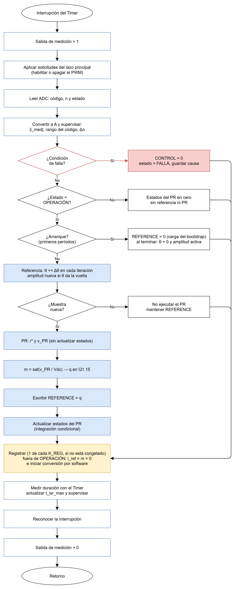
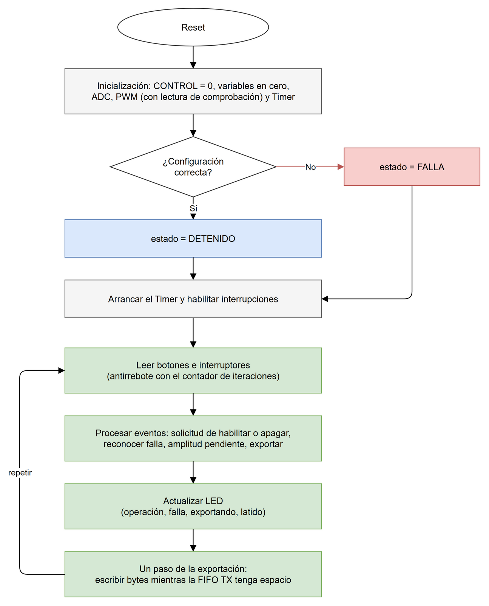

# Cuarto nivel — Rutina de control, registro y exportación

Este documento desarrolla los bloques del [tercer nivel del software](nivel_3_software.md): el flujo de la rutina periódica, la inicialización y el lazo principal, los cálculos de cada bloque, la estructura del registro de muestras, el formato de la trama UART y las funciones de los drivers. Los valores que dependen de PEDP, del ADC o de la plataforma se tratan como parámetros con nombre; su valor se fija en el archivo de configuración cuando se acuerden.

## 1. Rutina periódica de control



**Figura 1.** Flujo de una iteración de la ISR. Las cuatro decisiones, en orden, separan una falla, el control detenido, el arranque y la muestra no nueva. En OPERACIÓN la fase de la referencia avanza en cada iteración, incluso si la muestra se repite; el PR solo se ejecuta con una muestra nueva. Todos los caminos se reúnen antes del registro de la muestra, de modo que el histórico conserva también lo ocurrido en DETENIDO y en FALLA.

### Secuencia

| Paso | Operación | Observaciones |
|---|---|---|
| 1 | Activar la salida GPIO de medición | Marca el inicio de la iteración para el osciloscopio |
| 2 | Aplicar las solicitudes del lazo principal | Habilitar o apagar el PWM. Se hace aquí para que el PWM arranque siempre a la misma distancia de la interrupción |
| 3 | Leer el ADC | Código, número de muestra `n` y estado, en una lectura coherente |
| 4 | Convertir y supervisar | Corriente en amperios, rango del código, continuidad de `n` y sobrecorriente |
| 5 | Decidir el estado | Una falla apaga el PWM y salta al paso 11. Fuera de OPERACIÓN no hay control: los estados del PR se ponen en cero y se salta al paso 11. En los primeros `N_ARRANQUE` períodos después de habilitar se escribe REFERENCE = 0 para cargar el bootstrap de los drivers y se salta al paso 11; al terminar, `θ` arranca en cero con la amplitud pedida |
| 6 | Referencia | En OPERACIÓN, avanzar la fase en cada iteración y aplicar el cambio de amplitud en el cruce por cero, aunque la muestra no sea nueva |
| 7 | PR | Solo con muestra nueva: calcular la parte resonante y `v_PR` sin actualizar todavía los estados. Con una muestra repetida se mantiene REFERENCE y se salta al paso 11 |
| 8 | Modulación | `m = sat(v_PR/Vdc)` y conversión a Q1.15 |
| 9 | Escribir REFERENCE | Una escritura de 32 bits |
| 10 | Actualizar los estados del PR | Según la regla de anti-windup |
| 11 | Registrar y preparar la siguiente muestra | Una de cada `K_REG` iteraciones, si el buffer no está congelado. Fuera de OPERACIÓN, iniciar la conversión por software que se leerá en la siguiente iteración |
| 12 | Medir la duración | Contador del Timer; actualizar el máximo |
| 13 | Reconocer la interrupción | Limpiar el pendiente del Timer y del controlador de interrupciones |
| 14 | Desactivar la salida GPIO de medición | El ancho del pulso es la duración de la ISR |

El paso 9 ocurre antes que el registro y la medición para que la referencia llegue al PWM lo antes posible dentro del período. El paso 13 es el único que depende de la configuración del controlador de interrupciones, que define la plataforma. La fase de la referencia avanza en cada iteración de OPERACIÓN y no solo cuando llega una muestra nueva, porque los 50 Hz son una magnitud del tiempo y no del número de muestras recibidas; de lo contrario, cada muestra repetida atrasaría la referencia 0,9° a 20 kHz.

### Lectura y validación de la muestra

La corriente se obtiene con la relación lineal que documente la adquisición:

```math
i_{med} = (\text{código} - \text{OFFSET\_ADC}) \cdot \text{GANANCIA\_ADC}\quad [\text{A}].
```

El número de muestra es un contador de 16 bits que avanza con cada conversión. La diferencia con el anterior se calcula en aritmética modular:

```math
\Delta n = (n - n_{ant}) \bmod 2^{16}.
```

| `Δn` | Significado | Acción |
|---|---|---|
| `N_PWM_POR_CONTROL` | Muestra nueva y sin pérdidas | Ejecutar el PR |
| 0 | Muestra repetida | No ejecutar el PR y mantener la REFERENCE anterior; la fase de la referencia sí avanza |
| Otro valor | Se perdieron `Δn − N_PWM_POR_CONTROL` conversiones | Ejecutar el PR con la muestra nueva y sumar las pérdidas |

`N_PWM_POR_CONTROL` es el número de períodos PWM por período de control: vale 1 si ambos coinciden. Una muestra repetida o con pérdidas incrementa un contador de iteraciones anómalas consecutivas. Si llega a `N_FALLA_MUESTRAS`, la supervisión declara falla. El contador vuelve a cero con cada muestra correcta.

En DETENIDO y FALLA el PWM está apagado y no hay disparos. Para seguir midiendo, en esos estados la ISR inicia una conversión por software en el paso 11 y la lee en la siguiente iteración; el `Δn` esperado es entonces 1. El paso 11 está después del punto donde se reúnen todos los caminos del flujo, de modo que la siguiente conversión se inicia aunque la muestra actual no haya sido nueva. Al habilitar el PWM cambia el origen de las conversiones y la primera iteración puede ver un `Δn` distinto; el umbral de `N_FALLA_MUESTRAS` iteraciones consecutivas tolera ese caso. El enunciado exige que la adquisición admita los dos inicios de conversión; el registro exacto lo define la adquisición.

### Supervisión

| Condición | Detección | Parámetro |
|---|---|---|
| Sobrecorriente | `|i_med| > I_MAX` en una sola muestra | `I_MAX`, de PEDP |
| Código fuera de rango | `código < CODIGO_MIN` o `código > CODIGO_MAX`: sensor saturado o desconectado | Límites de la adquisición |
| Muestras anómalas | `N_FALLA_MUESTRAS` iteraciones consecutivas con `Δn` incorrecto | Propuesto: 3 |
| Exceso de tiempo | La duración medida en el paso 12 supera el período de control menos un margen | `MARGEN_ISR` |
| Error de configuración | La lectura de comprobación del PWM no coincide o `running` no sube | — |

Las condiciones se evalúan en cada iteración, en DETENIDO y en OPERACIÓN, de modo que un sensor desconectado o un ADC que no responde se detecta antes de habilitar la potencia. La comprobación de `running` ocurre solo al habilitar.

Ante una falla, la ISR escribe `CONTROL = 0` en la misma iteración. El contrato del PWM garantiza que esa escritura siempre se acepta y que las órdenes se apagan en el siguiente ciclo de reloj. La causa queda guardada en un registro de bits que se exporta en la trama y no se borra hasta el reconocimiento.

### Referencia sinusoidal

La fase se guarda en un acumulador entero de 32 bits, `θ`, que da la vuelta solo al pasar de 2π. En cada iteración se avanza primero la fase y después se lee la tabla con la fase nueva:

```math
\theta[k] = \theta[k-1] + \Delta\theta \pmod{2^{32}}, \qquad \Delta\theta = \text{round}\left(2^{32} \cdot f_{ref} \cdot T_s\right).
```

Con `f_ref = 50 Hz` y `Ts = 50 µs`, `Δθ = 10 737 418`. El error relativo de frecuencia por el redondeo es del orden de 10⁻⁸. Los 8 bits superiores de `θ` seleccionan una de las 256 entradas de la tabla de seno, guardada en Q1.15 (512 B). Usar una tabla escalonada atenúa la fundamental en un factor `sinc(π/256)`, que equivale a 0,0025 %. Esa atenuación es despreciable frente al criterio de 10 %.

```math
i_{ref}[k] = A \cdot \frac{\text{tabla}[\theta[k] \gg 24]}{32768}.
```

El cruce por cero ascendente se detecta cuando `θ[k] < θ[k-1]`, es decir, cuando el acumulador da la vuelta. En esa iteración, la amplitud pendiente que escribió el lazo principal pasa a ser la activa antes de leer la tabla. Como la fase acaba de dar la vuelta, la lectura cae en las primeras entradas, con valores cercanos a 0, y el cambio de amplitud no produce un salto apreciable en `i_ref`. Al habilitar el control, `θ` arranca en cero.

### Controlador PR y anti-windup

La parte resonante se calcula primero como candidata, sin modificar los estados:

```math
r^{*} = b_0 e[k] + b_1 e[k-1] + b_2 e[k-2] - a_1 r[k-1] - a_2 r[k-2], \qquad v_{PR} = K_p e[k] + r^{*}.
```

Después de la conversión a modulación, los estados se actualizan con integración condicional:

| Resultado de la saturación | Actualización |
|---|---|
| `m` no saturó | `e[k-2] ← e[k-1]`, `e[k-1] ← e[k]`, `r[k-2] ← r[k-1]`, `r[k-1] ← r*` |
| `m` saturó y `e[k]` tiene signo opuesto a `v_PR` | Igual que el caso anterior: el error ayuda a salir de saturación |
| `m` saturó y `e[k]` tiene el mismo signo que `v_PR` | Se conservan los estados: el resonador no acumula un error que la actuación no puede corregir |

En DETENIDO y FALLA los cuatro estados se mantienen en cero, por lo que al habilitar el controlador parte siempre de la misma condición. Los coeficientes `Kp, b0, b1, b2, a1, a2` se calculan fuera del microcontrolador con el método que elija PEDP y se copian al archivo de configuración. Su validación es comparar la salida del código en PC con la ecuación evaluada en Python o PLECS para la misma secuencia de error.

### Conversión a Q1.15

```math
m = \min\left(\max\left(\frac{v_{PR}}{V_{dc}},\ -M\right),\ M\right), \qquad M = \frac{\text{MOD\_LIMIT\_Q15}}{32768}.
```

```math
q = \text{round}(m \cdot 32768), \qquad \text{REFERENCE} = q \ \&\ \text{0xFFFF}.
```

Como `|m| ≤ M` y `MOD_LIMIT_Q15 ≤ 32767`, el entero `q` siempre cabe en 16 bits con signo y no llega a −32768. La multiplicación por la inversa de `Vdc`, calculada una vez en la inicialización, reemplaza la división dentro de la ISR.

## 2. Registro de muestras

Cada entrada ocupa 8 bytes:

| Campo | Tipo | Unidad o formato |
|---|---|---|
| `i_med` | `int16_t` | mA (rango ±32,767 A, resolución 1 mA) |
| `i_ref` | `int16_t` | mA |
| `m` | `int16_t` | Q1.15, el mismo valor escrito en REFERENCE |
| `n` | `uint16_t` | Número de muestra del ADC |

El buffer es un arreglo de `N_BUF` entradas con un índice de escritura que vuelve a cero al llegar al final. Un contador de iteraciones selecciona una de cada `K_REG` para registrar (la `k` del tercer nivel). Mientras la bandera `congelado` está activa, la ISR no escribe. El lazo principal es el único que activa y desactiva esa bandera.

Qué se registra en cada caso: con el PR ejecutado se guardan los valores de esa iteración. Con una muestra repetida en OPERACIÓN se guardan la `i_ref` calculada y el último `m` escrito en REFERENCE. En DETENIDO y FALLA no hay referencia ni PR, así que `i_ref` y `m` se guardan en 0. La corriente medida y el número de muestra se guardan siempre.

La ventana registrada es `N_BUF · K_REG · Ts`. El enunciado pide al menos 100 ms. Con `N_BUF = 1024` (8 KB), la ventana para cada frecuencia de evaluación del PWM, con un período de control igual al período PWM, queda así:

| Frecuencia | `Ts` | `K_REG` mínimo | Ventana | Frecuencia de registro |
|---|---|---|---|---|
| 10 kHz | 100 µs | 1 | 102,4 ms | 10 kHz |
| 20 kHz | 50 µs | 2 | 102,4 ms | 10 kHz |
| 25 kHz | 40 µs | 3 | 122,9 ms | 8,33 kHz |

`N_BUF` se ajusta cuando se conozca el tamaño real del programa. Si hay espacio, conviene aumentarlo para cubrir más períodos y mejorar la extracción de la fundamental.

La muestra se toma en el valle de la portadora, que es el instante en que la corriente instantánea coincide con su valor medio en el período. Por eso el registro representa la componente de baja frecuencia, no el rizado de conmutación. Además, con frecuencias de registro de 8 a 10 kHz el rizado a la frecuencia de conmutación tampoco es observable. El rizado pico a pico se mide con el osciloscopio, como pide el enunciado; la PC analiza la fundamental, su error y su desfase.

## 3. Inicialización y lazo principal



**Figura 2.** Inicialización y lazo principal. El lazo no tiene esperas: cada paso hace lo que puede y continúa, de modo que su duración por vuelta es corta y las interrupciones lo atienden en cualquier punto.

### Inicialización

1. Escribir `CONTROL = 0` en el PWM y apagar los LED. Esto se hace primero para que nada quede accionado si el programa se reinició con el PWM en marcha.
2. Poner en cero los estados del PR, el buffer, `θ`, la amplitud y los contadores.
3. Configurar la adquisición según su contrato.
4. Escribir DEADTIME, TRIGGER_PHASE y `REFERENCE = 0` con el PWM apagado. Leer cada registro de vuelta y comprobar el valor.
5. Configurar el Timer en modo de generación con recarga automática e interrupción, y conectarlo con el controlador de interrupciones.
6. Si todas las comprobaciones son correctas, pasar a DETENIDO; si no, a FALLA. En ambos casos, arrancar el Timer y habilitar las interrupciones.

El contrato del PWM responde SLVERR ante un acceso inválido. Desde C, esa respuesta solo se observa si la plataforma la convierte en una excepción de acceso. Por eso la comprobación se hace leyendo de vuelta los registros, sin depender de esa configuración.

### Lazo principal

| Paso | Operación |
|---|---|
| Leer entradas | Botones e interruptores por GPIO. Un cambio se acepta si se mantiene durante `T_REBOTE` (propuesto: 20 ms), contado con el número de iteraciones de la ISR, sin funciones de espera |
| Procesar eventos | Habilitar o apagar: deja una solicitud para la ISR. Reconocer falla: pasa de FALLA a DETENIDO y borra la causa. Interruptores de amplitud: actualizan la amplitud pendiente. Exportar: inicia la exportación si no hay una en curso |
| Actualizar LED | Operación, falla, exportación en curso y latido (alternado cada 0,5 s con el mismo contador) |
| Atender la exportación | Ejecuta un paso de la máquina de exportación |

Las solicitudes y la amplitud pendiente son variables `volatile` de 32 bits que escribe solo el lazo principal y lee solo la ISR. El estado de la aplicación y la causa de falla los escribe solo la ISR, salvo el reconocimiento de falla, que el lazo principal hace únicamente cuando el estado ya es FALLA y el PWM está apagado.

### Máquina de exportación

| Estado | Acción | Siguiente |
|---|---|---|
| REPOSO | Esperar la solicitud | Al solicitar: activar `congelado`, armar el encabezado → ENCABEZADO |
| ENCABEZADO | Escribir bytes del encabezado mientras la FIFO de transmisión no esté llena | Encabezado completo → MUESTRAS |
| MUESTRAS | Escribir las entradas desde la más antigua, mientras haya espacio en la FIFO | Todas enviadas → CRC |
| CRC | Escribir los 2 bytes del CRC | Enviados → desactivar `congelado` → REPOSO |

UART Lite tiene una FIFO de transmisión de 16 bytes y un bit de FIFO llena en su registro de estado. La máquina escribe mientras ese bit esté en cero y, cuando la FIFO se llena, devuelve el control al lazo principal. El CRC se calcula a medida que se envía cada byte, sin recorrer el buffer dos veces.

## 4. Trama de exportación

Todos los campos multibyte van en little-endian, el orden nativo de MicroBlaze V.

| Offset | Campo | Tamaño | Contenido |
|---|---|---|---|
| 0 | Sincronismo | 2 B | `0xA5 0x5A` |
| 2 | Versión | 1 B | Versión del formato, inicialmente 1 |
| 3 | Estado | 1 B | Estado de la aplicación al exportar |
| 4 | `f_sw` | 4 B | Frecuencia de conmutación en Hz |
| 8 | `Ts` | 4 B | Período de control en ns |
| 12 | `K_REG` | 2 B | Submuestreo del registro |
| 14 | `N` | 2 B | Número de entradas enviadas |
| 16 | Amplitud | 2 B | Amplitud activa en mA |
| 18 | Causa de falla | 2 B | Registro de bits de la supervisión |
| 20 | `t_isr_max` | 4 B | Duración máxima medida de la ISR, en ciclos de 100 MHz |
| 24 | Muestras perdidas | 4 B | Total acumulado desde el último reset |
| 28 | Muestras | 8·N B | Entradas en orden cronológico, con el formato de la sección 2 |
| 28 + 8·N | CRC | 2 B | CRC-16/CCITT-FALSE (polinomio `0x1021`, valor inicial `0xFFFF`) de los bytes 2 a 27 + 8·N |

Con `N = 1024` la trama mide 8222 B. A 115200 bit/s con 8N1 (10 bits por byte), la transmisión tarda unos 0,71 s.

La aplicación de PC busca el sincronismo, lee el encabezado y comprueba el CRC antes de aceptar las muestras. Una trama con CRC incorrecto o incompleta se descarta y se informa. Los parámetros del encabezado acompañan a los datos en los archivos generados, para que cada ensayo quede identificado con sus condiciones.

## 5. Análisis en la PC

1. Convertir `i_med` e `i_ref` a amperios y construir el eje de tiempo con `K_REG · Ts`.
2. Tomar la mayor cantidad de períodos completos de 50 Hz que quepa en la ventana, como mínimo cinco.
3. Calcular la componente de 50 Hz de cada señal con la transformada de Fourier evaluada en esa frecuencia: amplitud y fase.
4. Reportar:
   - el error relativo de amplitud: `(|I_med| − |I_ref|)/|I_ref|`;
   - el desfase: `∠I_med − ∠I_ref`;
   - el residuo de baja frecuencia: `i_med` menos su fundamental.
5. Revisar `n` para confirmar que no faltan muestras dentro de la ventana.

Al usar un número entero de períodos, la transformada en 50 Hz no tiene fuga espectral. El resultado es la amplitud de la fundamental que pide el criterio de 10 %, sin que el error instantáneo del PWM se cuente como error de seguimiento.

## 6. Drivers y parámetros

### Funciones de los drivers

| Driver | Función | Descripción |
|---|---|---|
| PWM | `pwm_apagar()` | Escribe `CONTROL = 0` |
| PWM | `pwm_configurar(freq_sel, deadtime, phase)` | Apaga, escribe frecuencia, DEADTIME, TRIGGER_PHASE y REFERENCE = 0 y los comprueba leyendo de vuelta; devuelve error si no coinciden |
| PWM | `pwm_habilitar(freq_sel)` | Escribe CONTROL con `enable = 1` y comprueba `running` |
| PWM | `pwm_escribir_referencia(q)` | Escribe REFERENCE con el entero Q1.15 |
| ADC | `adc_configurar()` | Comprueba que ERROR esté en cero al iniciar |
| ADC | `adc_leer(&codigo, &n, &estado)` | Lee STATUS y SAMPLE (ID y código en una lectura) y reconoce la muestra escribiendo su token en ACK_ID |
| ADC | `adc_iniciar_conversion()` | Inicio por software, usado en DETENIDO y FALLA |
| GPIO | `gpio_iniciar()`, `gpio_leer_entradas()`, `gpio_escribir_led(mascara)`, `gpio_medicion(nivel)` | Canales y bits según la plataforma; LED y medición en canales distintos para que la ISR y el lazo no se pisen |
| UART | `uart_iniciar()`, `uart_tx_llena()`, `uart_escribir(byte)` | Reinicio de FIFOs, bit de FIFO llena y escritura de un byte, sin espera |
| Timer | `timer_configurar(carga)`, `timer_arrancar()`, `timer_reconocer()`, `timer_contador()` | Contador 0 en modo de generación con recarga e interrupción; contador 1 libre para medir la duración |

Las direcciones base se toman de `xparameters.h`, que genera Vitis a partir del hardware exportado. Así, un cambio en el Address Editor no requiere editar el código. Los offsets del PWM y de la adquisición se definen en el encabezado de cada driver, según sus contratos.

### Parámetros de configuración

| Parámetro | Origen | Uso |
|---|---|---|
| `FREQ_SEL`, `N_PWM_POR_CONTROL`, `TS` | Equipo y PEDP | Frecuencia, período de control y `Δθ` |
| `DEADTIME_CICLOS`, `TRIGGER_PHASE` | Aguilar, Campos y PEDP | Configuración del PWM |
| `KP`, `B0`, `B1`, `B2`, `A1`, `A2` | PEDP | Controlador PR |
| `VDC`, `MOD_LIMIT_Q15` | PEDP y Aguilar | Conversión a modulación |
| `I_MAX`, `CODIGO_MIN`, `CODIGO_MAX` | PEDP y Campos | Supervisión |
| `OFFSET_ADC`, `GANANCIA_ADC` | Campos | Conversión a amperios |
| `AMPLITUDES` | Enunciado | 0,2; 0,5 y 1,0 A pico |
| `N_BUF`, `K_REG` | Software | Registro de muestras |
| `N_FALLA_MUESTRAS`, `MARGEN_ISR`, `T_REBOTE` | Software | Supervisión y botones |
| `N_ARRANQUE` | Aguilar | Períodos con REFERENCE = 0 al habilitar (bootstrap) |

## 7. Comprobaciones por bloque

| Bloque | Comprobación |
|---|---|
| Referencia | 50 cruces por cero en 1 s de iteraciones simuladas; cambio de amplitud solo cuando `θ` da la vuelta |
| PR | Igualdad con la ecuación evaluada aparte, con tolerancia de redondeo de `float`; estados en cero al detener |
| Anti-windup | Con una referencia imposible de alcanzar, `r` no crece mientras dure la saturación y no hay sobreimpulso al liberarla |
| Q1.15 | `m = ±M`, `0`, `±1/32768` y valores fuera de rango |
| Validación de `n` | Secuencias con repeticiones, saltos y vuelta del contador de 16 bits; con una repetición, la fase de la referencia avanza igual |
| Supervisión | Cada condición produce su bit de causa y escribe `CONTROL = 0` en la misma iteración |
| Registro | Submuestreo `K_REG`, vuelta del índice y ninguna escritura mientras está congelado |
| Trama | CRC conocido para una trama de referencia; la PC rechaza un byte alterado y una trama cortada |
| Exportación | La máquina nunca espera: con la FIFO llena, vuelve al lazo principal sin escribir |
| Temporización en la tarjeta | Período de la salida de medición igual a `Ts`; duración máxima por debajo de `Ts − MARGEN_ISR`, también durante la exportación |

[Tercer nivel del software](nivel_3_software.md) · [Índice del diseño](README.md)
