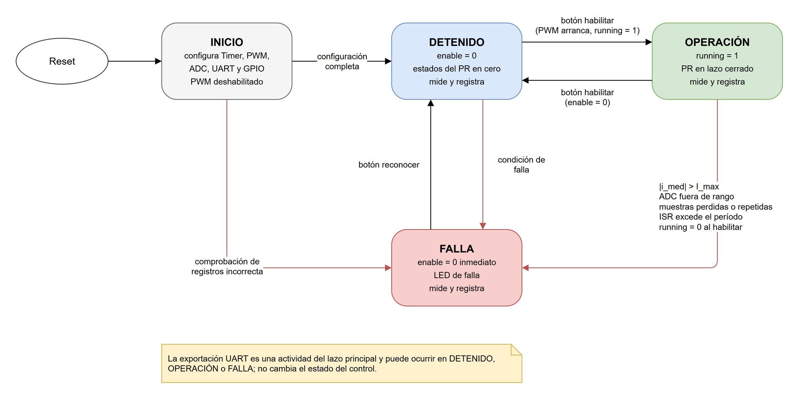
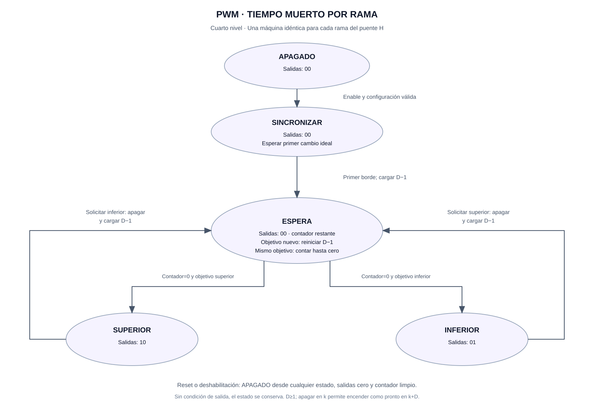
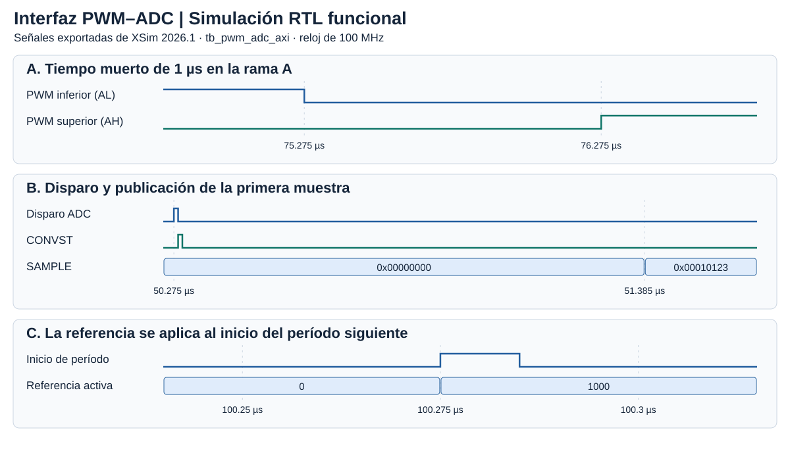
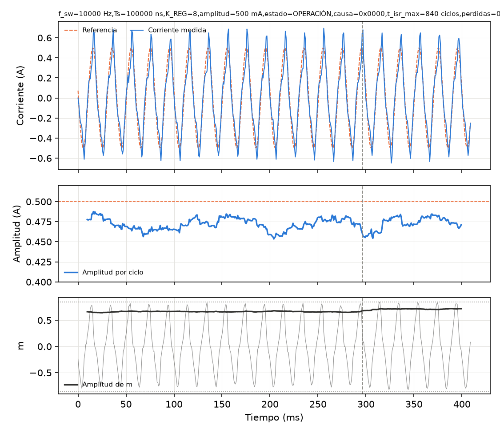

# Informe técnico de Taller de Diseño Digital

**EL3313 · Proyecto 4.** Daniel Puentes, Kevin Aguilar, Kenneth Campos y Kevin Cortés.

La Basys 3 regula la corriente de un inversor monofásico en lazo cerrado y exporta por UART las muestras del control. El PWM personalizado y el XADC se verificaron mediante simulaciones autocomprobables. En el montaje, la corriente de 50 Hz siguió las consignas de 0,2 A pico con 12 y 24 V y de 0,5 A pico con 24 V dentro del error de amplitud del 10 %. Los resultados incluyen la puesta en marcha, las fallas observadas y los límites del montaje.

## Fundamentos y enfoque

**Procesamiento embebido.** MicroBlaze V ejecuta el firmware bare-metal. Se utiliza RV32 con FPU simple para calcular el PR en punto flotante, reloj de 100 MHz y caché de instrucciones de 8 KiB. El controlador AXI de instrucciones y el controlador LMB de datos acceden a puertos distintos de una BRAM física de 32 KiB compartida. El MDM permite depuración JTAG. SmartConnect da acceso a los registros de los periféricos desde el espacio de direcciones del procesador. [AMD, MicroBlaze V Processor Reference Guide](https://docs.amd.com/r/en-US/ug1629-microblaze-v-user-guide/Memory-Architecture).

**Interfaz de periféricos.** AXI4-Lite separa dirección y dato de escritura en AW y W, confirma la escritura en B y utiliza AR y R para lectura. Cada transferencia ocurre con VALID y READY simultáneos. El esclavo puede capturar AW y W en distinto orden y debe sostener la respuesta mientras el maestro no la acepte. El PWM admite escrituras por byte mediante WSTRB y utiliza SLVERR para accesos no admitidos. El ADC añade reconocimiento de muestras por token para preservar la indicación de una publicación más reciente. [AMD, AXI Reference Guide](https://docs.amd.com/api/khub/documents/1N~rJgeEMU28Fyv7kWcW6Q/content).

**Temporización.** El AXI Timer solicita una interrupción por AXI INTC cada 100 µs nominales. El PWM genera el disparo de adquisición a los 50 µs de su propio período, sin depender del tiempo de ejecución del código. La ISR consume una muestra completa, actualiza el PR y escribe una referencia pendiente. El PWM captura esa referencia al inicio del siguiente período, evitando truncar pulsos a mitad de ciclo. El firmware registró la duración máxima instrumentada de la ISR. El desfase efectivo Timer–PWM y el jitter requieren medir los flancos en tarjeta.

**Puente H y control.** La modulación unipolar usa referencias opuestas para las dos ramas. La tensión diferencial toma los niveles +Vdc, 0 y −Vdc. En el modelo promediado vale aproximadamente m·Vdc. Con carga serie, L·di/dt + R·i = VAB. Se seleccionaron cuatro IRF540N, dos IR2110, 6,6 Ω de resistencia externa y un devanado con aproximadamente 0,6 Ω de resistencia. Se midieron 9,29 mH a 120 Hz y 6,98 mH a 1 kHz. Los 10 mH a 50 Hz son un valor de modelado. El tiempo muerto separa el apagado de una orden del encendido de su complementaria. Se eligieron 10 kHz para coordinar el muestreo y limitar el rizado, con 20 y 25 kHz disponibles en el periférico. [Dimensionamiento y selección de componentes](../../Potencia/01_diseno_y_componentes.md).

**Realimentación y registro.** El ACS712 de 5 A entrega una tensión con offset, reducida por un divisor de 4,7 kΩ/1 kΩ hacia VAUX6. El firmware de laboratorio usa un cero de 1776 códigos, signo positivo para la orientación ensayada y una escala nominal de 7,64 mA por código. Falta contrastar esa escala con una medición independiente. El PR suma una acción proporcional y una rama resonante centrada en 50 Hz, discretizada con Tustin preajustado. La acción se limita a ±0,85 y se convierte a Q1.15 para el PWM. La aplicación de laboratorio registra 512 muestras cada 200 µs y las transmite por UART Lite en tramas con CRC-16. En caso de falla, deshabilita el PWM. [Diseño del software](../diseno/nivel_4_software.md).

## Interfaz implementada y estados

El periférico `pwm_system_axi` recibe reloj y reset activo bajo, expone un esclavo AXI4-Lite de 32 bits y produce las cuatro órdenes del puente, un pulso de disparo ADC y un indicador de inicio de período. Su base en el Block Design integrado es `0x44000000`. Las direcciones de la tabla son offsets en bytes.

| Interfaz | Dirección | Ancho y comportamiento |
|---|---|---|
| `s_axi_aclk`, `s_axi_aresetn` | Entrada | Un bit cada una. Reloj de 100 MHz y reset activo bajo. |
| `s_axi_*` | Entrada/salida | Direcciones locales de 12 bits en el Block Design, datos de 32 bits, `WSTRB[3:0]`, respuestas de 2 bits y señales `VALID`/`READY` por canal. |
| `pwm_ah`, `pwm_al`, `pwm_bh`, `pwm_bl` | Salida | Un bit activo alto por orden. Las dos órdenes de cada rama quedan bajas durante el tiempo muerto. |
| `pwm_trigger_o`, `pwm_period_start_o` | Salida | Pulsos de un ciclo que indican la fase de adquisición y el inicio de período, respectivamente. |

| Offset | Registro | Campos y efecto |
|---|---|---|
| 0x00 | CONTROL | Bit 0 `enable` R/W. Bits 2:1 `freq_sel` R/W, con códigos 00, 01 y 10 para 10, 20 y 25 kHz. Bit 3 `running` RO. La habilitación exige una configuración válida. |
| 0x04 | REFERENCE | Bits 15:0 R/W. Valor Q1.15 con signo, saturado a ±27853. La lectura devuelve el valor pendiente aceptado. El PWM lo captura en el inicio de período. |
| 0x08 | DEADTIME | R/W, ciclos de reloj entre órdenes de una rama. Escritura en reposo. Configuración nominal de 100 ciclos. |
| 0x0C | TRIGGER_PHASE | R/W, ciclos desde el inicio de período. Escritura en reposo. Configuración nominal de 5000 ciclos. |

El ADC, en `0x44A00000`, ofrece CONTROL (0x00, inicio por software), STATUS (0x04, validez, novedad y ocupación), SAMPLE (0x08, identificador de 16 bits y conversión de 12 bits), ERROR (0x0C) y ACK_ID (0x10, token de 32 bits). La lectura de SAMPLE captura también su token. El software lee y devuelve ese token al reconocer la muestra. Una coincidencia limpia `new_data` de la publicación correspondiente. [Semántica detallada de AXI y ACK](../diseno/adc/mapa_registros.md).

*Figura 1. Estados de la aplicación y transiciones de supervisión.*

*Figura 2. Máquina por rama del puente. Durante la espera las dos órdenes permanecen bajas.*

## Verificación digital e implementación

Los bancos funcionales se repitieron en XSim 2026.1 sobre las fuentes de `2b7a183`. El autochequeo compara estados y datos esperados, cuenta ciclos y termina ante la primera discrepancia. Los conteos por ciclo indican el alcance de cada ejecución.

| Banco | Criterio comprobado | Resultado |
|---|---|---|
| `tb_pwm_deadtime` | Transiciones, separación, cambios de objetivo, apagado y reset | 20 comprobaciones aprobadas |
| `tb_pwm_core` | 10/20/25 kHz, referencias positivas y negativas, extremos, pulsos y fase | 1 064 490 aprobadas |
| `tb_pwm_axi` | AW/W independientes, WSTRB, respuestas retenidas, saturación y configuración inválida | 1 220 aprobadas |
| `tb_pwm_adc` | Disparo y reconocimiento con controlador ADC y estímulos EOC/DRDY | 260 195 aprobadas |
| `tb_pwm_timing`, RTL | Programación, tres períodos, disparo, apagado y reset desde puertos | 81 aprobadas |
| `tb_pwm_adc_axi` | PWM y ADC completos sobre AXI con maestro de prueba y XADC digital modelado | 65 602 aprobadas |
| `tb_permiso_basys3` | Bloqueo, sincronización, inicio de período y reset del permiso SW15 con plataforma modelada | Aprobado |

La ejecución negativa de `tb_pwm_adc_axi +INJECT_ERROR` terminó con `ERROR_INYECTADO_DETECTADO` y sin mensaje de aprobación. El ensayo independiente del PWM también verifica que se detecte el solapamiento de órdenes complementarias. Se conservan [los extractos de la ejecución](resultados/integracion_basys3/xsim_funcional.txt), [el procedimiento de reproducción](../../src/testbench/README.md) y los [resultados detallados del PWM](pwm_verificacion.md).

*Figura 3. Ondas exportadas de la ejecución nominal de tb_pwm_adc_axi. Los paneles tienen escalas de tiempo distintas.*

En el banco conjunto el período es de 10 000 ciclos, con disparo en el ciclo 5000 y publicación 111 ciclos después del disparo (1,11 µs). SAMPLE vale `0x00010123` y `0x00020124` en las dos conversiones. El banco comprueba que el ACK atrasado conserva la nueva muestra y que la referencia escrita entra en vigor en la frontera de período. La prueba que usa el modelo XADC de Vivado obtuvo 113 ciclos (1,13 µs) desde el disparo hasta SAMPLE. Pasaron los siete bancos del ADC. Los cuatro bancos funcionales del PWM, la prueba negativa del PWM y la simulación temporizada se repitieron durante la verificación del entregable. [Extractos de PWM y ADC](resultados/integracion_basys3/xsim_perifericos.txt). En ambos escenarios el maestro AXI es un banco de pruebas que programa los periféricos. [Prueba con el modelo XADC de Vivado](adc_verificacion.md).

La simulación del PWM después del ruteo con SDF máximo obtuvo **81 comprobaciones aprobadas**. Esa ejecución se hizo sobre la implementación independiente: comprobó las órdenes y los accesos desde puertos externos con retardos anotados. Su WNS fue +0,507 ns y su WHS +0,169 ns. [Registro de la simulación temporizada](resultados/pwm/temporizada.txt).

| Recurso en Basys 3 | PWM fuera de contexto | Top integrado `inversor_basys3` |
|---|---:|---:|
| LUT de 20 800 | 568 (2,73 %) | 6 459 (31,05 %) |
| Registros de 41 600 | 282 (0,68 %) | 4 271 (10,27 %) |
| Bloques RAM de 50 | 0 | 11 (22,00 %) |
| DSP de 90 | 3 (3,33 %) | 9 (10,00 %) |

La columna del top integrado y los resultados de la construcción descrita a continuación corresponden a `inversor_basys3`, con [PWM en JA hacia S1–S4](../diseno/integracion_basys3.md#conexiones) y diagnóstico ISR en JB1. La [plataforma digital independiente](verificacion_digital_integrada_microblaze.md#implementación-nueva-con-pines-jc) usa PWM en JC y diagnóstico ISR en JA1; sus resultados históricos, constraints y ejecutables no se mezclan con los de laboratorio.

La implementación integrada con Vivado/Vitis 2026.1 generó bitstream, XSA y tres ELF. El sistema ruteado cerró el reloj interno de 100 MHz con **WNS +0,289 ns, WHS +0,042 ns y cero endpoints con fallo de setup o hold**. El margen de hold es positivo y estrecho. El DRC conserva doce advertencias de registro de DSP y se mantiene la revisión de avisos de metodología de reset y timing. Los constraints exceptúan E/S asíncronas y salidas sin reloj externo asociado. El resultado de ruteo no cuantifica retardos de cables ni de drivers. Se conservan [utilización](resultados/integracion_basys3/utilizacion.rpt), [timing](resultados/integracion_basys3/timing.rpt), [DRC](resultados/integracion_basys3/drc.rpt), [CDC](resultados/integracion_basys3/cdc.rpt) y el [manifiesto de construcción](resultados/integracion_basys3/verificacion.json). La compatibilidad con Vivado/Vitis 2025.1, versión solicitada, no se comprobó.

La construcción documentada desde `2b7a183` aprobó 201 comprobaciones en C. La revisión del código de laboratorio del 23 de noviembre aprobó 206 comprobaciones en C y las pruebas del receptor UART. Se probaron registro circular, exportación, CRC, drivers con registros modelados, casos de falla y respuesta PR. El ELF de la construcción desde `2b7a183` reserva 28 528 de 32 768 bytes, incluida la pila de 2 KiB. Los 4 240 bytes restantes son margen estático de esa compilación. El uso máximo de pila durante la ejecución sigue sin medir.

## Laboratorio y análisis de discrepancias

Los resultados calculados se presentan, en general, con tres cifras significativas y prefijos SI. Las cuentas digitales y los parámetros de configuración conservan sus valores exactos; los archivos de medición mantienen su precisión.

### Puesta en marcha

| Magnitud | Referencia o cálculo | Observación | Interpretación |
|---|---|---|---|
| Frecuencia y tiempo muerto en la orden de la FPGA | 10 kHz y 1 µs | 10,0 kHz y 1,00 µs por cursores | Concuerdan con el contador. Queda medir ambas parejas de VGS en condiciones de potencia. |
| Salida inferior del IR2110 | Cercana a 12 V con LIN activo y SD bajo | 11,9 V entre pines 1 y 2 en prueba estática del izquierdo. El derecho respondió tras cambiar de protoboard. | La falla se mantuvo al intercambiar integrados antes del cambio de placa, lo que apunta a un problema de conexión o contacto. |
| Nodos conmutados con bus reducido | Escalones cercanos al bus de 3,01 V | Niveles altos de 2,91 V y 2,95 V. En una captura diferencial se observó un ciclo de 20 ms. | Hubo conmutación del puente en el ensayo reducido. Se requiere una medición independiente de corriente para cuantificar lo entregado a la carga. |
| Entrada XADC en reposo | 426 mV equivalen aproximadamente a 1 745 códigos en escala de 1 V y 12 bits | Tras corregir el retorno, 426 mV diferenciales y 1 748,2 códigos en promedio (426,8 mV nominales). | La diferencia es de aproximadamente 0,8 mV. Antes de corregir el retorno negativo, −47 mV en JXADC7 elevaron la lectura diferencial a 473 mV. |
| Sondeo de 50 Hz con 3 V y modulación 0,20 | Con 7,2 Ω y 9,3 mH, 600 mV pico promediados dan aproximadamente 77 mA pico. El escalamiento nominal y la fase RL dan alrededor de 9,5 códigos en fase. | Correlación de 1,57 códigos en fase y −0,34 en cuadratura. El software indicó ERROR=5 y apagó el PWM. | El resultado quedó por debajo de lo esperado para el modelo y la ganancia nominal. El sondeo abortó antes de ejecutar el PR. |

La primera instrumentación mostró picos incluso al conectar punta y retorno al mismo punto. Se cambió de osciloscopio y se acortó el retorno para revisar la repetibilidad. La [captura temprana del osciloscopio](resultados/potencia/laboratorio/scope_2.csv) tiene 5,10 mV RMS de componente AC y 35,3 mV pico a pico en 50 ms. El CSV no identifica el punto ni el acoplamiento y es anterior a corregir VAUX6. Esos valores no permiten estimar el rizado de corriente ni atribuir todos los picos al puente.

Tras corregir el retorno, sustituir el devanado y ajustar el cero y el signo del sensor, se obtuvo seguimiento a 3 V en una prueba limitada. Con referencia de 0,1 A pico, la fundamental fue 93,6 mA y el atraso fue de 5,7°. [Registro de puesta en marcha](../../Potencia/04_registro_laboratorio.md#primer-ensayo-completo-del-pr-a-3-v).

### Operación a 12 y 24 V

La serie principal utilizó el bitstream de `da2b7c3` y el firmware `control_inversor` de `d2d60c6`. Se retiraron los capacitores conectados sobre la carga y se mantuvo el devanado de reemplazo en serie con la resistencia. La normalización interna del PR quedó fija en 12 V tanto con el bus de 12 V como con el de 24 V. La siguiente tabla resume la primera serie con 6,6 Ω externos, usando un ajuste sinusoidal de 50 Hz sobre al menos cinco períodos en régimen.

| Bus | Referencia pico | Fundamental pico | Error de amplitud | Desfase | Amplitud dentro de ±10 % |
|---|---:|---:|---:|---:|---|
| 12 V | 0,2 A | 190 mA | −5,05 % | −3,05° | Sí |
| 24 V | 0,2 A | 193 mA | −3,62 % | −1,87° | Sí |
| 12 V | 0,5 A | 318 mA | −36,4 % | −43,5° | No |
| 24 V | 0,5 A | 471 mA | −5,91 % | −3,87° | Sí |
| 12 V | 1,0 A | 329 mA | −67,1 % | −43,5° | No |
| 24 V | 1,0 A | 736 mA | −26,4 % | −26,4° | No |

**UART y ejecución del control.** Se verificó el CRC de las 38 tramas conservadas. Las 36 tramas de ensayo del 23 de noviembre, excluyendo los dos registros de reposo, reportaron cero conversiones perdidas y se conservaron los identificadores sucesivos. En operación, el máximo instrumentado de la ISR fue 8,57 µs. Las capturas incluyen exportación manual por BTNL durante la operación y exportaciones activadas por las variantes de diagnóstico. [Tramas y condiciones](resultados/potencia/laboratorio/2026-11-23/resultados.md).

**Cambios de referencia y de carga.** Se repitió seis veces el escalón de 0,2 a 0,5 A a 24 V y 6,6 Ω. Durante el cambio de 6,6 a 9,9 Ω (+50 %) con la misma inductancia y referencia de 0,5 A, se obtuvo una fundamental de 472 mA antes del evento y 483 mA en la ventana posterior de la trama 37. Con 9,9 Ω en régimen, la trama 38 dio 473 mA (−5,49 %). El escalón de 0,5 a 1 A queda pendiente.

*Figura 4. Trama 37. El instante se estima a partir del cambio de amplitud de la modulación.*

**Contraste con PLECS y diagnóstico.** A 0,5 A pico, el PR simulado con la carga nominal de 7,2 Ω y 10 mH dio 484 mA a 12 V y 492 mA a 24 V. En el montaje, la modulación alcanza ±0,85 en los puntos con mayor error. La impedancia aparente inferida a partir de la corriente y de la modulación es consistente con falta de margen de tensión. La contribución del devanado requiere una medición independiente. En la trama 13 el firmware deshabilitó el PWM por sobrecorriente tras registrar una lectura aparente de −12,6 A. El valor es incompatible con la corriente esperada para ese ensayo y se conserva como anomalía de sensado. [Informe de Potencia](potencia/informe_potencia.pdf).

**Alcance de la medición.** Las capturas de osciloscopio muestran la conmutación y la caída en la resistencia. El recorte de los canales y el intervalo de 50 µs en los CSV impiden usar esas trazas para verificar el límite de 200 mA pico a pico o validar la escala del ACS712. Para completar la evidencia se necesitan capturas asociadas a cada ensayo con corriente independiente, tensión de carga y PWM, además de una medición específica del rizado. [Capturas del osciloscopio](../../Potencia/mediciones_lab_osciloscopio/README.md) · [Estado de validación](../../Potencia/03_pendientes_y_validacion.md).

Para medir la precisión temporal se registrarán flancos sucesivos de `isr_debug` en JB1. La diferencia entre flancos de subida da el período efectivo y el ancho del pulso da la duración de la rutina instrumentada. Se reportarán mínimo, máximo, promedio y jitter pico a pico como diferencia entre el máximo y el mínimo del período. La medición se repetirá durante la exportación UART para comprobar si afecta la periodicidad. La frecuencia PWM medida en JA sirve como referencia de hardware y la latencia del ADC permanece disponible por separado en simulación.

## Conclusiones

1. El PWM cumple los criterios de simulación para las tres frecuencias, saturación, tiempo muerto y sincronización de adquisición. El autochequeo detectó el error forzado y la simulación con SDF respaldó el funcionamiento del periférico ruteado.
2. La adquisición sincronizada, el cálculo PR y la exportación UART operaron juntos en el montaje. Se documentó seguimiento dentro de la tolerancia a 0,2 A pico con ambos buses y a 0,5 A pico con 24 V, así como la recuperación ante un aumento del 50 % en la resistencia externa.
3. La consigna de 1 A supera el margen observado en el montaje. Para cerrar la verificación quedan el escalón hacia esa consigna, la comprobación independiente de la escala de corriente, el rizado y la precisión temporal del período de control durante operación extendida.

[Documento de diseño](../diseno/README.md) · [Instructivo, secciones 6 y 7 y anexo A](../enunciado/Proyecto_4_EL3313__Taller_de_Diseño_Digital.pdf) · [Entregables de Potencia](potencia/README.md)
