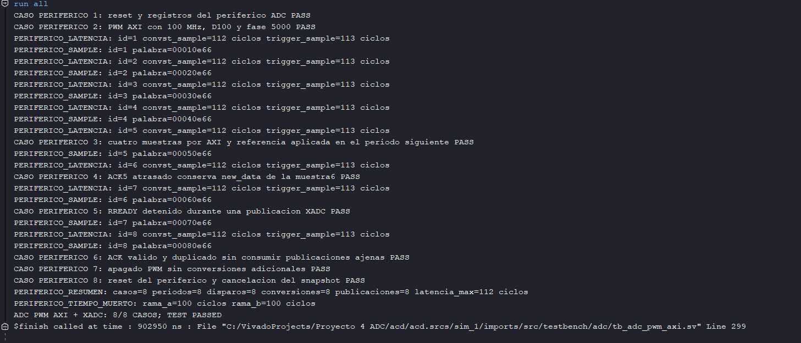

# Verificación del periférico ADC/XADC

## Descripción del subsistema

El subsistema ADC/XADC permite adquirir una señal analógica y leer el resultado mediante AXI4-Lite. Su módulo principal, `adc_system_axi`, reúne los registros de control, el controlador `adc_control` y el XADC Wizard configurado para el canal VAUX6. Trabaja con datos de 32 bits, un reloj de 100 MHz y reset activo bajo. La adquisición puede iniciarse por software o mediante un disparo del PWM en el mismo dominio de reloj.

La [arquitectura](../diseno/adc/arquitectura.md), el [mapa de registros](../diseno/adc/mapa_registros.md) y el [driver C](../../software/embedded/drivers/adc/adc_regs.h) describen las conexiones y el procedimiento de lectura. Los aspectos que faltan por comprobar con el resto del sistema se detallan en los [pendientes de integración](../diseno/adc/integracion_pendiente.md).

Los registros son CONTROL (0x00), STATUS (0x04), SAMPLE (0x08), ERROR (0x0C) y ACK_ID (0x10). SAMPLE contiene el identificador de 16 bits y el código de conversión de 12 bits. Al leerlo, la interfaz guarda también el token de 32 bits de esa misma muestra, que luego se obtiene leyendo ACK_ID. Para reconocer la muestra se escribe ese token en ACK_ID. Si entretanto llega una nueva conversión, el reconocimiento anterior no borra su indicación `new_data`. El software debe coordinar los lectores y el reset como se explica en el mapa de registros.

## Prueba del periférico con PWM y XADC

La prueba [tb_adc_pwm_axi.sv](../../src/testbench/adc/tb_adc_pwm_axi.sv) se ejecutó en Vivado/XSim 2026.1. Conecta los módulos `pwm_system_axi` y `adc_system_axi` a través del disparo `pwm_trigger_o` → `pwm_trigger_i`. La conversión se simula con el modelo XADC de Vivado y el archivo de estímulos `design.txt`.

El testbench configura el PWM y lee las muestras del ADC mediante transacciones AXI. Su maestro cambia de periférico cuando las transacciones anteriores han terminado y comprueba los cinco canales de cada interfaz. Esta prueba cubre ambos periféricos; la conexión con MicroBlaze V, SmartConnect y AXI Timer debe comprobarse en el Block Design integrado.

| Caso | Comportamiento comprobado | Resultado |
|---|---|---|
| 1 | El reset deja los registros en su estado inicial y una dirección no implementada devuelve SLVERR. | PASS |
| 2 | El PWM acepta la configuración por AXI con dirección y datos enviados por separado, tiempo muerto de 100 ciclos y fase de disparo de 5000 ciclos. | PASS |
| 3 | Se leen y reconocen cuatro muestras por AXI. La referencia del PWM se aplica al inicio del período siguiente. | PASS |
| 4 | Tras leer la muestra 5 y publicarse la 6, el ACK de la 5 conserva `new_data` de la 6. La sobrescritura queda indicada como overrun. | PASS |
| 5 | La respuesta AXI de la muestra 6 mantiene su dato y su token aunque se publique la 7 mientras `RREADY` está en bajo. | PASS |
| 6 | Se comprueban los ACK válidos, atrasados y duplicados. El reconocimiento antiguo mediante CONTROL.bit1 devuelve SLVERR. | PASS |
| 7 | Al apagar el PWM por AXI se detienen sus salidas y los nuevos disparos del ADC. | PASS |
| 8 | El reset común invalida la muestra, el token guardado para la lectura y los errores persistentes. | PASS |

Durante la simulación se comprueba que los pulsos de disparo PWM, CONVST y DEN duren un ciclo, que la lectura DRP use la dirección 0x16 de VAUX6 y que cada disparo produzca una conversión y una muestra. También se verifica el tiempo muerto y que las salidas complementarias nunca estén activas a la vez. Las sobrescrituras de los casos 4 y 5 se provocan para comprobar la protección de muestras; por eso deben activar overrun. Las cuatro adquisiciones nominales se completan sin errores.

## Resultados medidos en simulación

*Figura 1. Resultado de la prueba del periférico ADC con PWM y XADC en Vivado. Los ocho casos finalizaron correctamente.*

| Indicador | Resultado |
|---|---|
| Casos completos | 8/8, TEST PASSED |
| Período PWM | 10000 ciclos, 100 µs, 10 kHz |
| Fase del disparo | 5000 ciclos, 50 µs |
| Disparo a CONVST | 1 ciclo, 10 ns |
| CONVST a SAMPLE | 112 ciclos, 1,12 µs, en las ocho conversiones |
| Disparo a SAMPLE | 113 ciclos, 1,13 µs |
| Tiempo muerto mínimo en cada rama | 100 ciclos, 1 µs |
| Disparos / conversiones / publicaciones | 8 / 8 / 8 |
| Código analógico simulado | 0xE66, aproximadamente 0,9 V |
| Duración del banco | 902950 ns |

Las primeras palabras leídas fueron `0x00010E66`, `0x00020E66`, `0x00030E66` y `0x00040E66`. La lectura nominal del maestro ocurre en fase 100 del período siguiente y obtiene la última publicación completa. Esta fase es un estímulo elegido por el banco; la relación entre el Timer y el PWM reales sigue pendiente de medición.

La compilación, elaboración y simulación terminaron sin errores ni advertencias. El [registro de resultados](resultados/adc/periferico_pwm_axi.json) identifica las fuentes utilizadas y los resultados de la ejecución. El archivo `adc_peripheral_trace.csv` permite seguir los eventos: distingue la muestra que se leyó o reconoció de la que estaba publicada en ese momento.

Para comprobar que la prueba detecta la condición de carrera, se ejecutó también con una copia de `adc_control` que omitía la comparación de tokens. Al reconocer la muestra 5 cuando ya estaba publicada la 6, el testbench se detuvo a los 601930 ns con el mensaje `ADC_PERIPHERAL_FAILED: new_data despues del reconocimiento`. La compilación y elaboración habían terminado correctamente. Este fallo esperado confirma que el test detecta la pérdida de la notificación de una muestra nueva. La modificación se hizo únicamente en la copia usada para ese ensayo.

## Alcance y evidencias anteriores

Las seis [pruebas ADC originales](../diseno/adc/verificacion.md) cubren control, AXI, XADC, ACK, desbordamientos y coherencia de lectura. La prueba conjunta añade el PWM completo y las interfaces AXI de ambos periféricos al modelo XADC. El [testbench PWM–ADC previo](../../src/testbench/pwm/tb_pwm_adc.sv) utiliza `adc_control` con respuestas digitales EOC/DRDY, por lo que comprueba otro nivel de conexión.

La síntesis aislada del ADC utilizó 130 LUT, 243 registros y un XADC, sin errores y con 16 advertencias de puertos sin carga. Las [restricciones y advertencias de síntesis](../diseno/adc/advertencias_sintesis.md) explican el alcance de ese resultado. La incorporación del testbench conjunto no cambió los módulos sintetizables ni el XCI. La repetición aprobó los siete bancos. La implementación del top integrado con sus resultados de ruteo se documenta en el informe general. [Extractos de simulación](resultados/integracion_basys3/xsim_perifericos.txt) · [Implementación integrada](README.md#verificación-digital-e-implementación).

## Cómo repetir la prueba en Vivado

1. Abrir el proyecto ADC en Vivado 2026.1 y comprobar que contiene los cuatro módulos del ADC y la IP `xadc_wiz_0`.
2. En **Add Sources → Add or create simulation sources**, agregar `tb_adc_pwm_axi.sv` y los cuatro módulos PWM: `pwm_system_axi.sv`, `pwm_axi_lite.sv`, `pwm_core.sv` y `pwm_deadtime.sv`. Deben quedar como fuentes de simulación para conservar el diseño de síntesis del ADC.
3. Comprobar que `adc_axi_tb_tasks.svh` esté agregado como **Verilog Header** y disponible para el testbench. Agregar también el [archivo de estímulos `design.txt`](../../src/testbench/adc/stimuli/design.txt) como archivo de datos de simulación, de modo que quede en el directorio de trabajo del simulador. Generar los productos de simulación de la IP si Vivado lo solicita.
4. En **Simulation Sources**, hacer clic derecho sobre `tb_adc_pwm_axi` y seleccionar **Set as Top**.
5. Seleccionar **Run Simulation → Run Behavioral Simulation**. Cuando abra el simulador, usar **Run → Run All** para completar la prueba.
6. Revisar la consola: deben aparecer los ocho casos aprobados y el mensaje `ADC PWM AXI + XADC: 8/8 CASOS; TEST PASSED`. La simulación termina a los 902950 ns.

Para revisar las ondas, el disparo PWM, la secuencia XADC y las transacciones AXI se pueden observar desde **Scope** y **Objects**. **Zoom Fit** muestra la ejecución completa; después se puede ampliar cada adquisición o el reconocimiento atrasado.

Las fuentes están en las carpetas [ADC](../../src/design/adc/), [PWM](../../src/design/pwm/) y [testbenches ADC](../../src/testbench/adc/). También se conserva el [script de verificación](../../scripts/verificacion/adc/ejecutar_pruebas_adc.ps1) para ejecutar las pruebas desde el repositorio. La compatibilidad con Vivado/Vitis 2025.1 sigue pendiente de comprobación.

## Conexión en el sistema integrado

La construcción `inversor_basys3` asigna `vauxp6` al pin J3 y `vauxn6` al pin K3. Corresponden a JXADC1 y JXADC7 y reciben la señal acondicionada y su retorno. El rango de medición es de 0 a 1 V. El Block Design usa un segmento AXI de 4 KiB en `0x44A00000`, reloj de 100 MHz, reset activo bajo y un disparo directo del PWM. La solicitud de interrupción para el software procede del Timer a través del AXI INTC. [Restricciones del top](../../src/constraints/inversor_integrado_basys3.xdc) · [Mapa y conexiones](../diseno/integracion_basys3.md).

En laboratorio se contrastó el código en reposo con la tensión diferencial en ese par después de corregir el retorno. Queda por medir la ganancia con signo de la cadena ACS712–XADC y repetir la prueba de corriente con el puente activo. [Resultados de laboratorio](README.md#laboratorio-y-análisis-de-discrepancias).
